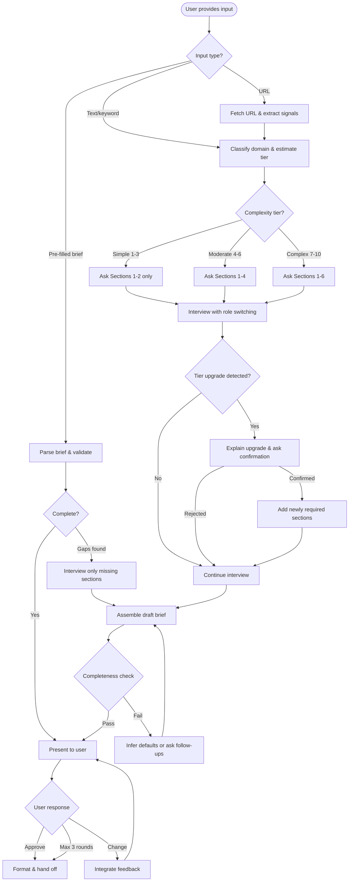
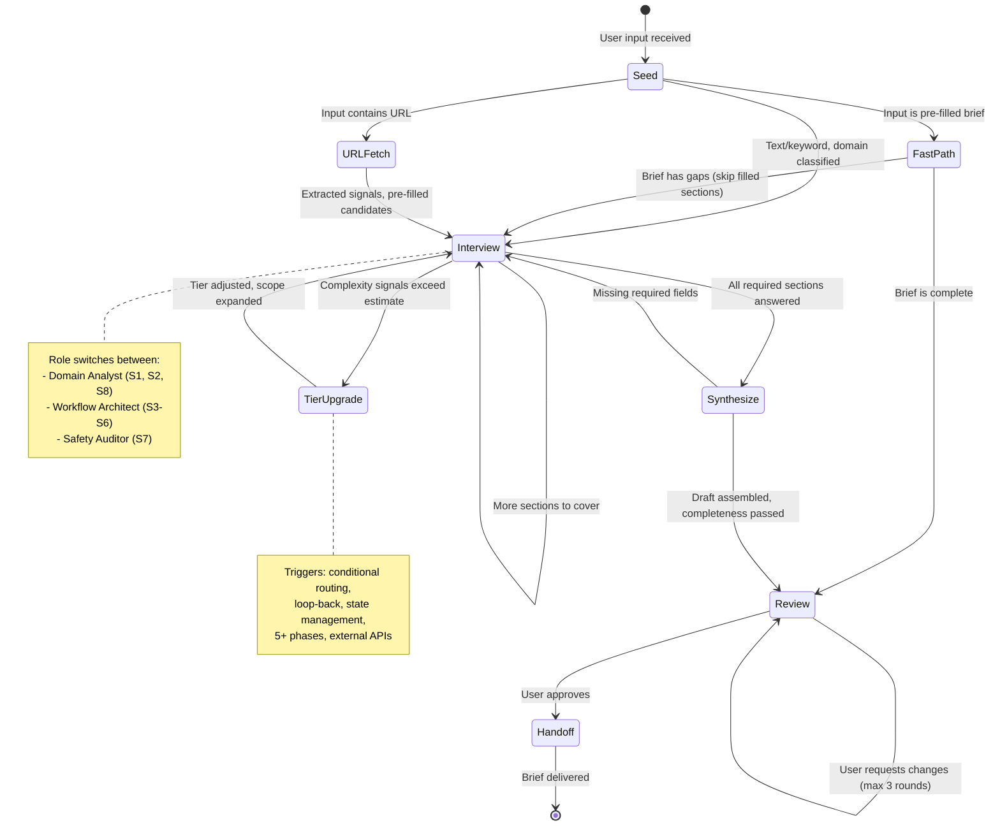
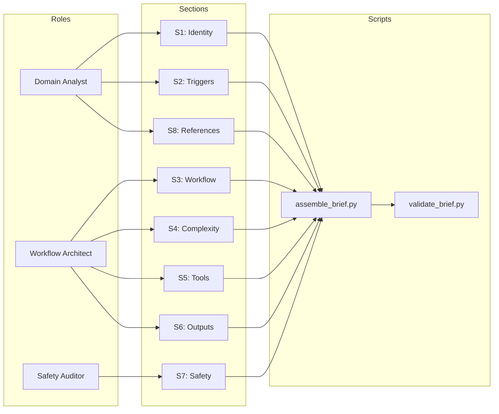
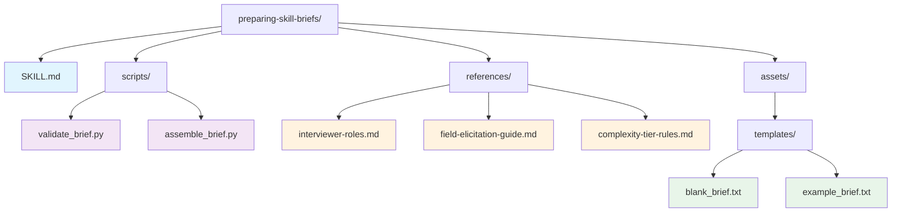

# Preparing Skill Briefs — Diagrams

## Logic: Interview Phase Decision Gates

## Flows: Full Pipeline Phase Transitions

## Relationships: Role-to-Section Mapping

## Structure: Skill Directory Tree

