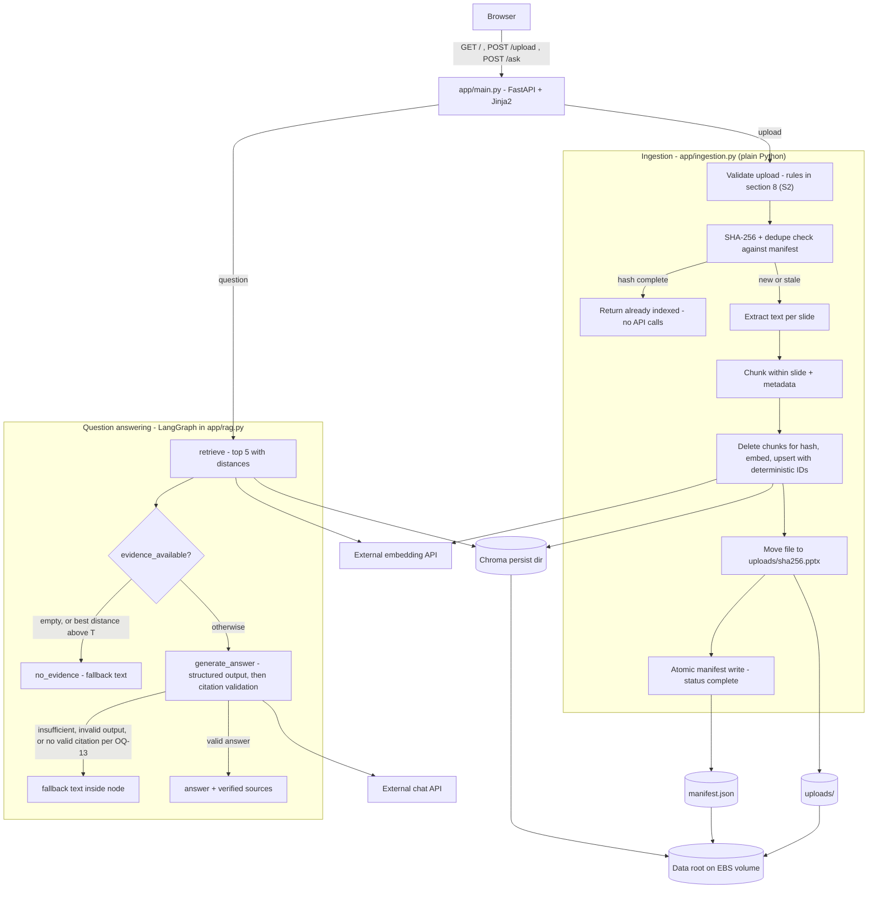
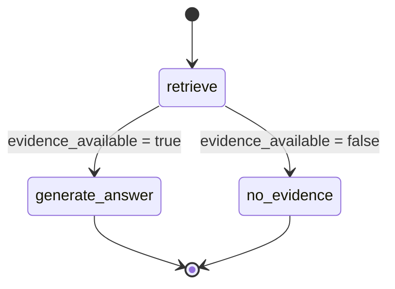
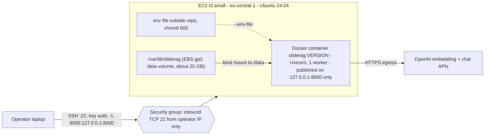

# SlideRAG Mini — Revised Plan (proposal)

> **Current status, 2026-11-03:** the owner selected Option C in the subsequent architectural review. [execution-plan.md](execution-plan.md) now governs. This r2 body remains a historical full-lifecycle proposal, not a blanket-approved specification. Its stale-state migration, broad reconciliation, calibration on acceptance questions, provisioning commands, test tiers, schedule, and pending approval statements must not override EXEC-01. Original metadata below describes that historical body.

## 0. Metadata

| Field | Value |
|---|---|
| Document ID | PREP-08 |
| Title | SlideRAG Mini — Revised Plan (requirements, architecture, data, interfaces, roadmap) |
| Revision | r2 |
| Status | ready-for-human-review |
| Owner | S1 (§§ 0–7, 10.1, 11–14) · S2 (§§ 8, 9, 10.2) · orchestrator (integration, § 15); approver: repository owner |
| Last updated | 2026-11-02 |
| Evidence baseline | source-register.md r2; SR-01 `docs/.prepare/brainstorm-plan.md` sha256 `8a5e41cc903a` (unchanged) |
| Core-context revision used | S1 and S2 drafted on core-context r1 (docs-baseline-r1); integration checked against core-context r2 (docs-baseline-r2): impact review in § 15.4 |
| Dependencies | core-context.md r2, plan-review.md r2 (F-01…F-20, R-01…R-15), open-questions.md r2, decision-log.md r2, source-register.md r2, `.claude/rules/*.md`; raw delegated drafts `delegation/S1-brainstorm-plan-revised.raw.md` (sha256 `00f395311b2d`), `delegation/S2-security-verification.md` (`48fab0b65f67`); independent review `delegation/S3-critic-review.md` (`de3bcc67137a`) |
| Supersedes | Proposes changes to brainstorm-plan.md v1.0. It does not replace it until the owner decides OQ-05. |
| Approval record | none |
| Change summary | r1 (S1): requirements register, architecture, gate and citation contracts, data model, interfaces, roadmap, traceability, change log. r2 (orchestrator): merged S2 security (§ 8), verification (§ 9), and runbook (§ 10.2); applied the S1↔S2 reconciliations C-01…C-17 and S3's tag and citation corrections; added NFR-14…16 and tests T-S01…T-S05; added the merged-budget re-sum (§ 15.3) and the integration log (§ 15). Status moved to ready-for-human-review after independent review by S3 and the orchestrator. |

**Tag legend** (core-context.md header): **[FACT]** verified, with evidence · **[REQ]** user-stated requirement (here: stated in SR-01 or a `.claude/rules/` file) · **[PROP]** proposed by S1, not approved · **[ASSUME]** working assumption · **[OPEN]** open question · **[CONFLICT]** unresolved conflict. Line references `L<n>` point to `docs/.prepare/brainstorm-plan.md` (SR-01). Rule references name the rule file and line. Findings and recommendations (F-/R-IDs) are in [plan-review.md](plan-review.md).

## 1. Status and relationship to v1.0

- [FACT] `brainstorm-plan.md` v1.0 is the source of truth named by `product-vision.md:3` (SR-03). This document is a **proposal** that refines it. It changes nothing in force until the owner approves it and decides OQ-05 (core-context § 9).
- [PROP] (per plan-review § 1) v1.0 is sound and well scoped. Its weak points are three load-bearing contracts that it names but does not specify: the evidence gate (F-01), the citation contract (F-02), and ingest consistency (F-03). It also has a schedule risk (F-06) (plan-review § 1).
- [PROP] This revision keeps v1.0's scope lock, stack, flat module layout, deployment shape, dataset, quality gates, and cut order. It adds specification, not features. Each change is listed in § 13 with its F-/R-ID.
- [PROP] Sections 8 (security) and 9 (verification) and the § 10 runbook belong to S2 and are merged by the orchestrator. Where this document depends on them, it says "§ 8 (S2)" or "§ 9 (S2)".
- [PROP] Where a library behaviour is load-bearing and unverified, it is tagged [ASSUME] and routed to R-12 (verification at M1, `library-claim-verify` skill). No library behaviour in this document was verified in this session.

## 2. Intent and definition of done

- [REQ] Intent, users, and outcomes are as stated in [core-context.md](core-context.md) §§ 1–3. They are not redefined here.
- [REQ] **Definition of done:** a reviewer uploads the synthetic 5G deck, asks a technical question, inspects slide-level source references, restarts or recreates the container, and keeps querying the same index (L26; `product-vision.md:7`).
- [REQ] The demo must include the unsupported-question refusal, which v1.0 calls "essential" (L394–396, L428).
- [REQ] Present the app as a deliberately constrained proof of capability, not a production telecom platform (L478–482).

## 3. Scope lock

- [REQ] Unchanged from v1.0 L28–49 and `product-vision.md:22–45`. MUST HAVE: PPTX upload and validation; slide-level text extraction; chunking and embeddings; persistent vector search; question-answer workflow; evidence-grounded answers; insufficient-evidence fallback; simple document list; FastAPI web interface; Docker and AWS deployment; basic tests and README. LATER: deletion/reindex UI, auth/multi-tenancy, conversation history/advanced evaluation. EXCLUDED: OCR/visual interpretation, multi-agent/tool use, Kubernetes/Redis/Celery/PostgreSQL, React/Next/build tooling.
- [REQ] **Scope freeze:** nothing enters the first release unless it fixes a correctness, security, or demonstration-blocking problem (L49).
- [PROP] This revision adds **no feature**. Three items might look like additions. Each is justified under the freeze:
  - The **upload lock** (NFR-02) is a correctness fix. It enforces v1.0's own "one upload operation at a time" (L189).
  - The **`stale` document status** (§ 6.3) is a correctness fix. It is the mechanism for v1.0's "never mix vector spaces" policy (L139). Reindexing happens by re-upload; no reindex UI is added (the UI stays LATER, L41).
  - The **tree additions** (`tests/conftest.py`, `tests/test_main.py`, `CLAUDE.md`, `CHANGELOG.md`) are test and documentation files that existing rules already require (SR-05 L64, L70–71; SR-08 L14; R-13). They are not product features.

## 4. Requirements register

Each requirement has one acceptance criterion that a test or a manual check can decide. Milestones refer to § 11. Test names and fixtures are S2's (§ 9). This table only says what each test must show.

### 4.1 Functional requirements

| ID | Statement | Acceptance criterion | Source | Tag | Milestone |
|---|---|---|---|---|---|
| FR-01 | The UI accepts one `.pptx` file per request through `POST /upload` (multipart field `file`). | Uploading the demo deck with `TestClient` returns 200, and the deck then appears in the document list. | L30, L80; § 7.1 | [REQ] / [PROP] field name | M2 |
| FR-02 | Before any extraction, the upload passes every check in `security-patterns.md:37–43`, using the numeric limits UV-L1…UV-L8 (§ 8.B.1; owner approval OQ-24). A rejected upload leaves no state behind. | QG-08 adversarial cases are rejected with a 4xx and a clear message. After each rejection, `uploads/`, the collection's chunk count, and `manifest.json` are unchanged. | L80, L412; SR-04 L35–43; R-05 | [REQ] | M2 |
| FR-03 | Extract text per slide from text frames and table cells, in presentation order. `slide_number` is 1-based. The display filename is kept in sanitized form. | QG-01: the generated demo deck yields 10 slides. Slide 4 text contains `46 ms`. Slide 5 text contains `92%`. Each slide's text contains the synthetic marker (FR-22). | L31, L82; § 6.2 | [REQ]; grouped shapes and notes [PROP] | M2 |
| FR-04 | Split each slide's text on its own, never across slides. Target about 1,000 characters with 150 overlap. `chunk_index` is 0-based within the slide. | Every chunk's `slide_number` equals its source slide. Every chunk's text is a substring of that slide's extracted text. The `chunk_index` values of a slide are `0..n-1`. | L84; S-09 | [REQ]; substring property [ASSUME] (splitter behaviour, R-12) | M2 |
| FR-05 | Every chunk carries `source_file` (str), `slide_number` (int ≥ 1), `file_sha256` (64 lowercase hex), and `chunk_index` (int ≥ 0). | QG-02: all four fields are present, typed, and valid on every chunk stored for the demo deck. | L91–96; SR-04 L55; `product-vision.md:17` | [REQ] | M2 |
| FR-06 | Embed chunks through the external API and upsert them with deterministic IDs `"{file_sha256}:{slide_number}:{chunk_index}"`. | QG-03: uploading identical bytes twice leaves the chunk count unchanged, and the second upload makes **zero** embedding calls (mock call count). | L85; F-03; R-03 | [REQ] idempotence / [PROP] ID format | M2 |
| FR-07 | Ingest follows the order and failure cleanup in § 6.5. At startup, the app removes chunks and files that no `complete` manifest entry accounts for. | A test that injects a failure after upsert ends with zero chunks for that hash, no manifest entry, and no stored file. A test that seeds an orphan chunk finds it removed after startup reconciliation. | L87; SR-04 L50; F-03; R-03 | [REQ] cleanup / [PROP] mechanism | M2 |
| FR-08 | The collection name is derived from `EMBEDDING_MODEL` (§ 6.4). If the manifest's model differs at startup, the app opens a new collection and marks the earlier documents `stale`. | Two different model names give two different collection names. A manifest recorded with model A, started with model B, ends with every document `stale` and the active collection named for B. | L139; SR-04 L67; F-04; R-04 | [REQ] policy / [PROP] mechanism | M2 |
| FR-09 | The Chroma persist directory, stored uploads, and manifest all live under the data root (§ 6.1). They survive process and container restarts. | QG-04: reopening Chroma on the same temp directory gives the same chunk count and the same IDs for the same query. QG-09 (manual): see FR-21. | L33, L182–189, L267–274; `product-vision.md:19` | [REQ] | M2 (code), M3 (QG-04 test, SR-05 L38) |
| FR-10 | `GET /` lists documents from the manifest: display name, slide count, chunk count, indexed time, and status. | After an upload, the list shows the document with the counts from the ingest result. After an app restart on the same data root, the list is unchanged. | L37, L189 | [REQ] | M2 |
| FR-11 | QA runs as a compiled LangGraph `StateGraph` with nodes `retrieve`, `generate_answer`, `no_evidence` and one conditional edge `evidence_available?` (§ 5.3). It is compiled once, at startup. | Unit tests drive the compiled graph, with a mocked retriever and chat client, through every row of the § 5.5 decision table. | L34, L190–233; `product-vision.md:16`; C-04 | [REQ] topology / [PROP] state fields | M3 |
| FR-12 | `retrieve` returns the top 5 chunks from the active collection, each with its distance. | Unit: at most 5 results, each with metadata and a numeric distance. QG-05 (integration): for each supported eval question, the expected slides appear in the top 5 (§ 9, S2). | L238; R-11 | [REQ] | M3 |
| FR-13 | The evidence gate follows the two-layer rule in § 5.5. | QG-07 unit tests: empty retrieval, best distance above T, and the model's `insufficient` flag each lead to the fallback. QG-07 integration: the live unsupported question leads to the fallback. | L36, L238–242; F-01; R-01; OQ-12 | [REQ] gate / [PROP] rule | M3 |
| FR-14 | Every fallback returns the exact constant text in § 5.5 and no sources. | On every fallback route, `answer == FALLBACK_TEXT` and `sources == []`. | L244–245 | [REQ] | M3 |
| FR-15 | Generation uses a fixed system message (the grounding policy) and a separate user message with labelled evidence (§ 5.6). It asks for structured output and runs at temperature 0. | A unit test inspects the messages sent to the mocked chat client: the system message contains no retrieved text, and each piece of evidence appears under its label in the user message. | L242; SR-04 L54; R-02; R-11 | [REQ] separation / [PROP] format | M3 |
| FR-16 | Citations are validated and displayed according to the contract in § 5.6. | QG-06: for any model output, including fabricated, malformed, and duplicate labels, every displayed source maps to a retrieved chunk's metadata. Invalid labels are never displayed. | L35, L98; SR-04 L55; SR-05 L40, L59; R-02; OQ-13 | [REQ] property / [PROP] contract | M3 |
| FR-17 | HTTP routes behave as in § 7.1. | Each route has one 2xx test and one error-path test through `TestClient` (SR-05 L64). | L38, L176; F-08; R-08 | [REQ] routes exist / [PROP] table | M1 (`/`, `/health`), M2 (`/upload`), M3 (`/ask`) |
| FR-18 | Pages render through Jinja2 with autoescape on. No document-derived or model-derived value uses `\| safe`. Error pages never echo upload bytes or request bodies. | A slide or answer containing `<script>` renders escaped (details in § 9, S2). | L414; SR-04 L60–61 | [REQ] | M2 / M3 |
| FR-19 | `GET /health` reports liveness and data-root writability. It makes no external calls (§ 7.1). | 200 with `status: ok` on a writable data root. 503 with `status: degraded` when the data root is not writable or the manifest is unreadable. | L176, L262; R-08 | [REQ] route / [PROP] semantics | M1 |
| FR-20 | One Docker image runs Uvicorn with one worker. No secret is baked into the image. | `docker build` succeeds. `docker run` followed by `GET /health` returns 200. `docker image inspect` and `docker history` show no `OPENAI_API_KEY` value. The container runs as non-root UID 10001 (§ 10.2 DEP-06; reconciled C-16). | L39, L116, L257, L317; SR-04 L18 | [REQ] | M4 |
| FR-21 | The app is deployed to one EC2 `t3.small` with `/data` bind-mounted from the EBS volume, and it stays usable after the container is recreated. | QG-09 manual script (§ 9 / § 10, S2): upload, query, recreate the container, query again, and get the same document list and an answer with slide references. | L26, L39, L249–293 | [REQ] | M4 |
| FR-22 | `demo/generate_pptx.py` deterministically builds the 10-slide synthetic deck in L375–385. Every slide visibly identifies itself as synthetic. | The generated deck passes FR-02 and FR-03. Every slide's extracted text contains the marker `SYNTHETIC DEMO DATA` [PROP string]. Two runs give the same extracted text. | L157, L371–387; C-06; F-06; R-06 | [REQ] deck / [PROP] marker | M2 |
| FR-23 | The automated suite covers QG-01…QG-08 and the eval set. QG-09 is a recorded manual check. | Every QG row in § 12 maps to a test or a manual check. The gates in `test-requirements.md:19–25` are green. | L40, L398–420; SR-05 L29–55 | [REQ] | M1–M4 |
| FR-24 | `README.md` covers setup, local run, test commands, deployment reproduction, and documented limits. `docs/architecture.md` covers the flow, graph, contracts, and the recorded calibration table (§ 5.5). | A reader can follow the README commands. The architecture doc contains the graph and the calibration table with measured values. | L40, L163, L357, L416 | [REQ] | M4 |

### 4.2 Non-functional requirements

| ID | Statement | Acceptance criterion | Source | Tag | Milestone |
|---|---|---|---|---|---|
| NFR-01 | Build time is at most 8 h, starting at M1, within the milestone budgets in § 11. | The § 11 budgets sum to 480 min. Actual time per milestone is recorded. | C-01; L319–369; D-01 | [REQ] | all |
| NFR-02 | One container, one Uvicorn worker, and one upload in progress at a time, enforced by a process-level lock. A second concurrent upload gets 409. | A test that holds the lock and calls `POST /upload` gets 409 and leaves no state. | L189, L416; `product-vision.md:54, 57` | [REQ] constraint / [PROP] 409 | M2 |
| NFR-03 | Peak memory during a demo-deck upload and query on the `t3.small` (2 GiB) is measured and recorded. No target is set. | The measured peak is recorded in the README or architecture doc. Upgrade to `t3.medium` only if the measurement justifies it. | L265 | [REQ] measure / [OPEN] target | M4 |
| NFR-04 | Upload and query wall-clock times on EC2 are measured and recorded. No target is set. | Values are recorded once in the README or architecture doc. | L446–448; F-07 | [PROP] | M4 |
| NFR-05 | Every embedding and chat call has an explicit timeout. Proposed: 30 s each (F-15). Final values come from § 8 (S2). A timeout or API error returns 502, not the fallback (§ 7.1). | A unit test with a client that raises a timeout shows a 502 page and no partial ingest state. | SR-04 L66; F-15 | [REQ] timeout / [PROP] value | M2 / M3 |
| NFR-06 | Logs carry the structured event names in § 8.E.2. They contain no secrets, prompts, model responses, or slide text. | Unit tests capture log records for one rejected upload, one dropped citation, and one fallback, and assert the event names and the absence of slide text. | SR-04 L13, L32, L80; F-15 | [REQ] / [PROP] names | M2 / M3 |
| NFR-07 | Settings are read once, in `app/config.py`. Feature modules never read `os.environ`. Every env key is listed in `.env.example`. | Grep finds no `os.environ` / `os.getenv` outside `app/config.py`. Every key in § 7.2 appears in `.env.example`. | SR-04 L30–31 | [REQ] | M1 |
| NFR-08 | The unit suite needs no network and runs in under 30 s. Integration tests skip when `OPENAI_API_KEY` is absent. | `uv run pytest -m "not integration"` passes offline in under 30 s. | SR-05 L3, L10, L72–73 | [REQ] | all |
| NFR-09 | `ruff check` and `ruff format --check` are clean. | Gate commands pass. | SR-05 L15–27 | [REQ] | all |
| NFR-10 | Only synthetic data is processed or sent to external APIs. | Demo deck per FR-22. The README states the restriction. | C-06; SR-04 L65; L317 | [REQ] | M2 / M4 |
| NFR-11 | Chat runs at temperature 0. Eval-set pass criteria are as defined in § 9 (S2). | Config constant `LLM_TEMPERATURE = 0`. Eval tests follow R-11. | F-09; R-11 | [PROP] | M3 |
| NFR-12 | The app is reachable only through an SSH tunnel. The port is published on loopback only. | Covered by the § 10 runbook and the § 9 checks (S2). | C-07; SR-04 L71–72 | [REQ] | M4 |
| NFR-13 | The Python version is pinned, and the Docker base image uses the same minor version. | `.python-version` and the Dockerfile `FROM` agree. `uv sync` succeeds. | P-01; OQ-07; SR-18 | [REQ] pin / [OPEN] which version | M1 |
| NFR-14 | Requests with a `Host` other than `127.0.0.1`, `localhost` (and `testserver` in tests) are rejected (§ 8.B UV-11). | Host-header test returns 400. | S2 UV-11; F-18 | [PROP] security fix under L49; keep/drop is OQ-27 | M1 |
| NFR-15 | The API key is masked in `repr`/logs, and custom base URLs must be `https` (§ 8.E SC-03, SC-04). | T-E01, T-E03 | SR-04 L16, L32 | [REQ] / [PROP] mechanism | M1 |
| NFR-16 | dockerd starts only after the data volume is mounted, and the container runs as a non-root user (§ 10.2 DEP-04, DEP-06). | DV-08 plus the G.1 unmount check; `docker exec sliderag id -u` = 10001 | SR-04 L73 | [PROP] | M4 |

## 5. Architecture

### 5.1 Components

| Component | Responsibility | Tag / source |
|---|---|---|
| `app/main.py` | FastAPI app, startup sequence (§ 6.6), routes (§ 7.1), template rendering, `/health`, mapping errors to status codes | [REQ] L176; `product-vision.md:15` |
| `app/ingestion.py` | Upload validation (rules in § 8, S2), SHA-256, per-slide extraction, chunking, ingest ordering and cleanup (§ 6.5), manifest read/write, upload lock | [REQ] L177 / [PROP] manifest + lock placed here |
| `app/rag.py` | Embedding client, Chroma open and collection naming (§ 6.4), delete by `file_sha256`, retrieval with distances, LangGraph state, nodes, and gate, prompt assembly, citation validation | [REQ] L178 |
| `app/config.py` | Settings from the environment, constants (§ 7.2), data-root resolution | [REQ] L179; SR-04 L30 |
| `app/templates/index.html` | One page: upload form, question form, answer and sources, document list, error message | [REQ] L153 |
| `app/static/style.css` | Plain CSS | [REQ] L155 |
| `demo/generate_pptx.py` | Deterministic synthetic deck (FR-22) | [REQ] L157 |
| Chroma (embedded, `persist_directory`) | Vector store under `<data_root>/chroma` | [REQ] L113, L134 |
| OpenAI embeddings + chat | External APIs; the only egress besides OS updates | [REQ] L110–111; C-05 |

- [REQ] No service framework, repository layer, abstract provider factory, or event bus (L180).
- [PROP] `rag.py` exposes one plain builder function, `build_graph(retrieve_fn, chat_client, max_distance)`. The compiled graph receives its dependencies as arguments, so tests inject mocks at the OpenAI-client boundary (SR-05 L72). This is a function, not a factory class.
- [PROP] `ingestion.py` reaches Chroma through `rag.py` functions (open collection, upsert, delete by hash). There is no shared abstraction layer.

### 5.2 Flow

The diagram matches §§ 5.3–5.6 and § 6.5. Unlike v1.0's diagram (L52–77), it places citation validation **inside** `generate_answer` (§ 5.6, resolving the L66 vs L220–222 inconsistency in F-02) and shows the manifest written by ingestion rather than by the embedding API. v1.0's edges were a reconstruction (D-07).



### 5.3 LangGraph topology

- [REQ] Topology: `START → retrieve → evidence_available? → generate_answer | no_evidence → END` (L206–233; `product-vision.md:16`). No extra agent, second model, reflection loop, or reranker (L247; `product-vision.md:52`).
- [PROP] The answer-or-refuse decision has two layers (§ 5.5). Layer 2 is decided **inside** `generate_answer`, which writes the fallback itself. The graph keeps exactly the single conditional edge from v1.0 and the rule, so no second conditional edge is needed. Rejected alternative: a second conditional edge `generate_answer → no_evidence`. It is equally testable but changes the rule-stated topology.



### 5.4 Graph state

[PROP] This extends v1.0's five fields (L197–204). Added fields are marked +.

| Field | Type | Set by | Meaning |
|---|---|---|---|
| `question` | `str` | caller | Validated user question (§ 7.1) |
| `retrieved_docs` | `list[Document]` | `retrieve` | Top-k chunks in rank order (k ≤ 5) |
| + `distances` | `list[float]` | `retrieve` | Distance per retrieved doc, same order; lower = closer [ASSUME, R-12] |
| + `best_distance` | `float \| None` | `retrieve` | `min(distances)`, or `None` when nothing was retrieved |
| `evidence_status` | `"sufficient" \| "insufficient"` | gate / `generate_answer` | Final outcome. The values are v1.0's (L202). |
| + `fallback_reason` | `None \| "empty_retrieval" \| "above_threshold" \| "model_insufficient" \| "invalid_model_output" \| "no_valid_citation"` | gate / `generate_answer` | Why the fallback was taken. It is logged (§ 7.4) and asserted in tests. |
| `answer` | `str` | `generate_answer` / `no_evidence` | Displayed text: the model answer with markers stripped, or `FALLBACK_TEXT` |
| `sources` | `list[dict]` | `generate_answer` | Verified sources (§ 5.6), or `[]` |
| + `dropped_citations` | `list[str]` | `generate_answer` | Labels the model emitted that failed validation. Logged; never displayed. |

### 5.5 Evidence gate (R-01, resolves OQ-12 as a proposal)

- [ASSUME, highly likely; verify at M1 via R-12] With 5 or more chunks indexed, a top-5 similarity search returns 5 results for **any** query. So "empty retrieval" (L240) never fires for the demo's unsupported question (F-01; OQ-12).
- [PROP] **Layer 0, empty retrieval.** If `retrieved_docs == []` (nothing indexed, or a fresh collection after a model change), route to `no_evidence` with `fallback_reason = "empty_retrieval"`.
- [PROP] **Layer 1, distance threshold.** If `best_distance > T`, route to `no_evidence` with `fallback_reason = "above_threshold"`. Comparison is strict: equal to T passes. If `T is None` (not yet calibrated), layer 1 is off and every non-empty retrieval passes.
- [PROP] **Layer 2, model judgement.** `generate_answer` asks for structured output `{answer, cited, insufficient}` (§ 5.6). If `insufficient` is true, the node sets `answer = FALLBACK_TEXT`, `sources = []`, `evidence_status = "insufficient"`, and `fallback_reason = "model_insufficient"`. Labels cited alongside `insufficient: true` are ignored. This implements L242.
- [PROP] **Fail closed on bad output.** If the model output cannot be parsed into the schema, the node takes the fallback with `fallback_reason = "invalid_model_output"`. [OPEN] OQ-23: S2 first routed this case to an error page; the integrated plan keeps S1's fail-closed route, and the owner confirms (§ 15 C-02). To keep QG-07 honest, the live test T-H07f must assert `fallback_reason ∈ {above_threshold, model_insufficient}`, so a malformed output can never count as a QG-07 pass.
- [PROP] **Outage is not refusal.** A timeout or API error from the embedding or chat call is not a fallback. It propagates and becomes a 502 page (§ 7.1). This keeps "I don't know" separate from "the service is down".
- [REQ] `FALLBACK_TEXT` is a constant. Its exact text is v1.0's (L245): "I couldn't find sufficient information in the uploaded presentations to answer that question. Please upload a relevant document or ask about the indexed material."
- [REQ] Chroma distances are not calibrated probabilities. T is valid only for one embedding model and one distance metric (L240; `product-vision.md:18`).
- [PROP] **Where T lives.** T is the constant `EVIDENCE_MAX_DISTANCE` in `app/config.py`. Its comment records the embedding model, the metric, the calibration date, and a pointer to the calibration table. Unit tests pass T explicitly to `build_graph`. The alternative, an env var, is [OPEN] (OQ-20).
- [PROP] **Calibration procedure (M3, about 20–30 min):**
  1. Index the generated demo deck into a clean data root using the configured embedding model.
  2. Run `retrieve` for the 5 eval questions (L388–394). Record `best_distance` and the top-5 slide numbers for each.
  3. If `max(best_distance of the 4 supported) < best_distance of the unsupported`, set T to the midpoint and record "separated".
  4. Otherwise, set `T = None` and record "overlap: layer 1 disabled, layer 2 is the safety net". The README and the demo narrative must then say so honestly (R-01 uncertainty).
  5. Record the table (question, best distance, top-5 slides, model, metric, date) in `docs/architecture.md`.
- [ASSUME] One unsupported question is a thin calibration basis. The midpoint is a heuristic, not a measured error rate. [OPEN] Whether to add 2–3 extra unsupported *probe* questions for calibration only. They would be calibration data, not tests, and not a scope addition (OQ-21).

**Decision table.** This is the QG-07 unit-test spec. It is load-bearing and must never be weakened (SR-05 L57–59).

| # | Retrieved | Best distance vs T | Model output | Route | `evidence_status` | `fallback_reason` | `answer` | `sources` |
|---|---|---|---|---|---|---|---|---|
| 1 | none | n/a | not called | no_evidence | insufficient | empty_retrieval | FALLBACK_TEXT | `[]` |
| 2 | ≥ 1 | `> T` | not called | no_evidence | insufficient | above_threshold | FALLBACK_TEXT | `[]` |
| 3 | ≥ 1 | `≤ T`, or T is None | `insufficient: true` (any `cited`) | generate_answer | insufficient | model_insufficient | FALLBACK_TEXT | `[]` |
| 4 | ≥ 1 | `≤ T`, or T is None | unparseable / schema-invalid | generate_answer | insufficient | invalid_model_output | FALLBACK_TEXT | `[]` |
| 5 | ≥ 1 | `≤ T`, or T is None | `insufficient: false`, ≥ 1 valid label | generate_answer | sufficient | `None` | model answer, markers stripped | validated sources (§ 5.6) |
| 6 | ≥ 1 | `≤ T`, or T is None | `insufficient: false`, 0 valid labels | generate_answer | **per OQ-13** (§ 5.6) | per OQ-13 | per OQ-13 | per OQ-13 |
| 7 | — | — | embedding/chat timeout or API error | none (exception) | — | — | 502 page | — |

In every fallback row, the chat model is either not called (rows 1–2) or its answer text is discarded (rows 3–4).

### 5.6 Citation contract (R-02; OQ-13 left to the owner)

- [REQ] Source labels are built from retrieved metadata, never from model text. Any model-emitted identifier is validated against the retrieved set before display (L98; SR-04 L55; `product-vision.md:17`).
- [PROP] **Evidence labels.** Retrieved chunks get labels `S1…Sk` in rank order (k ≤ 5). Code builds `label_map: {"S1": metadata_1, …}`. Labels exist only for the current request.
- [PROP] **Messages.** There are two messages:
  - The system message is a constant: the grounding policy, plus the instructions to cite only the given labels and to set `insufficient` when the evidence does not answer the question. It never contains document text (SR-04 L54).
  - The user message contains the question and the evidence blocks, each introduced by `[S<n>]` followed by the chunk text. Delimiting and the injection posture are in § 8 (S2).
- [PROP] **Output schema.** `{"answer": str, "cited": list[str], "insufficient": bool}`. It is produced by the chat wrapper's structured-output or JSON mode. [ASSUME] The chosen model and wrapper support this (R-12). If they do not, use JSON-mode text plus strict parsing. A parse failure is decision-table row 4.
- [PROP] **Validation.** This is a pure function, `validate_citations(cited, label_map) → (sources, dropped)`, called as the **last step of `generate_answer`**.
  1. Normalise each label: strip whitespace and one pair of surrounding brackets, uppercase it, and match `^S(\d+)$`. The canonical form is `S{int(n)}`.
  2. Keep a label if and only if its canonical form is a key of `label_map`. Put every other label in `dropped`.
  3. Map kept labels to metadata. Deduplicate by `(file_sha256, slide_number)`, keeping first-citation order.
  4. Each source dict is `{label, source_file, slide_number, file_sha256, chunk_index, display}`, where `display = "<source_file> — slide <slide_number>"`. Every field is copied from metadata.
- [PROP] **Answer text.** Remove every inline `[S<n>]` marker from the displayed answer text, valid or not. Sources are shown only in the separate list. That way an invalid inline marker can never look like a citation. The alternative, rewriting valid markers into display labels, is [OPEN] (OQ-18).
- [PROP] **Logging.** If `dropped` is non-empty, log `citation_dropped` with the count and the label strings. Labels are not document text (§ 7.4).
- [REQ] **QG-06 property.** For any model output, every element of the displayed `sources` equals the metadata of some element of `retrieved_docs`. This is load-bearing (SR-05 L59).
- [OPEN] **OQ-13: no valid citation (row 6) and what is displayed.** These are alternatives, not a decision. The owner chooses.

| Option | Row 6 behaviour (`insufficient: false`, 0 valid labels) | Rows 5 display | Pro | Con |
|---|---|---|---|---|
| **C1: cited-only, fail closed** | Fallback: `evidence_status = insufficient`, `fallback_reason = no_valid_citation`, FALLBACK_TEXT, `sources = []` | Only validated cited labels | Strongest grounding signal. Every displayed answer has at least one verified source. QG-06 and QG-07 stay strict. | May refuse a correct answer when the model forgets to cite. That is visible in the demo. |
| **C2: cited-only, uncited fallback list** | Show the model answer. List all retrieved slides under a separate heading "Retrieved (not cited by the model)". | Only validated cited labels | Never discards an answer | Can present irrelevant slides next to an answer. Weakens the "verified source" story. |
| **C4: answer without sources** (added from S2 T-H06e, C-10) | Show the model answer with no source list and an explicit "no verified source" note | Only validated cited labels | Never discards an answer; honest about missing provenance | Displays an unsourced answer, which is weaker than C2 against L35 "source-verified citations" |
| **C3: retrieved-only** | Not applicable. The model does not cite, and all retrieved slides are shown as "Retrieved evidence". | All retrieved chunks, deduplicated by slide | Simplest. QG-06 holds trivially. | No per-claim provenance. The `cited` field becomes unused. Weakest demo of grounding. |

[PROP] S1 leans towards **C1**, because it keeps the load-bearing tests strict and makes the refusal path the single "no evidence" story. This is a recommendation, not a decision.

## 6. Data model and lifecycle

### 6.1 Data root layout

- [REQ] Runtime data lives outside the source tree, in `/data/{uploads/, chroma/, manifest.json}` (L182–189; `product-vision.md:19`).
- [PROP] All paths derive from one resolved **data root**. How the root is configured is OQ-14 (§ 7.3).

```
<data_root>/                      # default /data in the container
├── uploads/
│   ├── <sha256>.pptx             # stored original, hash-derived name (SR-04 L47)
│   └── .incoming-<uuid4hex>.part # in-flight upload, removed on success, failure, or startup (PC-02)
├── chroma/                       # Chroma persist_directory
└── manifest.json                 # manifest v1 (§ 6.3)
```

- [REQ] Every resolved path must stay under the data root. The containment check and the rule wording are § 8 (S2) and OQ-14.

### 6.2 Extraction and chunk model

- [REQ] Extract with python-pptx: text boxes and supported table cells (L82).
- [PROP] Extraction details:
  - Shapes are read in the order python-pptx yields them. Each text frame contributes its paragraphs joined by `\n`.
  - Each table contributes its cells row by row. Cells in a row are joined by ` | `, rows by `\n`.
  - Group shapes are recursed.
  - Speaker notes, images, charts, and SmartArt are **excluded**: citations should point to visible slide text, and OCR and visual interpretation are EXCLUDED (L44).
  - [ASSUME] python-pptx exposes text frames, tables, and group-shape children through its public shape API (R-12). [OPEN] If group recursion is not straightforward, drop it (OQ-22).
- [PROP] Slides with no extracted text produce zero chunks but still count in `slide_count`. A deck with **zero chunks overall** is rejected with "no extractable text" and leaves no state.
- [REQ] Chunks are split within each slide, about 1,000 characters with 150 overlap (L84). [ASSUME] Implemented with LangChain's recursive character splitter (L109). Its class name and parameters are to be verified (R-12).
- [PROP] Chunk record:

| Field | Type | Rule |
|---|---|---|
| `id` | str | `"{file_sha256}:{slide_number}:{chunk_index}"`, deterministic (F-03) |
| `page_content` | str | Chunk text |
| `source_file` | str | Sanitized display name from the manifest entry (first upload wins, § 6.3) |
| `slide_number` | int | 1-based slide position |
| `file_sha256` | str | 64 lowercase hex of the uploaded bytes |
| `chunk_index` | int | 0-based within the slide |

### 6.3 Manifest v1

- [REQ] The manifest records filenames, hashes, successful ingest status, slide counts, and chunk counts (L189). It is written atomically, and only after successful indexing (L87; SR-04 L50).
- [PROP] Schema (values in angle brackets are placeholders, not measurements):

```json
{
  "schema_version": 1,
  "embedding_model": "<EMBEDDING_MODEL>",
  "collection": "<derived per section 6.4>",
  "documents": {
    "<file_sha256>": {
      "display_name": "<sanitized client filename>",
      "stored_name": "<file_sha256>.pptx",
      "status": "complete",
      "slide_count": "<int>",
      "chunk_count": "<int>",
      "indexed_at": "<UTC ISO-8601>"
    }
  }
}
```

- [PROP] `status` takes one of two values:
  - `complete`: indexed in the active collection.
  - `stale`: indexed under an earlier embedding model (§ 6.4). Stale documents are listed with "re-upload to reindex" and are not queryable.
  - There is no `indexing` status, because the manifest is written only after success (SR-04 L50).
- [PROP] **Display name for identical bytes.** The first upload wins. A later upload of the same bytes under another name returns "already indexed as `<display_name>`" (R-04).
- [PROP] **Missing manifest** means an empty manifest. The file is not created until the first success.
- [PROP] **Unreadable manifest** (invalid JSON or an unknown `schema_version`): the app starts, `/health` returns 503 `degraded`, uploads are refused with 503, and the file is **never overwritten automatically**.
- [PROP] **Atomic write:** write `manifest.json.tmp-<uuid4hex>` in the same directory (PC-02, PC-05), flush and `fsync`, then `os.replace` (SR-04 L50).

### 6.4 Collection naming and vector-space identity

- [REQ] A change of embedding model triggers reindexing or a new collection, never mixed vector spaces (L139; SR-04 L67).
- [PROP] Collection name: `sliderag-v1-<slug(EMBEDDING_MODEL)>`, where `slug` lowercases the name and replaces every character outside `[a-z0-9._-]` with `-`. The `v1` segment is bumped if the distance metric or the chunking parameters change.
  - [ASSUME] Chroma restricts collection names to a short length and a limited character set (R-12). The slug must stay within that limit, so verify it at M1.
- [PROP] Distance metric: fixed in code, chosen at M1 after verification, and recorded in the manifest comment and the calibration table. [OPEN] Library default versus explicit cosine (OQ-15).
- [PROP] **Startup mismatch** (`manifest.embedding_model != EMBEDDING_MODEL`):
  1. Log `embedding_model_changed`.
  2. Set `embedding_model` and `collection` to the new values.
  3. Mark every document `stale`.
  4. Write the manifest atomically.
  5. Open the new collection.
  - The old collection stays on disk untouched, because deletion is LATER (L41). Reindexing happens by re-uploading. A `stale` hash is treated as not indexed by the dedupe check.
  - Automatic reindexing from `uploads/` at startup was rejected: it adds API calls and latency to startup and borders on the LATER reindex feature. It remains [OPEN] (OQ-21).

### 6.5 Ingest ordering, failure cleanup, reconciliation (R-03)

[PROP] `POST /upload` runs these steps synchronously, holding the upload lock (NFR-02). This relies on [ASSUME] A-02, that the demo deck is small.

| Step | Action | On failure |
|---|---|---|
| 1 | Receive the body into `uploads/.incoming-<uuid4hex>.part` with the size cap enforced by the `Content-Length` pre-check (UV-01) and re-counted while copying, hashing SHA-256 as bytes arrive (UV-02; see § 15 T-03 on Starlette spooling). The mechanism and limits are § 8 (S2). | Delete the temp file. Respond 413 or 400. |
| 2 | Validate the archive (§ 8, S2) | Delete the temp file. Respond 400. Log `upload_rejected`. |
| 3 | Dedupe: if the hash is in the manifest with `complete`, respond "already indexed" | Delete the temp file. No embedding call (FR-06). |
| 4 | Extract and chunk (§ 6.2). Reject if there are zero chunks. | Delete the temp file. Respond 400. |
| 5 | Delete existing chunks where `file_sha256 == hash` in the active collection (clean slate for retries and stale re-uploads) | Go to cleanup |
| 6 | Embed and upsert all chunks with deterministic IDs | Go to cleanup. A timeout or API error responds 502. |
| 7 | `os.replace` the temp file to `uploads/<sha256>.pptx` (same filesystem) | Go to cleanup |
| 8 | Write the manifest atomically with `status: complete` | Go to cleanup |
| 9 | Respond 200 with display name, slide count, and chunk count. Log `ingest_completed`. | — |

- [PROP] **Cleanup** after steps 5–8: delete chunks by `file_sha256`, delete the temp file or the stored file unless a `complete` or `stale` manifest entry references it, leave the manifest unchanged, and log `ingest_failed`. [ASSUME] langchain-chroma or the Chroma client supports delete by metadata filter (R-12). If it does not, delete by the deterministic IDs, which can be recomputed from the chunk list.
- [PROP] **Startup reconciliation**, after the § 6.4 check:
  1. Delete chunks in the active collection whose `file_sha256` is not a `complete` document.
  2. Delete `uploads/.incoming-*` and stray `manifest.json.tmp-*` files.
  3. Delete `uploads/<sha256>.pptx` files that no manifest entry references.
  4. Log `reconcile_removed` with counts.
  - [ASSUME] Listing all chunk metadata is cheap at demo size (A-02).
- [PROP] **A crash between steps 7 and 8** leaves a stored file without a manifest entry. Reconciliation removes it, and the user re-uploads.

### 6.6 Startup sequence (`app/main.py` lifespan)

[PROP] The order is:

1. Load settings.
2. Resolve the data root and create `uploads/` and `chroma/` if they are absent.
3. Load the manifest.
4. Run the vector-space check (§ 6.4).
5. Open the collection.
6. Reconcile (§ 6.5).
7. Compile the graph with T.
8. Serve.

A failure in steps 2–3 still lets the app start, so `/health` can report `degraded` (§ 7.1).

## 7. Interfaces and configuration

### 7.1 HTTP routes (R-08)

[PROP] All HTML responses render `index.html`, with an `error` or `result` context and the document list. Error messages are fixed strings and never echo the request body (SR-04 L61).

| Method + path | Input | Success | Errors | Notes |
|---|---|---|---|---|
| `GET /` | — | 200 HTML: forms + document list | 503 HTML if the manifest is unreadable (list replaced by a message) | |
| `POST /upload` | multipart `file` (one `.pptx`) | 200 HTML: "indexed `<name>`: `<n>` slides, `<m>` chunks", or "already indexed as `<name>`" | 400 invalid file (extension, signature, structure, members, no text; reason codes § 8.B.2); 411 missing `Content-Length` (UV-01); 413 over the size cap; 409 another upload in progress; 422→400 missing field (rendered as HTML, not FastAPI's default JSON); 502 embedding API timeout or error; 503 data root not writable, manifest unreadable, or `OPENAI_API_KEY` not set | Synchronous (A-02) |
| `POST /ask` | form `question`: 1–1,000 characters after trimming [PROP]; § 8 (S2) governs if it sets another limit | 200 HTML: answer plus sources, **or** FALLBACK_TEXT with no sources (a fallback is a 200, not an error) | 400 empty or too long; 502 embedding or chat API timeout or error; 503 `OPENAI_API_KEY` not set | Graph per §§ 5.3–5.6 |
| `GET /health` | — | 200 JSON `{"status": "ok", "data_root_writable": true, "manifest_readable": true}` | 503 JSON, same keys, `"status": "degraded"` | No external calls, no secrets, no counts that need Chroma (R-08) |
| `GET /static/style.css` | — | 200 CSS | 404 | FastAPI static mount |

- [PROP] **Missing API key:** the app starts so the UI and `/health` work. `/upload` and `/ask` return 503 "model API not configured". Tests run without a key (NFR-08). The alternative, failing fast at startup, is [OPEN] (OQ-17).
- [ASSUME] FastAPI runs sync handlers in a threadpool, so two requests can overlap even with one Uvicorn worker. That is why NFR-02 needs an explicit lock. Verify at M1 (R-12).

### 7.2 Configuration (R-09, config side)

| Key | Kind | Default | Required | Source / tag |
|---|---|---|---|---|
| `OPENAI_API_KEY` | env, secret | none | for upload and ask | [REQ] L129; SR-04 L31 |
| `LLM_MODEL` | env | `gpt-4.1-mini` | no | [REQ] L130; availability [ASSUME] A-01, OQ-08 |
| `EMBEDDING_MODEL` | env | `text-embedding-3-small` | no | [REQ] L131; drives the collection name (§ 6.4); OQ-08 |
| `LLM_BASE_URL` | env | unset → the provider SDK default | no | [REQ] L132, L137 |
| `EMBEDDING_BASE_URL` | env | unset → the provider SDK default | no | [REQ] L133, L137 |
| `CHROMA_PATH` | env | `/data/chroma` | no | [REQ] L134; its relation to the data root is OQ-14 |
| `TOP_K` | constant | `5` | — | [REQ] L238 |
| `CHUNK_SIZE`, `CHUNK_OVERLAP` | constants | `1000`, `150` | — | [REQ] L84 |
| `EVIDENCE_MAX_DISTANCE` (T) | constant | `None` until calibrated in M3 | — | [PROP] § 5.5; OQ-20 |
| `LLM_TEMPERATURE` | constant | `0` | — | [PROP] R-11 |
| `EMBED_TIMEOUT_S`, `CHAT_TIMEOUT_S` | constants | `30`, `30`; `max_retries=1` (§ 8.F EXT-01/02) | — | [PROP] F-15; SR-04 L66 |
| Upload limits | constants | UV-L1…UV-L8 (§ 8.B.1); owner approval OQ-24 | — | R-05 |
| `FALLBACK_TEXT` | constant | L245 text | — | [REQ] |
| Question length cap | constant | `1000` [PROP] | — | § 7.1 |

- [REQ] Constants in `app/config.py` need no tests (SR-05 L78). Every env key goes in `.env.example` with a placeholder (SR-04 L31).

### 7.3 Data root: OQ-14 options (not decided)

- [CONFLICT] `security-patterns.md:49` and `:78` require every runtime path to be "under `/data`". A local run and pytest temp directories (SR-05 L71, "temp `/data`-style directory") are not under `/data`. A literal implementation either fails locally or gets weakened ad hoc (F-11).

| Option | Mechanism | Env keys | Rule impact | Pro | Con |
|---|---|---|---|---|---|
| **D2 (S1-A / S2-O2): new `DATA_DIR`** | `DATA_DIR` (default `/data`). Uploads, chroma, and manifest derive from it. `CHROMA_PATH` is removed or defaults to `${DATA_DIR}/chroma`. | +1 key; SR-04 L31 list changes | L49/L78 reworded to "under the configured data root (default `/data`)" | Explicit. One knob for tests and local dev. | Changes the rule's closed key list |
| **D1 (S1-B / S2-O1): derive from `CHROMA_PATH`** | `data_root = Path(CHROMA_PATH).resolve().parent` | none | Same rewording | No new key | Implicit coupling. A custom `CHROMA_PATH` silently moves uploads and the manifest. |
| **D3 (S1-C / S2-O3): fixed `/data`, override in tests only** | `/data` hard-coded. Tests and local dev monkeypatch the settings object. | none | Literal L49 kept for production; tests deviate | No rule edit | Local `uvicorn` needs root or a `/data` directory. Containment is tested against a patched root anyway. |

[PROP] Labels unified at integration (C-11). S2 recommends **D1** and mitigates its "implicit coupling" con with a startup assertion `Path(CHROMA_PATH).name == "chroma"` (§ 8.C.2). S1 makes no recommendation. The owner decides (OQ-14).

[PROP] All three options keep the containment *check* itself: resolve, then require `is_relative_to(data_root)`. Only the source of `data_root` changes. The rule-wording proposal is S2's (§ 8) and goes in the readiness report.

### 7.4 Structured log events

[PROP] The single authoritative event table is **§ 8.E.2** (S2's table as the base, with S1's `upload_busy` and `embedding_model_changed` added and one name chosen per pair: reconciled C-04, § 15). Values never include secrets, prompts, model responses, question text, or slide text (SR-04 L13, L32, L80).

## 8. Security and trust boundaries

> **Integration note (orchestrator).** §§ 8–9 and § 10.2 are S2's content (`delegation/S2-security-verification.md` r1), merged with the reconciliations in § 15. S2's section letters are kept so that its cross-references (§ B.2, § H.4 …) still resolve: **§ 8.A–8.F and § 8.I** = S2 A–F and I; **§ 9.H** = S2 H; **§ 10.2.G** = S2 G. Conventions inside: `SP` = security-patterns.md, `TR` = test-requirements.md, `PV` = product-vision.md. S2's "open-S1" markers were resolved at integration (§ 15 T-04). S2's scope check: nothing here adds a LATER/EXCLUDED feature; UV-11 (Host-header allow-list) and DEP-04 (mount ordering) are called out as security fixes under the scope freeze (L49).

### 8.A. Trust boundaries and proportional threat summary

[FACT] core-context § 7 and SP L3 name four boundaries. [FACT] Exposure is one operator behind an SSH tunnel, with the port published on loopback only (L276–284, SP L71–72). [ASSUME] A-03: one user at a time. Severity below is judged against **that** exposure, not against public traffic (PV L57).

| # | Boundary | What crosses it | Main threats | Likelihood × impact (this deployment) | Controls (spec IDs) |
|---|---|---|---|---|---|
| TB-1 | Browser → FastAPI upload and ask | `.pptx` bytes (ZIP of XML), display filename, question text | Zip bomb / memory exhaustion on a 2 GiB host; ZIP member path tricks; XML entity attacks (XXE, billion laughs); malformed files leaving partial state; oversized body; cross-site form POST / DNS rebinding through the operator's browser to `127.0.0.1:8000` | Low × Medium. Only the operator can reach the port. A malicious web page in the operator's browser is the only realistic path for a third party. | UV-01…UV-12 (§ B), UV-11 |
| TB-2 | App → OpenAI embeddings and chat APIs | Synthetic slide text, question, API key in a header | Real data sent to a third party; key leaked through logs; unbounded waits; TLS downgrade; prompt injection inside slide text | Low × Medium | SC-01…SC-06, EXT-01…EXT-07, UT-01…UT-06 |
| TB-3 | Model output → HTML | Answer text, citation labels | XSS from slide-derived or model-derived HTML; fabricated citations; model text used as a path or query | Medium × Low (the model sees attacker-influenceable slide text, but the browser is single-user) | UT-03…UT-06 |
| TB-4 | App → filesystem under the data root | Stored uploads, Chroma files, manifest | Path traversal; writes outside the data root; non-atomic manifest; orphan chunks; data written to the root disk when EBS is not mounted (false QG-09 pass) | Low × High (data loss / false pass) | PC-01…PC-07, DEP-03, DEP-04 |

- [FACT] SR-01 already covers the boundary principles (L411–416). The gaps are numbers and enforcement mechanics (F-05, F-10, F-11, F-15).
- [PROP] Threats that are **not** modelled, because they are out of scope by design: multi-user isolation, authentication bypass, public-internet DoS, and supply-chain scanning of dependencies. They are listed as residual risks in § I. They are not addressed with new features (PV L51, L57).


### 8.B. Upload validation specification (`app/ingestion.py`, route in `app/main.py`)

#### 8.B.1 Numeric limits

| ID | Limit | Value | Tag | Basis |
|---|---|---|---|---|
| UV-L1 | Compressed upload size | **10 MB = 10,485,760 bytes** (binary MiB; the rule says "10 MB") | [REQ] value; [PROP] binary interpretation | L80, SP L41, PV L57 |
| UV-L2 | Total declared uncompressed size (sum of `ZipInfo.file_size`) | **≤ 100 MiB (104,857,600 bytes)** | [PROP] | F-05; SP L42 ("fixed ceiling" without a value) |
| UV-L3 | ZIP member count | **≤ 2,000** | [PROP] | F-05 |
| UV-L4 | Slide count (members matching `^ppt/slides/slide[0-9]+\.xml$`, and `len(prs.slides)` after opening) | **≤ 200** | [PROP] | F-05 |
| UV-L5 | Extracted text, whole document | **≤ 1,000,000 characters** (≈ 1,200 chunks at 1000/150; bounds embedding cost and time) | [PROP] new; justified as cost and DoS bound, not a feature | L84, A-02 |
| UV-L6 | Display filename | **≤ 120 characters** after sanitisation | [PROP] | SP L48 ("cap length", no value) |
| UV-L7 | Question length | **1–1,000 characters** after strip | [PROP] | SP L77 (validate at entry point) |
| UV-L8 | Multipart overhead allowance for the `Content-Length` pre-check | **UV-L1 + 64 KiB** | [PROP] | SP L41 |

[ASSUME] The demo deck is ~10 slides and well under 1 MB (A-02; L374). Every proposed limit is therefore 1–2 orders of magnitude above the legitimate input, so the limits will not affect the demo. **Unmeasured:** the generated deck's real size is checked at M2 (TR L71 fixture).

#### 8.B.2 Enforcement order (all steps before any extraction; SP L37)

| Step | ID | Check | On failure | Tag / evidence |
|---|---|---|---|---|
| 0 | UV-01 | **Content-Length pre-check.** If `Content-Length` is missing → 411. If it exceeds UV-L1 + UV-L8 → 413. This runs **before** multipart parsing (a route that accepts `Request` and calls `await request.form()` only after the check, or a small middleware scoped to `POST /upload`). | 411/413, fixed message | [PROP] SP L41. [ASSUME] **unverified:** FastAPI/Starlette parses the multipart body (and spools file parts above ~1 MB to a temp file) **before** a handler that declares `UploadFile = File(...)` runs. That is why the check cannot live inside such a handler. Verify against the pinned Starlette in M2 (R-12). |
| 1 | UV-02 | **Streamed size count.** Read the file part in 64 KiB chunks into a temp file at `<data_root>/uploads/.incoming-<uuid4>.part`. Update SHA-256 while streaming. Abort as soon as the running total exceeds UV-L1. [ASSUME] If `request.form()` has already spooled the part (RR-12), this is a recount plus hash, not an early abort; UV-01 is then the effective pre-read cap (S3 § 5.3). | 413; temp file deleted | [PROP] SP L41, L47. Enforces the cap even if `Content-Length` lies. |
| 2 | UV-03 | Extension: `Path(sanitised_name).suffix.lower() == ".pptx"` | 400 `invalid_extension` | [REQ] SP L38 |
| 3 | UV-04 | Magic bytes: the first 4 bytes are `PK\x03\x04` | 400 `not_a_zip` | [REQ] SP L39 |
| 4 | UV-05 | `zipfile.ZipFile(path)` opens (central directory readable). Catch `zipfile.BadZipFile`, `zipfile.LargeZipFile`, `OSError`, `ValueError`, and `NotImplementedError`. | 400 `malformed_archive` | [PROP] SP L43 |
| 5 | UV-06 | **Member-name checks** over `infolist()`. Reject if any name: starts with `/` or `\`; contains `\` or a NUL byte; matches `^[A-Za-z]:`; has any `/`-separated component equal to `..`; or is a duplicate. | 400 `unsafe_member_name` | [REQ] SP L40 (absolute, `..`). [PROP] backslash, drive, NUL, and duplicates. Duplicates matter because python-pptx keeps only the last blob per name (it builds a dict, see UV-09). |
| 6 | UV-07 | Required members: `[Content_Types].xml` and `ppt/presentation.xml` present | 400 `not_a_presentation` | [REQ] SP L40 |
| 7 | UV-08 | Resource bounds from the central directory: member count ≤ UV-L3; Σ `file_size` ≤ UV-L2; slide-member count ≤ UV-L4; no member with the encryption flag (`flag_bits & 0x1`); `compress_type ∈ {ZIP_STORED, ZIP_DEFLATED}` | 400 `archive_too_large` / `unsupported_archive` | [REQ] SP L42. [PROP] count, slide, encryption, and method checks. See B.3 for why declared sizes are a sufficient bound. |
| 8 | UV-09 | Only now call `pptx.Presentation(path)`. Wrap it so any exception → 400 `malformed_presentation`. Then check `len(prs.slides) ≤ UV-L4`. | 400 | [FACT] python-pptx 1.0.2 reads **every** member fully into memory when opening: `{PackURI(...): z.read(name) for name in z.namelist()}` (`pptx/opc/serialized.py` L191–195, host copy, see B.3). UV-08 **must** therefore run first. |
| 9 | UV-10 | Extract per slide. Abort if the cumulative text exceeds UV-L5. Reject a deck with zero extractable chunks (§ 6.2; reconciled C-14). | 400 `document_too_large` / `no_extractable_text` | [PROP] |
| — | UV-11 | **Host-header allow-list** for all routes: `TrustedHostMiddleware(allowed_hosts=["127.0.0.1", "localhost", "testserver"])` | 400 (Starlette default) | [PROP] **security fix under L49, not a feature.** It defeats DNS-rebinding reads of `/ask` through the operator's tunnel. One line, built-in middleware. [ASSUME] the parameter name and `testserver` host are unverified for the pinned Starlette. Optional: if dropped, record it as residual risk RR-06. |
| — | UV-12 | **No partial state.** On any failure in steps 1–10, delete the `.incoming-*` temp file in a `finally` block, leave the manifest unchanged, and add no chunks. Ingest failures after step 10 (embedding / upsert) follow R-03 cleanup by `file_sha256` [reconciled: ordering in § 6.5]. On startup, delete stale `<data_root>/uploads/.incoming-*` files. | — | [REQ] SP L43, L50; R-03 |

- [PROP] Error responses use **fixed, enumerated reason codes** with a short human message, rendered through the normal template. The response **never** contains upload bytes, ZIP member names, XML fragments, or exception text (SP L61). The rejection is logged as LOG-01.
- [PROP] The stored file is named `<sha256-hex>.pptx`. It is renamed from the temp file with `os.replace` (same filesystem, so atomic) only after indexing succeeds (§ 6.5 step 7; reconciled C-15). The client filename is never used in a path (SP L47).

#### 8.B.3 Library behaviour relevant to B (verified where marked)

| Claim | Status | Evidence | What would verify it for the build |
|---|---|---|---|
| python-pptx parses all package XML through `oxml_parser = etree.XMLParser(remove_blank_text=True, resolve_entities=False)` via `parse_xml()` | [FACT] for **python-pptx 1.0.2** | `pptx/oxml/__init__.py` L21, L34–36; OPC parts, rels and content types go through `parse_xml` (`pptx/opc/package.py` L277, L399, L482). Read from a host copy at `~/.cache/codex-runtimes/codex-primary-runtime/dependencies/python/lib/python3.12/site-packages/` (python 3.12 site-packages; **not** the project's environment, which does not exist yet). | Re-run the same grep against the version pinned in `uv.lock` at M1 (R-12, `library-claim-verify`) |
| lxml `XMLParser` defaults: `load_dtd=False`, `no_network=True`, `huge_tree=False`, `resolve_entities='internal'` (overridden to `False` by python-pptx) | [FACT] for **lxml 6.1.1** | Signature string embedded in `lxml/etree.cpython-312-x86_64-linux-gnu.so` (same host copy). lxml also carries the message "External entity resolution is disabled for security reasons". | Same as above, against the pinned lxml |
| Consequence: python-pptx does not resolve external entities, does not fetch the network, and does not expand internal entities. `huge_tree=False` keeps libxml2's default depth and text-size limits. | [PROP] inference from the two facts above. libxml2's exact limits are **not** verified here. | — | Adversarial test T-B11 (XXE deck) at M2 |
| CPython `zipfile` truncates decompressed output at the member's **declared** `file_size` and raises `BadZipFile` on CRC mismatch, so Σ declared `file_size` bounds the memory used by `z.read()` | [FACT] for **CPython 3.14.4** (host) | `/usr/lib/python3.14/zipfile/__init__.py` L969 (`self._left = zipinfo.file_size`), L1183–1185 (`data = data[:self._left]`) | [ASSUME] The same logic exists in the 3.12 image (P-01, OQ-07). Verify by reading `zipfile.py` in the pinned base image at M1, or by test T-B08 (a lying-size ZIP is rejected or bounded). |

[OPEN] If the build pins a different python-pptx major version, B.3 must be re-verified before M2. That is an escalation item, not a blocker for this document.


### 8.C. Data-root path containment (OQ-14)

#### 8.C.1 Specification

| ID | Spec | Tag / evidence |
|---|---|---|
| PC-01 | `app/config.py` derives **one** data root once, at import or startup, resolves it (`Path(...).resolve()`), and exposes `uploads_dir = root/"uploads"`, `chroma_dir = root/"chroma"`, `manifest_path = root/"manifest.json"`. The root is never taken from request input. | [PROP] F-11, R-09; SP L30, L49 |
| PC-02 | Every runtime path is built only from those three anchors plus **internally generated** names: `<sha256>.pptx` (validated against `^[0-9a-f]{64}$`), `.incoming-<uuid4hex>.part`, `manifest.json.tmp-<uuid4hex>` | [PROP] SP L47, L49 |
| PC-03 | A single helper (proposed `resolve_data_path(*parts) -> Path` in `config.py`) resolves the candidate and requires `candidate.is_relative_to(root)`. Otherwise it raises `PathContainmentError` and logs LOG-05. Because `resolve()` follows symlinks, the check applies to the real path. | [PROP] SP L49, L78, L80 |
| PC-04 | At startup, create `uploads/` and `chroma/` if missing, then check the root is a directory and writable. `/health` reports data-root writability (R-08) and makes no external calls. | [PROP] R-08 |
| PC-05 | Manifest writes go to a temp file in the **same directory**, then `flush` + `os.fsync`, then `os.replace(tmp, manifest_path)`. They happen only after successful indexing. | [REQ] SP L50; L87. [PROP] fsync detail |
| PC-06 | Model free text and slide text are never passed to any path helper (enforced by construction: PC-02 accepts only generated names) | [REQ] SP L56 |
| PC-07 | Display filename sanitisation (`sanitize_display_name`): take the substring after the last `/` or `\`; Unicode NFC; remove characters in categories `Cc` and `Cf`; collapse whitespace; strip; truncate to UV-L6; if empty → `"untitled.pptx"`. Used only for rendering and the manifest, never in a path. | [REQ] SP L48; [PROP] exact algorithm |

#### 8.C.2 OQ-14 — options for the owner (not decided here)

[CONFLICT] SP L49 ("every resolved path MUST be under `/data`") and SP L78 ("contain every file path under `/data`") cannot hold on a laptop or in pytest temp directories. TR L71 already asks for "a temp `/data`-style directory". The conflict is recorded as OQ-14 / F-11 and **escalated** to the owner.

| Option | Mechanism | Changes to rules and keys | Pros | Cons |
|---|---|---|---|---|
| **D1 (O1) — root derived from `CHROMA_PATH`'s parent** | `root = Path(CHROMA_PATH).resolve().parent`. Startup asserts `Path(CHROMA_PATH).name == "chroma"`. Tests set `CHROMA_PATH=<tmp>/chroma`. | Wording of SP L49 and L78 only. Key list SP L31 and C-05 unchanged. | No new env var; consistent with L134 and C-05 | Implicit coupling: the root's meaning is hidden in a Chroma setting |
| **D2 (O2) — new `DATA_DIR` key (default `/data`)** | `root = DATA_DIR`; `chroma_dir` derived. `CHROMA_PATH` is either removed or validated to lie inside `DATA_DIR`. | SP L31 key list, `.env.example`, C-05 (core-context), L134. Plus the SP L49/L78 wording. | Explicit, self-documenting | Touches more governance text; two keys can disagree if both are kept |
| **D3 (O3) — keep literal `/data`, tests monkeypatch a module constant** | No configuration | None | Zero rule edits | Local dev without root needs a `/data` directory; tests depend on monkeypatching; the containment check is effectively weakened in tests |

- [PROP] S2 recommends **D1 (O1)**. It is the smallest change that keeps the closed key list (SP L31) and C-05 intact. O2 is the cleaner long-term choice if the owner prefers explicitness. O3 is not recommended.
- [PROP] **Proposed replacement wording for SP L49** (for O1; for O2 replace the bracketed clause with "from `DATA_DIR`"):

  > - All runtime paths are built with `pathlib.Path` and resolved; every resolved path MUST be under the configured data root (`uploads/`, `chroma/`, `manifest.json`). The data root is `/data` in the container and a temporary directory in tests; it is derived once in `app/config.py` [as the parent of `CHROMA_PATH`] and never from request input. Reject anything that escapes.

- [PROP] **Proposed replacement wording for SP L78:** "2. Resolve and contain every file path under the configured data root (`/data` in the container)".
- [PROP] PV L75 (litmus "under `/data`") describes the container and can stay unchanged.
- [FACT] This document does not edit the rule files. The wording goes to the orchestrator for readiness-report.md (manifest § 3 rule 2).


### 8.D. Untrusted slide text: prompting, injection posture, rendering

| ID | Spec | Tag / evidence |
|---|---|---|
| UT-01 | **Message separation.** The system message is a module-level constant (the grounding policy). No document text, question text, or metadata is ever interpolated into it. The user message carries the question and the labelled evidence. | [REQ] SP L54, L79; L414 |
| UT-02 | **Evidence framing.** Each retrieved chunk goes into the user message as `<evidence label="S{i}">…</evidence>` (no `slide` attribute: reconciled C-09, because slide numbers in the prompt invite unchecked slide references in prose), with `i = 1..k` in retrieval order (R-02). Before framing, replace any `<evidence` / `</evidence` substring in the chunk text with `&lt;evidence` / `&lt;/evidence` so a slide cannot close its own frame. | [PROP] R-02. The delimiters are an aid to the model, **not** a security boundary (see posture below). |
| UT-03 | **Structured output.** The model returns `{answer: str, cited: list[str], insufficient: bool}`, parsed by a schema (R-01/R-02). If parsing fails, the node takes the fallback (§ 5.5 row 4, `invalid_model_output`) and never displays the model text (reconciled C-02, pending OQ-23). | [PROP] R-01, R-02 [reconciled: schema in § 5.6] |
| UT-04 | **Citation validation.** Normalise and validate exactly as § 5.6 (S1's rule governs, reconciled C-08: strip, case-fold, `^S(\d+)$`, canonical `S{int(n)}`, keep only keys of `label_map`, dedupe by `(file_sha256, slide_number)`). Displayed source = metadata of chunk `i`, rendered as `"<source_file> — slide <n>"`. Invalid entries are dropped and logged (LOG-06). Labels are never read from `answer` text. | [REQ] SP L55, PV L17; [PROP] normalisation (R-02) [reconciled with S1, § 15 T-04] |
| UT-05 | **Model text is inert.** `answer` is never executed, evaluated, used in a path, used as a Chroma filter, or used as a query. It is rendered as plain text. No Markdown→HTML conversion, because that would require an HTML sanitiser. CSS `white-space: pre-wrap` keeps line breaks. | [REQ] SP L56; [PROP] no-Markdown rule |
| UT-06 | **Autoescape.** Templates are `.html` files rendered through FastAPI/Starlette `Jinja2Templates` with autoescape on. **No** `| safe`, `Markup(...)`, or `` anywhere in `app/templates/`. Error pages render fixed strings only. | [REQ] SP L60–61. [ASSUME] **unverified:** Starlette's `Jinja2Templates` enables autoescape by default. It is enforced by test T-D03 whatever the default turns out to be. |
| UT-07 | **Question transport.** The question is a `POST` form field, never a query string, so it does not appear in Uvicorn access logs. | [PROP] SP L14 |

**Prompt-injection posture** (honest statement for the README and interview):

- [FACT] The model has no tools, no retrieval control, and no write path (PV L52; L247). [PROP] The worst a hostile slide can do is change the **answer text**, including false claims or slide references in prose, which are not citation-checked (C-09), and choose among **valid** labels S1…Sk.
- [FACT] Citations are derived from metadata, and fabricated labels are dropped (SP L55). Displayed sources therefore always point at slides that were actually retrieved. They do not prove that the answer is correct (L100).
- [PROP] Injection is a **documented residual risk** (RR-01). There is no detection classifier, second model, or reflection loop, which PV L52 forbids anyway. The synthetic-data policy (SP L65) keeps the impact low.


### 8.E. Secrets, configuration and security logging

#### 8.E.1 Secrets and configuration

| ID | Spec | Tag / evidence |
|---|---|---|
| SC-01 | `.env.example` is committed with the six key names and placeholders. `.env` is git-ignored. Docker builds ignore `.env`, `.git`, and any local `data/` through `.dockerignore`. | [REQ] SP L17, L25–27, L31 |
| SC-02 | Only `app/config.py` reads the environment, once. Feature modules import settings. | [REQ] SP L30 |
| SC-03 | `OPENAI_API_KEY` is held in a masking type (e.g. a `SecretStr`-style wrapper) so `repr` / `str` / exception traces show `**********`. The startup log line LOG-09 prints key names and booleans only (`openai_api_key_set=True`). | [REQ] SP L32; [PROP] masking type [OPEN: settings library chosen at M1] |
| SC-04 | `LLM_BASE_URL` / `EMBEDDING_BASE_URL`, if set, must use the `https` scheme, otherwise startup fails. No HTTP client is built with `verify=False`. | [REQ] SP L16; [PROP] scheme validation |
| SC-05 | The image contains no secret: no `ENV OPENAI_API_KEY`, no `COPY .env`, no build arguments carrying keys. Secrets enter at run time only, via `--env-file` (DEP-05). | [REQ] SP L18; L317 |
| SC-06 | On EC2 the env file is `/etc/sliderag/sliderag.env`, owned by root, mode `600`, outside the checkout. | [REQ] SP L33. [PROP] path |

#### 8.E.2 Security log events

[PROP] Logging uses the standard `logging` module with one-line `key=value` records (no new dependency). The `openai` and `httpx` loggers are set to `WARNING`, and `OPENAI_LOG` must not be set. [ASSUME] **unverified:** debug-level logs from those libraries can include request details. The level cap is the mitigation.

| ID | Event | Level | Allowed fields | Never logged | Rule |
|---|---|---|---|---|---|
| LOG-01 | `upload_rejected` | WARNING | `reason` (enum from § B.2), `size_bytes`, `display_name` (sanitised, ≤ 120 chars) | bytes, member names, XML, exception text | SP L80 |
| LOG-02 | `ingest_completed` | INFO | `sha256_12` (first 12 hex), `slides`, `chunks`, `duration_ms`, `duplicate` (bool) | slide text | R-03 |
| LOG-03 | `ingest_failed` | ERROR | `sha256_12`, `stage` (`extract`/`embed`/`upsert`/`manifest`), `chunks_deleted`, `error_class` | exception message bodies from the API | SP L50 |
| LOG-04 | `reconcile_removed` | INFO | `orphan_hashes`, `chunks_deleted`, `stale_temp_files_deleted` | — | R-03 |
| LOG-05 | `path_containment_failed` | ERROR | `anchor` (`uploads`/`chroma`/`manifest`), `reason` (code) | the offending path or name (untrusted input; reconciled C-04) | SP L80 |
| LOG-06 | `citation_dropped` | WARNING | `dropped_count`, `dropped_labels` (each truncated to 16 chars), `retrieved_k` | answer text | SP L80 |
| LOG-07 | `fallback_taken` | INFO | `fallback_reason` ∈ {`empty_retrieval`, `above_threshold`, `model_insufficient`, `invalid_model_output`, `no_valid_citation`*}, `best_distance`, `threshold` | question text, chunk text | F-15; *only if the owner picks that OQ-13 option |
| LOG-08 | `external_call_failed` | ERROR | `op` (`embed`/`chat`), `error_class`, `status_code`, `elapsed_ms`, `attempt` | API key, headers, request/response bodies | SP L14, L66 |
| LOG-09 | `config_loaded` | INFO | key names, `openai_api_key_set`, model names, data root path, `chroma_telemetry=False` | key value | SP L32 |
| LOG-10 | `question_answered` | INFO | `question_len`, `question_sha256_12`, `retrieved_k`, `cited_count`, `duration_ms` | question text, prompt, answer | SP L14 |
| LOG-11 | `upload_busy` | INFO | — | — | NFR-02 (from S1) |
| LOG-12 | `embedding_model_changed` | WARNING | `old_model`, `new_model`, `stale_count` | — | FR-08 (from S1) |

- [REQ] Full prompts and responses are never logged, at any level (SP L14).
- [PROP] The question text is not logged either, because it is part of the prompt. Its length and hash prefix are enough to correlate events during a demo.


### 8.F. External calls

| ID | Spec | Tag / evidence |
|---|---|---|
| EXT-01 | Chat call timeout **30 s**; embedding call timeout **30 s**, per request. Set on the client or wrapper, never left as the library default. | [REQ] SP L66 (a timeout is required); [PROP] values (F-15, R-07). [ASSUME] Both LangChain OpenAI wrappers accept a `timeout` and a `max_retries` argument; **unverified**, check at M1 (R-12). |
| EXT-02 | Retries: **`max_retries=1`** for both, so the worst-case chat wait is ≈ 2 × 30 s = 60 s. No custom retry loop. | [PROP]. [ASSUME] the OpenAI SDK default is 2 retries; **unverified**, set it explicitly so the default does not matter. |
| EXT-03 | Embeddings at ingest are sent in batches, one request per batch. Total ingest time is bounded by UV-L5 and EXT-01/02. | [PROP] A-02 |
| EXT-04 | **Ingest failure** (timeout or API error): R-03 cleanup by `file_sha256`, manifest unchanged, HTTP 502 with a fixed message, LOG-03 + LOG-08. | [REQ] SP L43, L50 |
| EXT-05 | **Ask failure** (timeout or API error): HTTP **502** page saying the model service is unavailable (reconciled C-01: 502 = upstream failure on both routes, 503 = local degraded state, § 7.1). This is **not** the insufficient-evidence fallback. Unparseable structured output is **not** an outage: it follows § 5.5 decision-table row 4 (fallback, `invalid_model_output`), pending owner confirmation OQ-23 (C-02). An outage must never look like "no evidence", or the QG-07 demo becomes ambiguous. | [PROP] correctness; L244–245 |
| EXT-06 | Temperature **0** for chat | [PROP] R-11 |
| EXT-07 | **Chroma telemetry off:** create the client with `Settings(anonymized_telemetry=False)`. Through langchain-chroma, pass it as client settings or pass a pre-built `chromadb.PersistentClient(path=chroma_dir, settings=Settings(anonymized_telemetry=False))`. Prefer the in-code setting over an env var, so the key list (SP L31) stays closed. Always pass the OpenAI embedding function. | [FACT] Chroma docs show `chromadb.PersistentClient(path=..., settings=Settings(anonymized_telemetry=False))` (Context7 `/chroma-core/chroma`, `docs/mintlify/docs/overview/migration.mdx`, retrieved 2026-11-02). [ASSUME] **unverified:** the default value of `anonymized_telemetry` in the pinned chromadb; the exact langchain-chroma parameter name (`client_settings` vs `client`); and whether chromadb downloads a default ONNX embedding model when a collection is created without an embedding function. Verify all three at M1 (R-12). |
| EXT-08 | Only synthetic text is sent: the demo deck self-identifies on every slide (L374). The README states that real documents must not be uploaded. | [REQ] SP L65, C-06 |

[ASSUME] Outbound egress beyond OpenAI and (if not disabled) Chroma telemetry is not expected from the app. This is **unmeasured**. [PROP] An optional check at M4: `sudo ss -tnp` on the host during a query, to confirm connections go only to the provider endpoint.


### 8.I. Residual risks and documented limitations

| ID | Residual risk / limitation | Why accepted | Mitigation in place | Tag |
|---|---|---|---|---|
| RR-01 | Prompt injection in slide text can steer the answer text and pick among valid citations. The prose itself is not citation-checked and may contain false claims or slide references (C-09); the README says so. | No tools, no second model (PV L52); synthetic data only | UT-01…UT-05, QG-06 | [PROP] |
| RR-02 | Citations prove traceability, not correctness | L100 states this boundary | Eval set + manual grounding | [FACT] L100 |
| RR-03 | Best-hit distances may not separate supported from unsupported questions; the unsupported refusal may then depend on the model's `insufficient` flag | Chroma distances are uncalibrated (L240) | Two-layer gate (R-01); T-H07f records which layer fired | [FACT] F-01; [OPEN] OQ-12 |
| RR-04 | No authentication. Anyone with SSH access to the host has full app access and can read secrets (`docker inspect` shows `--env-file` values to anyone with Docker access). | Private single-operator demo (PV L51; L293) | SG /32, key file `400`, env file `600` | [PROP] |
| RR-05 | Operator IP changes lock out SSH, or a stale /32 is left open for someone else | Accepted operational chore | G.2 pre-demo step | [PROP] |
| RR-06 | Cross-site POST from a malicious page in the operator's browser to `127.0.0.1:8000` (blind upload or ask). DNS-rebinding reads are blocked only if UV-11 is kept. | No cookies or auth to steal; the data is synthetic; the impact is junk uploads or API spend | UV-11 (optional); upload limits | [PROP] |
| RR-07 | EBS is not a backup; one AZ, one volume | L274 | G.6 tar backup before upgrades | [FACT] L274 |
| RR-08 | Library behaviour (B.3, EXT-01/02/07, UT-06) was verified on host copies or docs, not on the pinned versions | No `uv.lock` exists yet (core-context § 5) | R-12 re-verification at M1; tests T-B11, T-F01, T-F03, T-D03 | [FACT] SR-17 |
| RR-09 | No dependency vulnerability scanning | 8 h budget; not in scope lock | Pinned `uv.lock` | [PROP] |
| RR-10 | One worker, one upload at a time, synchronous ingest; a large valid deck can occupy the worker for up to the EXT-03 bound | PV L57; P-08 | UV-L1…L5 limits | [REQ] PV L57 |
| RR-11 | OpenAI receives (synthetic) slide text and questions and retains them under its own policy | Required for the architecture (C-05) | SP L65 synthetic-only rule; README warning | [REQ] SP L65 |
| RR-12 | Upload bodies are spooled to the container's temp directory during parsing (outside `/data`), lost on recreation, and they consume container disk | Transient by design | UV-01 pre-check bounds the size | [ASSUME] Starlette spooling behaviour unverified |
| RR-13 | t3.small memory headroom for python-pptx (which loads the whole package into memory, UV-09) plus Chroma is **unmeasured** | L265 | UV-L2 bounds the worst case at ~100 MiB of package data plus parse overhead | [FACT] L265; [OPEN] measure at M4 |

**README "Limitations" text (proposed, for M4):** private single-user demo over SSH, no authentication · one worker, one upload at a time, 10 MB / 200-slide / 100 MiB-uncompressed caps · text-only extraction (no OCR) · citations show where evidence came from, not that the answer is correct · synthetic data only; slide text is sent to OpenAI · EBS is not a backup. [REQ] PV L57 ("document these limits rather than hide them"); L416.


## 9. Verification and acceptance

### 9.H. Verification plan

#### 9.H.0 Fixtures (`tests/conftest.py`)

| Fixture | Content | Tag |
|---|---|---|
| `demo_deck` (session) | Generated by `demo/generate_pptx.py` into a tmp dir; 10 slides; "SYNTHETIC" on every slide | [REQ] TR L71; L374 |
| `data_root` | `tmp_path` with `uploads/` and `chroma/`; settings pointed at it (O1: `CHROMA_PATH=<tmp>/chroma`) | [REQ] TR L71; [OPEN] OQ-14 |
| `fake_embeddings` | Deterministic vectors (e.g. a hash of the text → a fixed-dimension unit vector), injected at the OpenAI client boundary | [REQ] TR L72. [OPEN] Whether the LangChain OpenAI embeddings wrapper accepts an injected OpenAI client is **unverified**. If it does not, inject a deterministic `Embeddings` through `app/rag.py`'s own construction function. Escalated as a possible tension with TR L72 ("not inside LangChain internals"). |
| `fake_chat` | Returns a configurable `{answer, cited, insufficient}`, or raises timeout / API error | [REQ] TR L72; R-02 |
| `fake_retrieval` | Returns a given list of `(Document, distance)` pairs for the gate tests | [PROP] R-01 |
| Adversarial byte builders | `non_zip_pptx`, `oversized_body` (UV-L1 + 1 bytes), `zip_slip_pptx` (member `../evil.xml`), `absolute_member_pptx` (`/etc/x`), `missing_presentation_xml`, `zip_bomb_pptx` (one member streamed with 1 MiB writes to > UV-L2 of zeros), `too_many_members` (UV-L3 + 1), `too_many_slides`, `encrypted_member_pptx`, `xxe_pptx`, `injection_pptx`, `html_pptx`. Each built in memory with `zipfile`, on top of the demo deck where structure is needed. | [REQ] SP L81; [PROP] list |

[PROP] All unit tests together must stay under 30 s (TR L73). The zip-bomb builder writes ~100 MiB of zeros through deflate. **Unmeasured** cost (expected well under 2 s). If it is slow, build it once with session scope.

#### 9.H.1 Security MUST → spec → verification matrix (SP L9–19, L30–33, L35–73, L80)

| Rule line | Requirement (short) | Spec | Verification |
|---|---|---|---|
| SP L9 / L10 / L13 | No `eval`/`exec`/`compile` on user input; no `shell=True` with user input; no `pickle.loads` on untrusted data | N/A by construction (no such calls planned) | Review grep before each commit: `eval(`, `exec(`, `shell=True`, `pickle` = 0 in `app/` |
| SP L11 / L12 | No hard-coded secrets; no credentials in Git remote URLs | SC-01, SC-05 | Review grep `sk-` = 0; `git remote -v` shows no embedded token |
| SP L14 | No logging of secrets / full prompts | SC-03, LOG table | T-E01, T-E02, DV-07 |
| SP L15 | No path traversal | PC-02, PC-03, UV-06 | T-C01, T-C02, T-B05 |
| SP L16 | No `verify=False` | SC-04 | T-E03; review grep `verify=False` = 0 |
| SP L17 | No committed `.env` | SC-01 | Pre-commit review: `git ls-files .env` empty |
| SP L18 | No secret in image | SC-05 | DV-04, DV-05 |
| SP L19 / L71 | Loopback publish only | DEP-05 | DV-01, DV-02 |
| SP L30 | Env read only in `config.py` | SC-02 | Review grep: `os.environ`/`getenv` only in `app/config.py` |
| SP L31 | Closed key list; new keys in `.env.example` | C.2 options | Review: `.env.example` keys = settings fields |
| SP L32 | Log key names / booleans only | SC-03, LOG-09 | T-E01, DV-07 |
| SP L33 | `.env` chmod 600 outside checkout | SC-06 | DV-06 |
| SP L38 | Extension check | UV-03 | T-B03 |
| SP L39 | Magic bytes | UV-04 | T-B01 |
| SP L40 | Required members; no absolute / `..` names | UV-06, UV-07 | T-B04, T-B05, T-B06 |
| SP L41 | 10 MB cap before reading into memory | UV-01, UV-02 | T-B02, T-B12 |
| SP L42 | Uncompressed ceiling | UV-08 (UV-L2) | T-B07, T-B08 |
| SP L43 | Clear error, no partial state | UV-12, EXT-04 | T-B10 (applied to every T-B case), T-B13 |
| SP L47 | SHA-256 storage names | PC-02 | T-C03 |
| SP L48 | Display name sanitised, capped | PC-07 | T-C04 |
| SP L49 | Resolved paths contained in data root | PC-01, PC-03 (OQ-14) | T-C01, T-C02 |
| SP L50 | Atomic manifest; partial chunks cleaned | PC-05, UV-12, R-03 | T-B13, T-C05 |
| SP L54 | System policy separate from document text | UT-01, UT-02 | T-D01 |
| SP L55 | Labels from metadata; cited IDs validated | UT-04 | T-H06a…e (QG-06) |
| SP L56 | Model text never executed or used as a path | UT-05, PC-06 | T-D02; review |
| SP L60 | Autoescape on, no `\| safe` | UT-06 | T-D03, T-D04 |
| SP L61 | Error pages never echo bytes | B.2 note | T-B10 (response-body assertion) |
| SP L65 | Synthetic data only | EXT-08 | T-H01b (every slide marked synthetic) |
| SP L66 | Timeouts on every external call | EXT-01, EXT-02 | T-F01 |
| SP L67 | Model change → new collection / reindex | R-04 [reconciled with S1, § 15 T-04] | T-F02 |
| SP L72 | SG 22 from operator IP only | G.2 | DV-02; console screenshot or CLI output in the release PR |
| SP L73 | `unless-stopped`; mount verified before start | DEP-03, DEP-04, DEP-05 | DV-08, G.7 step 9 |
| SP L80 | Log rejected uploads, containment failures, dropped citations | LOG-01, LOG-05, LOG-06 | T-E04 (`caplog`) |

#### 9.H.2 Quality gates → tests

Names follow `test_<function>_<scenario>` (TR L70). Function names other than `build_graph` and `validate_citations` (S1 § 5) are provisional; reconcile at M2/M3 plan mode. Layer: **U** = unit (mocked, no network), **I** = `@pytest.mark.integration` (skips without `OPENAI_API_KEY`, TR L3), **M** = manual.

| Gate | ID | Test | L | Fixture | Assertion | Milestone |
|---|---|---|---|---|---|---|
| QG-01 | T-H01a | `test_extract_slides_recovers_text_and_numbers` | U | `demo_deck` | 10 slides; numbers `1..10` contiguous; slide 4 text contains `46 ms`; slide 5 contains `92%`; table-cell text recovered if the deck has a table [OPEN: the M2 deck generator must include a table to exercise this; F-09] | M2 |
| QG-01 | T-H01b | `test_extract_slides_every_slide_marked_synthetic` | U | `demo_deck` | Every slide's text contains the exact marker `SYNTHETIC DEMO DATA` (FR-22; reconciled C-13) | M2 |
| QG-02 | T-H02 | `test_chunk_slides_metadata_complete` | U | `demo_deck` | Every chunk has `source_file` (str, sanitised), `slide_number` (int, 1..10), `file_sha256` (64 hex = SHA-256 of the bytes), `chunk_index` (int ≥ 0); `(slide_number, chunk_index)` unique; each chunk text is a substring of its own slide's text (never spans slides, L84); chunk ID = R-03 scheme [reconciled with S1, § 15 T-04] | M2 |
| QG-03 | T-H03a | `test_ingest_file_identical_reupload_keeps_chunk_count` | U | `demo_deck`, `data_root`, `fake_embeddings` | Collection count after the 2nd upload == after the 1st; one manifest entry; embedding mock call count on the 2nd upload == 0 (FR-06; reconciled C-17) | M2 |
| QG-03 | T-H03b | `test_ingest_file_same_bytes_new_name_keeps_first_name` | U | same | Display name unchanged (R-04 "first upload wins", proposed) [reconciled with S1, § 15 T-04] | M2 |
| QG-04 | T-H04 | `test_open_vectorstore_reopen_retains_chunks` | U | `data_root`, `fake_embeddings` | Index, close, reopen from the same `persist_directory`: count equal; a search returns slide-4 metadata intact. [ASSUME] Chroma caches clients in-process, so reopening in the same process may not prove disk persistence. Clear the client system cache if the pinned API offers it, or reopen in a `subprocess`. **Unverified**; decide at M2. QG-09 is the true end-to-end check. | M3 (reconciled C-12; TR L38 home `test_rag.py`) |
| QG-05 | T-H05 | `test_retrieve_eval_questions_hit_expected_slides[q1..q4]` | I | `demo_deck`, real embeddings, `data_root` | Per § H.4 retrieval column | M3 |
| QG-06 | T-H06a | `test_validate_citations_drops_fabricated_labels` | U | — | Retrieved S1–S3 (slides 4, 5, 7); `cited=["S2","S9","S0","slide 4","S2","s2","S01"]` → displayed = `[label(S2), label(S1)]` (`s2` folds to S2; `S01` canonicalises to S1); LOG-06 `dropped_count=3` (`S9`, `S0`, `slide 4`) | M3 |
| QG-06 | T-H06b | `test_validate_citations_label_built_from_metadata` | U | — | The displayed string equals `f"{source_file} — slide {slide_number}"` from metadata; `answer` text mentioning "slide 99" creates no citation | M3 |
| QG-06 | T-H06c | `test_answer_question_citations_subset_of_retrieved` | U | `fake_retrieval`, `fake_chat` | For every displayed source, `(file_sha256, slide_number)` ∈ the retrieved set, across a parametrised list of model outputs (valid, invalid, mixed, empty) | M3 |
| QG-06 | T-H06d | `test_answer_question_injected_slide_cannot_add_citation` | U | `injection_pptx` text in `fake_retrieval`; `fake_chat` cites `S7` with k = 2 | `S7` dropped; displayed ⊆ {S1, S2} | M3 |
| QG-06 | T-H06e | `test_answer_question_no_valid_citation_policy` | U | `fake_chat` returns `insufficient=false`, `cited=[]` | **OQ-13-dependent** [OPEN]: option "fallback" → exact fallback text, no sources; option C4 "answer without sources" → answer shown with no source list and an explicit "no verified source" note. The test is written to the owner's choice and never relaxed afterwards (TR L59). | M3 |
| QG-07 | T-H07a | `test_answer_question_empty_retrieval_returns_fallback` | U | empty `data_root` | Answer == the exact fallback constant (L245); sources `[]`; `fake_chat` call count == 0; LOG-07 `fallback_reason=empty_retrieval` | M3 |
| QG-07 | T-H07b | `test_answer_question_distance_above_threshold_returns_fallback` | U | `fake_retrieval` with best distance = T + ε | Fallback; chat not called; `fallback_reason=above_threshold` (reconciled C-03) | M3 |
| QG-07 | T-H07c | `test_answer_question_model_insufficient_returns_fallback` | U | distance = T − ε; `fake_chat` `insufficient=true`, `answer="anything"` | The **fallback constant** is shown, not the model text; sources `[]` | M3 |
| QG-07 | T-H07d | `test_answer_question_supported_routes_to_generate` | U | distance = T − ε; valid cite | Answer is the model text; sources non-empty. This is the control that shows the gate is not stuck closed. | M3 |
| QG-07 | T-H07e | `test_answer_question_threshold_boundary` | U | distance == T | Proposed: passes the gate (`<= T`). [reconciled with S1, § 15 T-04] The boundary rule belongs to R-01. | M3 |
| QG-07 | T-H07f | `test_answer_question_unsupported_live_returns_fallback` | I | Q5, real models | Exact fallback, no citation; asserts `fallback_reason ∈ {above_threshold, model_insufficient}` and records which layer fired, per the R-01 honesty note and F-17 | M3 |
| QG-07 | T-H07g | `test_ask_route_model_error_is_not_fallback` | U | `fake_chat` raises timeout | HTTP 502; body does **not** contain the fallback text (EXT-05; reconciled C-01) | M3 |
| QG-08 | T-B01…T-B13 | see § H.3 | U | adversarial builders, `data_root` | Rejected with the expected status/reason, and T-B10 no-state assertions hold | M2 |
| QG-09 | T-M09 | G.7 script | M | EC2 | All steps pass; outputs recorded in the release PR | M4 |

#### 9.H.3 Upload and security unit tests (QG-08 and §§ C–F)

| ID | Test | Expected | Spec |
|---|---|---|---|
| T-B01 | `test_validate_pptx_rejects_non_zip_bytes` | 400 `not_a_zip` | UV-04 |
| T-B02 | `test_upload_route_rejects_oversized_body` (TestClient, UV-L1 + 1 bytes) | 413; no file under `uploads/` | UV-01/02 |
| T-B03 | `test_validate_pptx_rejects_wrong_extension` (`deck.pdf` with valid PPTX bytes) | 400 `invalid_extension` | UV-03 |
| T-B04 | `test_validate_pptx_rejects_missing_presentation_xml` | 400 `not_a_presentation` | UV-07 |
| T-B05 | `test_validate_pptx_rejects_dotdot_member` | 400 `unsafe_member_name` | UV-06 |
| T-B06 | `test_validate_pptx_rejects_absolute_member` (parametrised: `/x`, `\x`, `C:x`, `a\..\b`, NUL, duplicate) | 400 `unsafe_member_name` | UV-06 |
| T-B07 | `test_validate_pptx_rejects_zip_bomb` (Σ `file_size` > UV-L2) | 400 `archive_too_large`; `Presentation()` never called (patched spy) | UV-08, UV-09 |
| T-B08 | `test_validate_pptx_rejects_too_many_members_or_slides` (parametrised) | 400 | UV-08 |
| T-B09 | `test_validate_pptx_rejects_encrypted_member` | 400 `unsupported_archive` | UV-08 |
| T-B10 | `test_upload_route_rejection_leaves_no_state` (parametrised over T-B01…B09 inputs) | `uploads/` holds no files (including no `.incoming-*`); manifest bytes unchanged or absent; collection count unchanged; the response body contains none of the uploaded bytes, member names, or exception text | UV-12, SP L43, L61 |
| T-B11 | `test_extract_slides_does_not_resolve_external_entities` (`xxe_pptx`: slide XML with `<!DOCTYPE … SYSTEM "file:///etc/hostname">`) | Either a clean `malformed_presentation` rejection or extracted text without the host file's content; no network access | B.3 |
| T-B12 | `test_upload_route_rejects_missing_content_length` | 411 | UV-01 |
| T-B13 | `test_ingest_file_embedding_failure_leaves_no_state` (`fake_embeddings` raises after the first batch) | No chunks with that `file_sha256`; no manifest entry; LOG-03 emitted | EXT-04, R-03 |
| T-C01 | `test_resolve_data_path_rejects_escape` (`..`, absolute, symlink pointing outside) | `PathContainmentError`; LOG-05 | PC-03 |
| T-C02 | `test_resolve_data_path_accepts_generated_names` | Path under root | PC-02 |
| T-C03 | `test_ingest_file_stores_under_sha256_name` | `uploads/<sha256>.pptx` exists; client name not present on disk | PC-02 |
| T-C04 | `test_sanitize_display_name_strips_paths_and_controls` (parametrised: `../../a.pptx`, `C:\x\a.pptx`, `a\u202e.pptx`, 500-char name, empty) | Per PC-07 | PC-07 |
| T-C05 | `test_write_manifest_is_atomic` (patch `os.replace` to raise) | The original manifest is byte-identical; no temp file left | PC-05 |
| T-D01 | `test_build_messages_keeps_document_text_out_of_system` | System message == constant; slide text (including an `injection_pptx` line) appears only in the user message; a `</evidence>` in slide text is escaped | UT-01/02 |
| T-D02 | `test_answer_question_model_text_never_used_as_path` | `fake_chat` answer `"../../etc/passwd"` → rendered as text; no filesystem call (spy on the path helper) | UT-05 |
| T-D03 | `test_ask_route_escapes_html_in_answer_and_sources` (`html_pptx`: `<script>alert(1)</script>` in slide text and in model answer; display name `<b>x</b>.pptx`) | The response contains `&lt;script&gt;`, and the raw `<script>alert(1)` is absent | UT-06 |
| T-D04 | `test_templates_have_no_safe_filter` (scan `app/templates/**/*.html` for `\|safe`, `\| safe`, `autoescape false`, `Markup(`) | 0 matches. [PROP] TR L77 exempts templates from tests; this is a one-line guard on a SP MUST, kept only if the owner agrees. | UT-06 |
| T-E01 | `test_settings_repr_masks_api_key` | `repr(settings)` and LOG-09 contain no key value; `openai_api_key_set=True` present | SC-03 |
| T-E02 | `test_answer_question_logs_no_prompt_or_answer` (`caplog` at DEBUG) | No record contains the question, slide text, or answer | LOG table, SP L14 |
| T-E03 | `test_settings_rejects_non_https_base_url` | Startup / settings validation error | SC-04 |
| T-E04 | `test_security_events_are_logged` (parametrised: rejected upload, containment failure, dropped citation, fallback) | Matching LOG-01/05/06/07 record present with only the allowed fields | SP L80 |
| T-F01 | `test_build_clients_sets_timeouts_and_retries` | Chat and embedding clients have `timeout=30`, `max_retries=1` (attribute names per pinned wrapper, R-12) | EXT-01/02 |
| T-F02 | `test_collection_name_changes_with_embedding_model` | Different `EMBEDDING_MODEL` → different collection name (R-04) [reconciled with S1, § 15 T-04] | SP L67 |
| T-F03 | `test_open_vectorstore_disables_telemetry` | The client's settings report `anonymized_telemetry is False` [ASSUME API accessor, R-12] | EXT-07 |
| T-R01…R04 | Route pairs (TR L64): `test_home_route_renders` / `test_health_route_ok` / `test_health_route_unwritable_root_returns_503` / `test_ask_route_rejects_empty_or_overlong_question` (UV-L7 → 400; reconciled C-06) / upload 2xx (`demo_deck`, fakes) | As stated | R-08 [reconciled: § 7.1] |
| T-S01 | `test_upload_route_concurrent_upload_returns_409` (lock held) | 409; no state; LOG-11 | NFR-02 (S1-only, added at integration) |
| T-S02 | `test_startup_model_change_marks_documents_stale` | All docs `stale`; new collection name; LOG-12 | FR-08 |
| T-S03 | `test_startup_reconciliation_removes_orphan_chunks_and_files` | Seeded orphan chunk, `.incoming-*` and unreferenced `<sha>.pptx` removed; LOG-04 | FR-07 |
| T-S04 | `test_routes_return_503_when_manifest_unreadable_or_key_missing` (parametrised) | `/upload` and `/ask` 503; `/health` 503 degraded for an unreadable manifest; manifest never overwritten | § 7.1, § 6.3 |
| T-S05 | `test_ingest_file_rejects_deck_without_text` | 400 `no_extractable_text`; no state | § 6.2, C-14 |

[PROP] Estimated build-time cost of §§ B–F tests beyond what plan-review already budgets (R-05 ~25 min, R-02 ~15 min, R-11 ~15 min): **~20 min** for T-C, T-D, T-E, T-F. Basis: each is a 5–15-line test with existing fixtures. This is an estimate, not a measurement.

#### 9.H.4 Eval-set pass criteria (R-11)

[PROP] Run with temperature 0 (EXT-06) and the pinned models (OQ-08). Retrieval criteria are automated (I). Answer-content criteria for Q3/Q4 are manual grounding checks (L418, PV L56). No evaluation framework.

| Q | Question (L390–394) | Retrieval (automated, I) | Answer (automated where deterministic) | Manual grounding check | Citations |
|---|---|---|---|---|---|
| Q1 | Peak latency during INC-042? | slide 4 ∈ top-5 slide numbers | Not fallback; answer matches `46\s?ms` | — | Contains slide 4; ⊆ retrieved (QG-06) |
| Q2 | PRB utilisation during congestion? | slide 5 ∈ top-5 | Not fallback; answer matches `92\s?%` | — | Contains slide 5; ⊆ retrieved |
| Q3 | Conditions behind the latency increase? | {4, 5, 7} ⊆ top-5 | Not fallback | Mentions congestion / PRB utilisation **and** backhaul saturation; claims none absent from the deck | ≥ 2 of {4, 5, 7}; ⊆ retrieved |
| Q4 | What to investigate first when latency rises at peak? | slide 8 ∈ top-5 and ≥ 2 of {7, 8, 9} ∈ top-5 | Not fallback | Steps match slide 8's documented order (traffic, counters, transport, alarms) [OPEN: the M2 deck generator must word slide 8 to match; F-09]; no invented steps | ≥ 1 of {7, 8, 9}; ⊆ retrieved |
| Q5 | Real current nationwide outage status? | — (recorded only: best distance) | **Exact** fallback text | — | **Empty** |

- [PROP] Q5 and every "⊆ retrieved" check are load-bearing (QG-06/QG-07, TR L59). They are never relaxed to make a run pass.
- [PROP] If a Q3/Q4 retrieval criterion turns out unstable at M3, the owner may change it. That change is recorded in decision-log.md as a change to QG-05 (not load-bearing). It is never made silently in the test.
- [PROP] M3 records, per question: best distance, top-5 slide numbers, the gate decision, and the cited labels. This is the calibration table for R-01's threshold T [OQ-12; procedure in § 5.5].


## 10. Deployment topology

### 10.1 Topology (S1)

Topology only. The runbook (exact `docker run`, mount guard, image build location, rollback, and QG-09 script) comes from S2 (R-10).



- [REQ] Region eu-central-1, `t3.small`, Ubuntu 24.04, a gp3 root volume plus a data volume of about 20 GB gp3, host `/var/lib/sliderag` bind-mounted to container `/data`, SSH plus private port forwarding, `--restart unless-stopped`, health at `GET /health`, no IAM role (L252–263).
- [REQ] The port is published on loopback only. The security group allows TCP 22 from the operator IP only. Ports 8000 and 443 stay closed (L284; SR-04 L71–72).
- [REQ] The data volume is mounted before Docker starts. EBS is not a backup (L274; SR-04 L73).
- [REQ] Secrets stay off GitHub and out of the image. The `.env` file has restrictive permissions and lives outside the checkout (L317; SR-04 L18, L33).
- [ASSUME] The cost figures in L294–313 are unverified vendor claims (SR-22). This plan sets no cost NFR.
- [OPEN] Where the image is built (on the host vs locally plus transfer) and whether AWS provisioning happens inside M4 are open: OQ-09, and S2's runbook.

### 10.2 Deployment runbook (S2 § G, R-10)

### 10.2.G. Deployment runbook (R-10) — private demo on EC2

[FACT] Inputs: t3.small, Ubuntu 24.04, eu-central-1, host `/var/lib/sliderag` → container `/data`, `unless-stopped`, SSH tunnel (L253–263, L278–284, SP L71–73). [OPEN] OQ-09 decides whether G.1 counts inside the M4 2 h. Commands are **proposed** and have **not been executed** on any host.

#### 10.2.G.1 One-time host preparation

```bash
# DEP-01  identify the data volume (device names vary on Nitro: verify, never assume)
lsblk -o NAME,SIZE,FSTYPE,MOUNTPOINT
DEV=/dev/nvme1n1                               # <-- confirm from lsblk output
sudo blkid "$DEV" || sudo mkfs.ext4 -L sliderag-data "$DEV"   # format ONLY if no filesystem

# DEP-02  mount point, made immutable while unmounted (DEP-04)
sudo mkdir -p /var/lib/sliderag
sudo chattr +i /var/lib/sliderag               # writes fail loudly if EBS is not mounted
UUID=$(sudo blkid -s UUID -o value "$DEV")
echo "UUID=$UUID /var/lib/sliderag ext4 defaults,nofail 0 2" | sudo tee -a /etc/fstab
sudo mount /var/lib/sliderag && mountpoint /var/lib/sliderag
sudo mkdir -p /var/lib/sliderag/{uploads,chroma}
sudo chown -R 10001:10001 /var/lib/sliderag    # container runs as non-root UID 10001 (DEP-06)

# DEP-04  Docker waits for the mount at boot
sudo mkdir -p /etc/systemd/system/docker.service.d
printf '[Unit]\nRequiresMountsFor=/var/lib/sliderag\n' | \
  sudo tee /etc/systemd/system/docker.service.d/sliderag-mount.conf
sudo systemctl daemon-reload

# SC-06  secrets outside the checkout
sudo install -d -m 700 /etc/sliderag
sudo install -m 600 /dev/null /etc/sliderag/sliderag.env   # then edit as root; never echo values
```

- [PROP] **DEP-03 / DEP-04 rationale.** With `--restart unless-stopped`, dockerd restarts the container at boot **without** running the `mountpoint` guard below. If the volume failed to mount (`nofail`), data would silently go to the root disk, and QG-09 could pass falsely (F-10). `chattr +i` on the empty mount-point directory makes that failure loud. `RequiresMountsFor` orders dockerd after the mount. [ASSUME, S3 § 5.3] `RequiresMountsFor` most likely also *requires* the mount, so a failed mount keeps dockerd from starting: the intended loud failure. This is a **security/correctness fix** for SP L73 ("verified mounted before the container starts"), not a feature. [ASSUME] **unverified** on this AMI. Check once with `sudo umount /var/lib/sliderag && sudo touch /var/lib/sliderag/x` (it must fail), then remount.
- [PROP] **DEP-06.** The Dockerfile creates and runs as a non-root user, UID 10001. [reconciled with S1, § 15 T-04] The Dockerfile is S1/M4 work. If the image runs as root instead, drop the `chown`.

#### 10.2.G.2 Security group and access

- [REQ] Inbound: TCP 22 from `<operator-public-ip>/32` only. **No** rules for 8000 or 443. Outbound: default (OpenAI is required) (SP L72; L284).
- [PROP] Before every demo, update the /32 if the operator's IP has changed. AWS console or CLI; [ASSUME] the CLI is optional, there is no IAM role on the instance (L263).
- [REQ] Tunnel from the operator laptop (L278–280):

```bash
chmod 400 sliderag-demo.pem
ssh -i sliderag-demo.pem -N -L 8000:127.0.0.1:8000 ubuntu@EC2_PUBLIC_IP
# browser: http://127.0.0.1:8000   (matches UV-11 allowed hosts)
```

#### 10.2.G.3 Image build location (options; owner/M4 choice)

| Option | Commands | Pros | Cons | Tag |
|---|---|---|---|---|
| **B1 — build locally, ship with `docker save`** | `docker build -t sliderag:0.1.0 .` then `docker save sliderag:0.1.0 \| gzip \| ssh -i sliderag-demo.pem ubuntu@EC2_PUBLIC_IP 'gunzip \| sudo docker load'` | No compile/install load on a 2 GiB host; same image tested locally | The local machine must build `linux/amd64` (t3 is x86_64). Upload time depends on image size (unmeasured). | [PROP] recommended if the local arch is amd64 |
| B2 — build on EC2 from a git checkout | `git clone …; docker build -t sliderag:0.1.0 .` | No large upload | Dependency install on 2 GiB RAM may be slow or OOM (**unmeasured**, L265); needs the repo on the host | [PROP] fallback |
| B3 — registry (ECR) | — | — | Adds a managed service (PV L14) and an IAM role (L263) | [PROP] rejected |

#### 10.2.G.4 Run (exact)

```bash
# DEP-03  mount guard: never start without the EBS volume
mountpoint -q /var/lib/sliderag || { echo "ABORT: EBS volume not mounted at /var/lib/sliderag" >&2; exit 1; }

# DEP-05  run
sudo docker run -d --name sliderag \
  --restart unless-stopped \
  -p 127.0.0.1:8000:8000 \
  --env-file /etc/sliderag/sliderag.env \
  -v /var/lib/sliderag:/data \
  sliderag:0.1.0
```

[REQ] `-p 127.0.0.1:8000:8000`, `--restart unless-stopped`, and the bind mount come from SP L71, L73. [PROP] The container listens on `0.0.0.0:8000` **inside** its namespace. This is safe only because the host publishes on loopback.

#### 10.2.G.5 Post-deploy checks (each must pass; record the output)

| ID | Check | Pass condition | Rule |
|---|---|---|---|
| DV-01 | `sudo ss -ltnp \| grep 8000` | Only `127.0.0.1:8000` | SP L19, L71 |
| DV-02 | From the operator laptop **without** the tunnel: `curl -m 5 http://EC2_PUBLIC_IP:8000/health` | Times out or is refused | SP L72 |
| DV-03 | `curl -s http://127.0.0.1:8000/health` on the host | HTTP 200, data root writable | R-08 |
| DV-04 | `sudo docker image inspect sliderag:0.1.0 --format '{{json .Config.Env}}' \| grep -c OPENAI_API_KEY` | `0` | SP L18 |
| DV-05 | `sudo docker history --no-trunc sliderag:0.1.0 \| grep -ci 'sk-\|OPENAI_API_KEY='` | `0` (never print matches) | SP L18 |
| DV-06 | `sudo stat -c '%a %U' /etc/sliderag/sliderag.env` | `600 root` | SP L33 |
| DV-07 | `sudo docker logs sliderag 2>&1 \| grep -c 'openai_api_key_set=True'` and `… \| grep -ci 'sk-'` | `≥ 1` and `0` | SP L32 |
| DV-08 | `findmnt /var/lib/sliderag` | Source is the EBS device | SP L73 |

#### 10.2.G.6 Versioned rollback

- [PROP] Tag every image `sliderag:<semver>` (matching `pyproject.toml`, versioning rule) and keep the **previous** tag on the host. Do not use `latest`.
- [PROP] Before upgrading, back up the data (container stopped):

```bash
sudo docker stop sliderag
sudo tar czf ~/sliderag-data-$(date +%F).tgz -C /var/lib sliderag   # root disk; protects against app-induced damage, not volume loss
```

- [PROP] Rollback = `sudo docker rm -f sliderag`, then rerun G.4 with the previous tag (same guard, same flags).
- [reconciled with S1, § 15 T-04] If the manifest `schema_version` or the collection name changed between versions (R-04), the older image may need a reindex. R-04's startup mismatch handling must flag this rather than mix vector spaces (SP L67).
- [FACT] An EBS volume is not a backup (L274). [PROP] An EBS snapshot is optional and outside the demo scope.

#### 10.2.G.7 QG-09 manual script (container **recreation**, not just restart)

Run through the tunnel. Record the outputs in the release PR description before tagging (TR L43, versioning rule step 1).

1. `curl -s 127.0.0.1:8000/health` → 200.
2. In the browser, upload `5G_RAN_Operations_Demo.pptx` while running `sudo docker stats --no-stream sliderag` in a second SSH session; record peak memory (NFR-03) and the upload and query wall-clock times (NFR-04). Record the document list row (display name, slides = 10, chunk count `N`).
3. Ask Q1 ("What was the peak latency during INC-042?"). Expect 46 ms with a source label for slide 4.
4. `sudo docker rm -f sliderag`, run the G.4 guard, then `docker run` again (same tag).
5. Health → 200. The document list shows the same row with the **same** `N`.
6. Ask Q1 again. Same answer, citation slide 4.
7. Ask Q5 (unsupported). Expect the exact fallback text and no citation.
8. Re-upload the same file. The chunk count stays `N` (QG-03 live).
9. Optional (≈ 3 min): `sudo reboot`, reconnect, repeat step 6. This validates `unless-stopped` + DEP-04.

Pass = every step passes. Any failure blocks the `v0.1.0` tag (versioning rule).


## 11. Roadmap and implementation plan (R-06)

[REQ] The budget is 8 h from M1: 1 h + 2 h + 2 h + 2 h + 1 h buffer (C-01; L319–369). [PROP] Below, tests are part of each milestone's exit rather than a separate phase. The deck generator moves into M2. M4 is split into conditional variants on OQ-09. Durations are estimates, not measurements.

**Gate block** (the exit for every milestone; SR-05 L19–25):
```bash
uv run ruff check . && uv run ruff format --check . && uv run pytest -m "not integration"
```

### M1 — Working skeleton (60 min)

| Item | Detail |
|---|---|
| Goal | The home page renders, the forms are visible, `/health` returns 200, the stack is verified, and the config is final. |
| Blocking OQs | OQ-02 and OQ-10 (first commit needs an issue and a remote), OQ-05 (which plan governs), OQ-07 (Python version), OQ-14 (data root) |
| Files | `pyproject.toml`, `uv.lock`, `.python-version`, `.gitignore`, `.env.example`, `app/__init__.py`, `app/config.py`, `app/main.py` (lifespan stub, `GET /`, `GET /health`), `app/templates/index.html`, `app/static/style.css`, `tests/conftest.py` (temp data root, mocked clients), `tests/test_main.py` (`/` and `/health` 2xx + error), `CLAUDE.md` (R-13) |
| Order (min) | 1. `uv init`, pin Python, add deps, `uv sync` (10) · 2. R-12 verification: provider model list and prices; `library-claim-verify` for the [ASSUME] items in §§ 5–7; record them in the source register (15) · 3. `config.py` + `.env.example` per § 7.2 and the chosen OQ-14 option (10) · 4. `main.py` skeleton, template, CSS (12) · 5. conftest + route tests (8) · 6. CLAUDE.md with the gate block (5) |
| Risks | Dependency wheels on the pinned Python version (OQ-07); a model is retired (OQ-08), which needs an owner decision before M2; a library claim fails verification and changes §§ 5–6 |
| Exit command | Gate block, then `uv run uvicorn app.main:app --port 8000` and `curl -fsS http://127.0.0.1:8000/health` returns 200 with a local data root per OQ-14 |

### M2 — PPTX ingestion (120 min)

| Item | Detail |
|---|---|
| Goal | The synthetic deck is generated, validated, extracted, chunked, embedded, and indexed idempotently. The document list persists. |
| Blocking OQs | OQ-08 (embedding model), OQ-15 (metric), § 8 upload limits (S2), OQ-13 (not needed yet) |
| Files | `demo/generate_pptx.py`, `demo/README.md`, `app/ingestion.py`, `app/rag.py` (collection open/naming, upsert, delete-by-hash only), `app/main.py` (`POST /upload`, list rendering, startup reconciliation), `app/templates/index.html`, `tests/test_ingestion.py`, `tests/test_main.py` (`/upload` 2xx + 400/409/413) |
| Order (min) | 1. Deck generator + demo README (20) · 2. Validator + adversarial tests, QG-08 (25) · 3. Extraction + chunking + metadata, QG-01/QG-02 tests (20) · 4. Collection naming, deterministic IDs, ordering, cleanup, manifest v1, reconciliation, lock; QG-03 + failure-injection + model-change tests (35) · 5. Upload route + list + route tests (15) · 6. Live upload twice with the real key (5) |
| Risks | python-pptx shape coverage (group shapes, OQ-22); the delete-by-filter API (R-12); embedding batch limits [ASSUME none at demo size]; step 4 is the densest block |
| Exit command | Gate block, then `uv run python demo/generate_pptx.py <out.pptx>`, then `curl -fsS -F file=@<out.pptx> http://127.0.0.1:8000/upload` run **twice**. The second response says "already indexed", and the list shows an unchanged chunk count. |

### M3 — Grounded RAG (120 min)

| Item | Detail |
|---|---|
| Goal | The questions in the browser return answers with verified slide references. The unsupported question returns the fallback. T is calibrated and recorded. |
| Blocking OQs | **OQ-12** (gate rule acceptance), **OQ-13** (citation option), OQ-08 (chat model), OQ-20 |
| Files | `app/rag.py` (retrieve, graph, gate, prompt, structured output, `validate_citations`), `app/main.py` (`POST /ask`), `app/templates/index.html` (answer + sources), `app/config.py` (T after calibration), `tests/test_rag.py` (QG-04, QG-06, QG-07 unit; QG-05, QG-07 integration; eval set), `tests/test_main.py` (`/ask` 2xx + 400/502) |
| Order (min) | 1. Retrieve with distances + QG-04 test (15) · 2. Graph + gate + decision-table tests, QG-07 unit (25) · 3. Prompt + structured output + parsing (20) · 4. `validate_citations` + QG-06 property tests (20) · 5. `/ask` route + template + route tests (15) · 6. Calibration run + table + eval integration tests (25) |
| Risks | Distances overlap (§ 5.5 step 4: honest fallback to layer 2); structured-output support (R-12); live answers are non-deterministic (R-11, § 9 S2) |
| Exit command | Gate block, then `uv run pytest -m integration` with `OPENAI_API_KEY` set. The calibration table exists in `docs/architecture.md` (a stub is acceptable in M3; prose comes in M4). |

### M4 — Deployment and portfolio polish (120 min, conditional on OQ-09)

| Item | Detail |
|---|---|
| Goal | The container runs on EC2 with `/data` on EBS. QG-09 passes. The README and architecture doc are complete. The demo is rehearsed. |
| Blocking OQs | **OQ-09** (is provisioning inside M4?), OQ-10 (repo to build from), S2 runbook (image build location) |
| Files | `Dockerfile`, `.dockerignore`, `README.md`, `docs/architecture.md`, `CHANGELOG.md` (dated section is written at release, SR-08 L14) |
| Order, variant **M4-in** (provisioning inside M4) | 1. Dockerfile + `.dockerignore` + local build/run (20) · 2. AWS: key pair, SG, EC2, EBS attach/format/mount (35) · 3. Deploy per runbook + `/health` over the tunnel (20) · 4. QG-09 + NFR-03/04 measurements (10) · 5. README + architecture doc (25) · 6. Rehearsal (10) |
| Order, variant **M4-pre** (provisioned before M1, outside the clock) | Same as M4-in without step 2. The freed ~35 min go to the buffer. |
| Risks | Image build memory on a 2 GiB host (S2 runbook option); the EBS mount is not in place, giving a false QG-09 pass (S2 mount guard); M4-in has zero slack, so step 2 overruns eat the buffer |
| Exit command | Gate block; `docker build -t sliderag:<version> .`; then on EC2, the S2 runbook `docker run`, `curl -fsS http://127.0.0.1:8000/health` through the tunnel, and the QG-09 script (§ 9, S2) |

### Buffer (60 min)

- [REQ] The buffer resolves dependency, API, retrieval, or deployment issues before any optional work (L363–365).
- [REQ] The cut order is unchanged: extra CSS polish → document deletion → detailed telemetry → additional demo presentations. Never cut ingestion, QA, correct source references, or persistence (L369).
- [PROP] Of those, only CSS polish exists in this plan. Deletion, detailed telemetry, and extra decks are not scheduled at all.

### Budget check

| M1 | M2 | M3 | M4 | Buffer | Total |
|---|---|---|---|---|---|
| 60 | 120 | 120 | 120 (M4-in) / 85 (M4-pre) | 60 / 95 | **480 min** |

> **Integration warning (orchestrator).** This sum predates the merge of S2's security and verification content. The merged plan is estimated at 75–100 min over budget unless the owner adopts test tiering (OQ-25) and/or M4-pre (OQ-09). See § 15.3.

### Tree assignment

Every file in the v1.0 tree (L145–170), plus the proposed additions marked +, is assigned below.

| File | Milestone | | File | Milestone |
|---|---|---|---|---|
| `app/__init__.py` | M1 | | `tests/test_ingestion.py` | M2 |
| `app/config.py` | M1 (T set in M3) | | `tests/test_rag.py` | M3 |
| `app/main.py` | M1 → M2 → M3 | | + `tests/conftest.py` | M1 (deck fixture added in M2) |
| `app/ingestion.py` | M2 | | + `tests/test_main.py` | M1 → M3 |
| `app/rag.py` | M2 (store) → M3 (graph) | | `docs/architecture.md` | M3 (calibration stub) → M4 |
| `app/templates/index.html` | M1 → M3 | | `Dockerfile`, `.dockerignore` | M4 |
| `app/static/style.css` | M1 | | `.gitignore`, `.env.example` | M1 |
| `demo/generate_pptx.py` | M2 | | `pyproject.toml`, `uv.lock` (+ `.python-version`) | M1 |
| `demo/README.md` | M2 | | `README.md` | M4 |
| + `CLAUDE.md` | M1 | | + `CHANGELOG.md` | M4 (release, SR-08) |

## 12. Traceability matrix

### 12.1 MUST HAVE → requirements → gates → milestone

| MUST HAVE (L30–40) | FR / NFR | QG | Test home (SR-05; names in § 9, S2) | Milestone |
|---|---|---|---|---|
| PPTX upload and validation (L30) | FR-01, FR-02, NFR-02 | QG-08 | `test_ingestion.py` unit; `test_main.py` | M2 |
| Slide-level text extraction (L31) | FR-03, FR-22 | QG-01 | `test_ingestion.py` unit | M2 |
| Chunking and embeddings (L32) | FR-04, FR-05, FR-06, NFR-05 | QG-02, QG-03 | `test_ingestion.py` unit (mocked embeddings, temp Chroma) | M2 |
| Persistent vector search (L33) | FR-07, FR-08, FR-09 | QG-03, QG-04, QG-09 | `test_ingestion.py`, `test_rag.py` unit; manual | M2, M3, M4 |
| Question-answer workflow (L34) | FR-11, FR-12 | QG-05, QG-07 | `test_rag.py` unit + integration | M3 |
| Evidence-grounded answers (L35) | FR-15, FR-16, NFR-11 | QG-05, QG-06 | `test_rag.py` unit (QG-06), integration (QG-05) | M3 |
| Insufficient-evidence fallback (L36) | FR-13, FR-14 | QG-07 | `test_rag.py` unit + integration | M3 |
| Simple document list (L37) | FR-10 | QG-09 (list survives) | `test_main.py`; manual | M2, M4 |
| FastAPI web interface (L38) | FR-17, FR-18, FR-19, NFR-07 | QG-08 (error path) | `test_main.py` | M1–M3 |
| Docker and AWS deployment (L39) | FR-20, FR-21, NFR-03, NFR-04, NFR-12, NFR-13 | QG-09 | manual (S2 runbook) | M4 |
| Basic tests and README (L40) | FR-23, FR-24, NFR-08, NFR-09 | QG-01…QG-09 | all | M1–M4 |

### 12.2 Gate coverage

| QG | Verification (L400–409) | Requirements | Layer | Milestone |
|---|---|---|---|---|
| QG-01 | Extraction | FR-03, FR-22 | unit | M2 |
| QG-02 | Metadata integrity | FR-05 | unit | M2 |
| QG-03 | Duplicate handling | FR-06, FR-07 | unit | M2 |
| QG-04 | Persistence (reopen) | FR-09 | unit | M3 |
| QG-05 | Retrieval relevance | FR-12 | integration | M3 |
| QG-06 | Citation integrity (load-bearing) | FR-16 | unit | M3 |
| QG-07 | No-evidence handling (load-bearing) | FR-13, FR-14 | unit + integration | M3 |
| QG-08 | Upload safety | FR-02, FR-07, NFR-02 | unit | M2 |
| QG-09 | Cloud integration | FR-09, FR-10, FR-21 | manual | M4 |

### 12.3 Requirements without a QG

- [PROP] FR-17/FR-19 (routes), NFR-05/NFR-06 (timeouts, logging), and NFR-07 (config) are covered by the per-route and unit tests that SR-05 L63–66 requires, not by a QG.
- [PROP] NFR-01/NFR-03/NFR-04/NFR-13 are recorded checks.
- [PROP] FR-24 is checked in review.

## 13. Change log vs v1.0

| ID | Change | v1.0 location | Driven by | Tag |
|---|---|---|---|---|
| CL-01 | Requirement IDs, acceptance criteria, traceability | L28–49, L319–369, L398–409 | F-07 / R-07 | [PROP] |
| CL-02 | NFRs added: timeouts, logging, memory/latency recording, Python pin, determinism | — | F-07, F-15, F-13 / R-07 | [PROP] |
| CL-03 | Graph state extended with `distances`, `best_distance`, `fallback_reason`, `dropped_citations` | L197–204 | F-01, F-02 / R-01, R-02 | [PROP] |
| CL-04 | Two-layer evidence gate, calibration procedure, T location, decision table | L237–245 | F-01 / R-01 (OQ-12) | [PROP] |
| CL-05 | Citation contract: labels, schema, validation placed at the end of `generate_answer`, marker stripping, OQ-13 options | L66, L98, L220–222 | F-02 / R-02 | [PROP]; OQ-13 [OPEN] |
| CL-06 | Flow diagram redrawn: validation inside generation, manifest written by ingestion | L52–77 | F-02; D-07 | [PROP] |
| CL-07 | Deterministic chunk IDs, ingest ordering, failure cleanup, startup reconciliation | L85–87 | F-03 / R-03 | [PROP] |
| CL-08 | Manifest v1 schema, collection naming, `stale` status on a model change | L137–139, L189 | F-04 / R-04 | [PROP] |
| CL-09 | Route table, error status codes, `/health` semantics, missing-key behaviour, outage ≠ fallback | L176, L262 | F-08, F-15 / R-08 | [PROP] |
| CL-10 | Data-root options; config/constants table | L128–135, L182–189 | F-11 / R-09 (OQ-14 open) | [PROP] / [OPEN] |
| CL-11 | Upload lock → 409 (enforces L189 under threadpooled handlers) | L189 | new, S1 (candidate F-16) | [PROP] |
| CL-12 | Roadmap re-budgeted: deck in M2, tests per milestone, exit commands, M4-in / M4-pre variants | L319–369 | F-06 / R-06 (OQ-09 open) | [PROP] |
| CL-13 | Tree additions: `tests/conftest.py`, `tests/test_main.py`, `CLAUDE.md`, `CHANGELOG.md`, `.python-version` | L145–170 | F-14 / R-13; SR-05 L64, L70–71; SR-08 L14 | [PROP] |
| CL-14 | Temperature 0 | L111 | F-09 / R-11 | [PROP] |
| CL-15 | M1 verification step for models, prices, and library claims | L110–122, L191–196, L267–270 | F-13 / R-12 | [PROP] |
| CL-16 | Extraction details: tables formatted, group shapes recursed, notes excluded, zero-text deck rejected | L82 | new, S1 | [PROP] |

**Unchanged:** scope lock (L28–49), stack (L102–118), module layout (L175–180), AWS shape (L249–293), dataset and eval questions (L371–396), quality gates (L398–409), cut order (L369), interview flow (L422–432).

## 14. Open questions raised and proposed core-context changes

### 14.1 Existing open questions this document depends on

OQ-05 (governing plan), OQ-07 (Python), OQ-08 (models), OQ-09 (M4 provisioning), OQ-10 / OQ-02 (repo, issues), OQ-12 (gate rule, proposed in § 5.5), OQ-13 (citation options, § 5.6), OQ-14 (data root, § 7.3). None is decided here.

### 14.2 New open questions (proposed IDs; the orchestrator assigns the final ones)

| Proposed ID | Question | Options | Affects | Blocking |
|---|---|---|---|---|
| OQ-15 | Which distance metric does the Chroma collection use? | library default (to verify) / explicit cosine | § 6.4, T calibration | Blocks M2 (fixed before first index) |
| OQ-16 | What does a second concurrent upload get? | 409 immediately (proposed) / wait for the lock | NFR-02 | Non-blocking |
| OQ-17 | What happens when `OPENAI_API_KEY` is missing? | start degraded, 503 on upload/ask (proposed) / fail fast at startup | § 7.1, tests | Non-blocking |
| OQ-18 | What happens to inline `[S<n>]` markers in the answer text? | strip all (proposed) / rewrite valid ones to display labels | § 5.6 | Non-blocking (M3) |
| OQ-19 | Should `tests/test_main.py`, `CHANGELOG.md`, and `CLAUDE.md` be added to the tree? | add (proposed) / fold route tests into existing files | § 11 tree; SR-05 L9 lists only two test files | Blocks M1 (file layout) |
| OQ-20 | Where is the evidence threshold T configured? | config constant (proposed) / new env var (changes SR-04 L31) | § 5.5 | Blocks M3 |
| OQ-21 | How are the calibration and the model-change reindex done? | (a) extra unsupported probe questions for calibration only: yes / no; (b) reindex: re-upload (proposed) / automatic from `uploads/` | § 5.5, § 6.4 | Non-blocking |
| OQ-22 | How far does extraction go? | recurse group shapes (proposed) / top-level only; notes excluded (proposed) / included | FR-03, § 6.2 | Non-blocking (M2) |

### 14.3 Conflicts and escalations

- [CONFLICT] `security-patterns.md:49, 78` require "under `/data`", which conflicts with local dev and temp-dir tests. This is the existing OQ-14 (§ 7.3). S2 proposes the rule wording.
- [CONFLICT] (minor) `test-requirements.md:9` names only `test_ingestion.py` and `test_rag.py` as unit-test homes, while `:64` and `:70` require route tests and per-module test files. This is resolved by adding `tests/test_main.py` (OQ-19). A rule edit may follow (readiness report).
- [OPEN] Every [ASSUME] library behaviour in §§ 5–7 is load-bearing for M2/M3 and unverified: Chroma distance orientation and metric default, delete by metadata filter, collection-name rules, the splitter's substring property, structured-output support, the python-pptx shape API, and FastAPI's threadpool. Verify them at M1 (R-12). If any fails, the affected section needs an r2 before that milestone.

### 14.4 Proposed core-context changes (for the orchestrator; S1 does not edit core-context)

1. **§ 7:** add one line saying that the graph keeps the single conditional edge and that layer 2 of the gate runs inside `generate_answer`. Point to PREP-08 §§ 5.3–5.6.
2. **§ 8 terminology:** add "Evidence label" (`S1…Sk`, request-scoped), "Fallback reason" (the five values in § 5.4), "Stale document" (indexed under an earlier embedding model), and "Data root".
3. **§ 11:** add A-05, that FastAPI threadpools sync handlers (needs the upload lock), and A-06, that Chroma distances are lower-is-closer. Both are unverified (R-12).
4. **§ 12:** add OQ-15 and OQ-20 to the blocking list. They block M2 and M3 respectively.
5. **§ 7 ingestion line:** append "→ atomic manifest; on failure delete by `file_sha256`; startup reconciliation", to match PREP-08 § 6.5.

## 15. Integration log (orchestrator)

### 15.1 S1 ↔ S2 reconciliations

Source: S3 § 5.1 (`delegation/S3-critic-review.md`). **ID note:** "C-01…C-17" here and in every "reconciled C-xx" marker are S3's *contradiction* IDs. They are not the core-context *constraints* C-01…C-10. Where a constraint is meant, this document says "constraint C-xx". "Resolved" means resolved by the orchestrator on evidence, within authority (mission § 8). "Escalated" means the owner decides.

| # | Topic | Resolution in r2 | Status |
|---|---|---|---|
| C-01 | 502 vs 503 for an upstream failure | 502 for an upstream failure on both routes; 503 only for local degraded state (§ 7.1; § 8.F EXT-05; T-H07g) | Resolved |
| C-02 | Unparseable model output: fallback or error | S1 fail-closed fallback kept (§ 5.5 row 4; § 8.D UT-03). T-H07f asserts the layer that fired. | **Escalated: OQ-23** (proposed default = fallback) |
| C-03 | `fallback_reason` values | S1 state values used everywhere (§ 8.E.2 LOG-07; T-H07a/b/f) | Resolved |
| C-04 | Log event names and fields | One table, § 8.E.2. S1 § 7.4 now points to it. Names: `ingest_completed`, `ingest_failed`, `reconcile_removed`, `config_loaded`. Added LOG-11 `upload_busy` and LOG-12 `embedding_model_changed`. LOG-05 logs a reason code, never the path. | Resolved |
| C-05 | Temp-file names | S2 PC-02 names: `.incoming-<uuid4hex>.part`, `manifest.json.tmp-<uuid4hex>` (§§ 6.1, 6.3, 6.5) | Resolved |
| C-06 | Invalid question status | 400 (S1 § 7.1); T-R row updated | Resolved |
| C-07 | Missing `Content-Length` | 411 added to the § 7.1 route table (UV-01) | Resolved |
| C-08 | Label normalisation and dedupe | S1 § 5.6 rule governs; § 8.D UT-04 and T-H06a updated (`s2`, `S01` cases) | Resolved |
| C-09 | Evidence framing exposes slide numbers | `slide` attribute dropped from UT-02; RR-01 and posture text say prose is not citation-checked | Resolved |
| C-10 | OQ-13 option set | S2's variant added as option **C4**; T-H06e references it | Resolved (choice remains OQ-13) |
| C-11 | OQ-14 labels crossed | Unified as **D1** (derive from `CHROMA_PATH`), **D2** (`DATA_DIR`), **D3** (literal `/data`) in § 7.3 and § 8.C.2 | Resolved (choice remains OQ-14) |
| C-12 | QG-04 milestone | M3 (T-H04) | Resolved |
| C-13 | Synthetic marker | Exact `SYNTHETIC DEMO DATA` (T-H01b) | Resolved |
| C-14 | Extraction bounds | Both kept; `no_extractable_text` reason code added (UV-10) | Resolved |
| C-15 | When the stored file is renamed | After indexing (§ 6.5 step 7); § 8.B note reworded | Resolved |
| C-16 | Container user | FR-20 acceptance adds non-root UID 10001 | Resolved |
| C-17 | QG-03 strength | T-H03a adds "zero embedding calls on the second upload" | Resolved |

### 15.2 Other integration corrections

| # | Correction | Source |
|---|---|---|
| T-01 | Tags corrected: S1 § 1 "sound and well scoped" → [PROP]; S1 § 5.5 top-k claim → [ASSUME, highly likely]; S2 posture bullet → [PROP] and widened; S2 egress statement → [ASSUME] | S3 § 5.3 |
| T-02 | § 9.H.1 gains rows for SP L9–13 (by construction, verified by review grep) | S3 § 5.3 |
| T-03 | Streaming claims stated honestly. UV-01 (`Content-Length`) is the effective pre-read cap. UV-02 is a recount plus hash if Starlette has already spooled the part. Starlette `form()` limits to be verified at M2 (R-12). | S3 § 5.3 |
| T-04 | Every S2 "open-S1" marker was checked against S1 §§ 5–7 and re-marked. The two deck-content items stay [OPEN] for the M2 deck generator (F-09). | S3 § 5.1 |
| T-05 | Traceability: S1-only behaviours got tests T-S01…T-S05. S2-only controls got NFR-14…NFR-16. The G.7 script now records NFR-03/04. FR-02 and § 7.2 cite UV-L1…UV-L8. | S3 § 5.4 |
| T-06 | Citations: SR-08 L15 → L14 (3×); "product-vision.md:57" → L478–482 | S3 § 5.7 |
| T-07 | DEP-04: `RequiresMountsFor` semantics noted as [ASSUME] | S3 § 5.3 |

### 15.3 Budget re-sum after the merge (K-03)

- [FACT] S1's § 11 sums to 480 min **before** S2's content was merged.
- [ASSUME] S2's additions are unmeasured and estimated at **75–100 min** (S3 § 5.6):
  - T-C, T-D, T-E, and T-F tests: about 20 min
  - the UV-01 multipart pre-check and the 411 path: about 10 min
  - the full T-B suite beyond S1's 25 min: 15–35 min
  - DEP-04 and DV checks: 10–15 min
  - branch and PR overhead from F-19: about 20 min
- [CONFLICT] Unmitigated, the merged plan exceeds the 8 h budget (constraint C-01, NFR-01).
- [PROP] Two levers. Neither is decided here. Both are owner questions:
  - **Test tiering (OQ-25).**
    - Tier 1, required for v0.1.0, never cut (L369): the full QG-06/QG-07 decision-table tests; QG-01…QG-04; the QG-08 minimum per SP L81 (non-ZIP, oversized, `..` member, zip bomb, instruction-like text, HTML text) plus T-B10; T-C01; T-C05; T-D01; T-E02; the route pairs.
    - Tier 2, if time allows, cut right after "extra CSS polish": T-B06's extra variants, T-B08, T-B09, T-B11, T-B12, T-D04, T-E03, T-F01, T-F03, T-H03b, T-H07e, T-S04.
  - **M4-pre (OQ-09):** frees about 35 min.
  - With both levers, the estimate returns to within 480 min with a reduced but non-zero buffer. This is unmeasured.

### 15.4 Impact review of docs-baseline-r2

The core documents changed after S1 and S2 drafted on r1:

- core-context: terminology, assumptions, blocking list
- decision-log: D-12 corrected; D-13…D-15 added
- open-questions: OQ-15…OQ-28 added
- source-register: SR-30…SR-36 added

Impact on this document: none of these changes alter a requirement, contract, or number in §§ 4–11. They record IDs and decisions this document already references, or correct D-12's wording (the blocker result is unchanged, S3 § 2.6). **No re-delegation is needed.**

### 15.5 Delegated completion reports

The S1 completion report, which ended r1 of this file, now lives in [delegation-manifest.md](delegation-manifest.md) § 5.1. The raw S1 draft is preserved verbatim in `delegation/S1-brainstorm-plan-revised.raw.md`.
