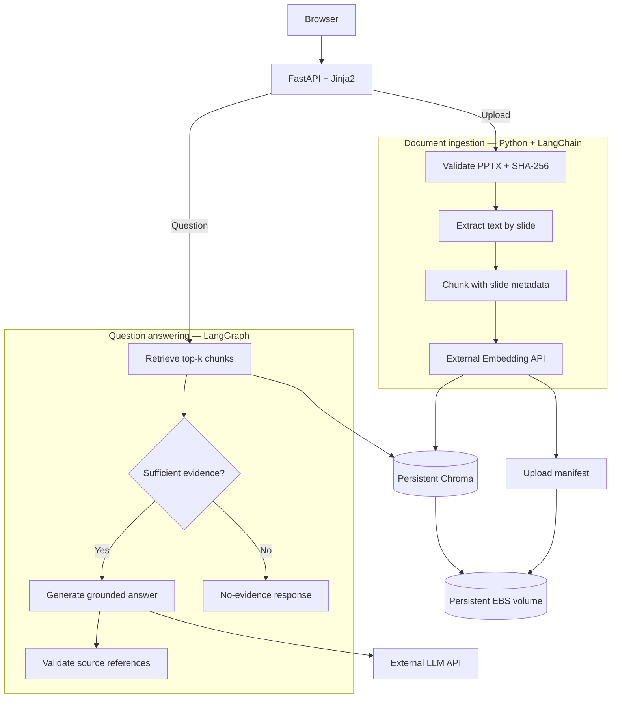

SlideRAG Mini — AI Engineer Portfolio Project
TECHNICAL ARCHITECTURE & IMPLEMENTATION PLAN · VERSION 1.0 · NOVEMBER 2, 2026
1. Executive Verdict
Recommendation: APPROVE — with strict MVP scope control.

Build SlideRAG Mini, a Python-based, presentation-grounded knowledge assistant demonstrating an end-to-end Retrieval-Augmented Generation (RAG) workflow for a fictional telecommunications operations team.
Development budget
8h
Maximum target

Runtime architecture
1
Application container

Deployment
AWS
EC2 + Docker

The project demonstrates five capabilities directly relevant to an AI Engineer interview: Python application engineering, document processing, vector retrieval, LLM orchestration, and AWS deployment.

The most convincing demonstration will not be an elaborate agent system. It will be a working application that can answer a question using specific slides, explain where the evidence came from, and decline to invent answers when the evidence is insufficient.

Architecture decision: LangChain handles document and retrieval integration; LangGraph manages explicit question-answering decisions; ordinary Python functions handle ingestion and validation.

Definition of done: A reviewer can upload a fictional 5G operations presentation, ask a technical question, inspect slide-level source references, restart the container, and continue querying the same indexed knowledge base.

2. Scope Lock
Feature	Priority	Decision
PPTX upload and validation	MUST HAVE	One file at a time
Slide-level text extraction	MUST HAVE	Preserve filename and slide number
Chunking and embeddings	MUST HAVE	External API
Persistent vector search	MUST HAVE	Local Chroma
Question-answer workflow	MUST HAVE	Minimal LangGraph
Evidence-grounded answers	MUST HAVE	Source-verified citations
Insufficient-evidence fallback	MUST HAVE	Explicit decision path
Simple document list	MUST HAVE	Persisted index metadata
FastAPI web interface	MUST HAVE	Jinja2 + HTML/CSS
Docker and AWS deployment	MUST HAVE	One container
Basic tests and README	MUST HAVE	Small, focused suite
Document deletion and reindexing UI	LATER	Not required for interview
User authentication and multi-tenancy	LATER	Private demo only
Conversation history and advanced evaluation	LATER	No requirement
OCR and visual slide interpretation	EXCLUDED	Text extraction only
Multiple agents and autonomous tool use	EXCLUDED	Unnecessary
Kubernetes, Redis, Celery, PostgreSQL	EXCLUDED	Overengineering
React, Next.js and frontend build tooling	EXCLUDED	No material MVP benefit

Scope freeze: No additional feature should enter the first release unless it fixes a correctness, security, or demonstration-blocking problem.
3. Architecture
One application, two simple workflows: document ingestion and grounded question answering.

Ingestion flow
1. Receive and validate the .pptx file, capped initially at 10 MB.
2. Compute its SHA-256 checksum and check whether that exact content was already indexed.
3. Extract text from slides using python-pptx, including text boxes and supported table cells.
4. Create LangChain Document objects, retaining slide metadata.
5. Split text within individual slides, not across slide boundaries, using approximately 1,000-character chunks with 150-character overlap.
6. Generate embeddings and upsert chunks to Chroma using deterministic IDs.
7. Record successful indexing in a small manifest and return the document's slide and chunk counts.
The manifest should be updated atomically only after successful indexing. On a failed or interrupted ingest, partial chunks for that file hash should be cleaned up or safely retried before marking the document complete.
Question-answering flow
The application embeds the question, retrieves the most relevant chunks from Chroma, evaluates whether they offer sufficient evidence, and either generates an answer or returns a fallback.

Every retrieved chunk carries provenance such as:
source_file: 5G_RAN_Operations_Demo.pptx
slide_number: 4
file_sha256: ...
chunk_index: 0

Source labels are built from retrieved metadata, not invented by the LLM. If the model is asked to cite source identifiers, the application validates those identifiers against the retrieved set before displaying them.

Architectural boundary: Retrieval and citations establish traceability, but they do not mathematically guarantee that every generated claim is correct. The small evaluation suite must verify grounding with known questions.

4. Final Technology Stack
Component	Final choice	Reason
Language	Python 3.12	Mature ecosystem and straightforward deployment
Backend	FastAPI	Lightweight routing and request validation
Templates	Jinja2	Server-side HTML without frontend tooling
Styling	Plain CSS	Minimum dependencies
PPTX extraction	python-pptx	Slide-by-slide text and table extraction
Chunking	LangChain text splitters	Simple, configurable splitting
Embeddings	OpenAI text-embedding-3-small	External inference, no GPU required
Chat model	OpenAI gpt-4.1-mini	Established, economical model
Orchestration	LangGraph	Explicit retrieval and fallback control
Vector storage	langchain-chroma	Integrated local persistence
Testing	pytest	Small automated quality suite
Web server	Uvicorn	Direct FastAPI serving
Packaging	Docker	Reproducible runtime
Cloud	AWS EC2 t3.small	Small private demonstration
Data storage	EBS gp3	Survives container recreation

The chosen OpenAI provider supports both chat completion and embedding endpoints, removing the need for two external vendors. The published API prices are $0.40 per million input tokens and $1.60 per million output tokens for gpt-4.1-mini, and $0.02 per million tokens for text-embedding-3-small. 

OpenAI API
+1

Keep both integrations configurable:
OPENAI_API_KEY
LLM_MODEL=gpt-4.1-mini
EMBEDDING_MODEL=text-embedding-3-small
LLM_BASE_URL
EMBEDDING_BASE_URL
CHROMA_PATH=/data/chroma

The base URLs can default to the provider's official endpoint. Keep separate optional settings because an OpenAI-compatible chat provider does not necessarily offer a compatible embeddings endpoint.

An embedding model change must trigger reindexing or a new collection, rather than silently mixing incompatible vector spaces.
5. Repository Tree
sliderag-mini/

Proposed compact repository

sliderag-mini/
├── app/
│   ├── __init__.py
│   ├── main.py           # FastAPI routes and startup
│   ├── ingestion.py      # PPTX validation/extraction
│   ├── rag.py            # Chroma, LLM, LangGraph
│   ├── config.py         # Environment configuration
│   ├── templates/
│   │   └── index.html
│   └── static/
│       └── style.css
├── demo/
│   ├── generate_pptx.py  # Fictional demo generator
│   └── README.md         # Demo facts and test questions
├── tests/
│   ├── test_ingestion.py
│   └── test_rag.py
├── docs/
│   └── architecture.md
├── Dockerfile
├── .dockerignore
├── .gitignore
├── .env.example
├── pyproject.toml
├── uv.lock
└── README.md
  

Module responsibilities
- main.py: upload, document listing, question answering, rendering, and /health.
- ingestion.py: file validation, SHA-256, slide extraction, chunking, and idempotent indexing.
- rag.py: embeddings, Chroma access, retrieval, LangGraph state and nodes, source validation.
- config.py: configuration and secret loading.
Avoid a generic service framework, repository layer, abstract provider factory, or event bus.

Runtime data remains outside the source tree:
/data/
├── uploads/
├── chroma/
└── manifest.json

The manifest records filenames, hashes, successful ingest status, slide counts, and chunk counts. One worker and one upload operation at a time are acceptable for this private demo, keeping manifest updates manageable.
6. LangGraph Design
LangGraph is valuable here because the decision between answering and refusing is an explicit, testable workflow transition. Its StateGraph supports named nodes and conditional edges; the graph must be compiled before invocation. 

GitHub
+1

Minimal state schema
State field	Type	Purpose
question	str	Original user question
retrieved_docs	list[Document]	Retrieved evidence
evidence_status	str	sufficient or insufficient
answer	str	Final response
sources	list[dict]	Verified filename/slide references

Nodes and transitions
START

retrieve

evidence_available?

Sufficient

generate_answer

Validate retrieved source IDs

Insufficient

no_evidence

Return factual fallback

END

Evidence policy
Start with top-5 retrieval and a conservative evidence policy.

An empty retrieval returns a deterministic fallback. For weakly related chunks, inspect the retrieval scores and calibrate the decision rule against known supported and unsupported questions. Chroma distance or relevance scores must not be treated as universally calibrated probabilities.

Even when retrieval passes the initial gate, the generation instruction must permit an explicit "not enough information" answer if the retrieved text does not support the question.

Grounded fallback example:
I couldn't find sufficient information in the uploaded presentations to answer that question. Please upload a relevant document or ask about the indexed material.

No extra agent, second model, self-reflection loop, or reranker is required.

7. AWS Deployment
Recommended: one EC2 host, one Docker application container, persistent EBS storage.

Infrastructure
Area	Configuration
Region	Europe (Frankfurt), eu-central-1
Instance	t3.small, 2 vCPU, 2 GiB RAM
OS	Ubuntu Server 24.04 LTS
Container	Single FastAPI/Uvicorn image
Storage	Root gp3 volume + approximately 20 GB data gp3 volume
Docker data mount	Host /var/lib/sliderag to container /data
Network access	SSH key + private port forwarding
Restart	Docker unless-stopped
Health	GET /health
IAM role	None required for the initial design

The t3.small is a reasonable low-cost starting point, not a guaranteed performance fit. Validate it with a representative upload and a query under its 2 GiB RAM limit. Upgrade to t3.medium only if measurements justify it.
Persistence
LangChain's Chroma integration supports an explicit persist_directory, enabling the local collection to survive process and container restarts when that directory is stored on persistent host storage. 

LangChain Reference

Keep the data EBS volume independently of the disposable application container and verify its mount before starting Docker. An EBS volume preserves files through a normal instance restart and container redeployment; it is not itself a backup.
Private interview access
Use SSH tunneling rather than exposing an unauthenticated application to the public internet.

ssh -i sliderag-demo.pem \
  -L 8000:127.0.0.1:8000 \
  ubuntu@EC2_PUBLIC_IP

Publish Docker's port on the EC2 host's loopback interface only. Allow inbound TCP 22 from your current public IP address in the EC2 security group. Do not open ports 8000 or 443 for this private mode.

AWS explicitly recommends restricting SSH ingress to known client addresses. 

Amazon Elastic Compute Cloud

For a private, single-user interview demonstration, SSH provides encrypted access without requiring a public domain, reverse proxy, TLS certificate, or authentication service. If an independently accessible public demo later becomes necessary, that is a separate scope decision requiring HTTPS and access controls.
Estimated monthly cost
Indicative pricing for a 730-hour month, excluding promotional credits and taxes.
Component	Estimate
EC2 t3.small	~$17.52
gp3 root + data volumes	~$2.50–$4.00
One public IPv4 address	~$3.60
Application LLM/embedding calls	Usage-dependent
Baseline infrastructure	~$24–$26/month

Allow approximately $25–$30/month for initial budgeting, plus model calls, data transfer, backups, potential burst CPU charges, and applicable taxes. The Frankfurt EC2 price is approximately $0.024/hour; AWS charges provisioned EBS storage and public IPv4 separately. 

DoiT Compute
+2

A stopped EC2 instance stops accruing normal instance-compute charges, but retained EBS and allocated public IPv4 resources may still cost money.

For illustration, 100 questions averaging 1,500 input tokens and 250 output tokens each cost approximately $0.10 at the selected chat model's listed rates, before other requests and features. That is a usage example, not a fixed per-question cost.
Deployment procedure
Build from the GitHub repository, configure the environment file on EC2, start the container with the persistent bind mount, and test /health, upload, query, and restart behavior.

Keep secrets off GitHub, use restrictive file permissions, and never bake API keys into the image. External model calls receive selected document text, so only synthetic demo data should be used initially.

8. One-Day Roadmap
Target: 7 hours of implementation and integration, plus 1 hour of debugging reserve.
1h
01
Milestone 1 — Working skeleton

Create the Python environment, FastAPI application, Jinja2 page, basic CSS, environment configuration, and health endpoint.

Acceptance: The home page renders locally, the upload/question controls are visible, and /health returns HTTP 200.

2h
02
Milestone 2 — PPTX ingestion

Implement upload validation, text extraction, per-slide chunking, embeddings, Chroma indexing, duplicate prevention, and the document list.

Acceptance: An uploaded synthetic presentation is indexed; slide metadata is correct; re-uploading identical bytes does not duplicate chunks.

2h
03
Milestone 3 — Grounded RAG

Implement the retrieval node, evidence decision, generation node, fallback, and citation validation. Integrate the browser question/answer flow.

Acceptance: Supported questions return answers with real slide references; unsupported questions return an appropriate fallback.

2h
04
Milestone 4 — Deployment and portfolio polish

Write the Dockerfile, deploy to EC2, mount persistent storage, verify restart behavior, document architecture and setup, and rehearse the interview demo.

Acceptance: The same presentation can be queried after recreating the container, and the GitHub README explains how to reproduce the deployment.

1h
Buffer
Integration and debugging reserve

Resolve dependency, API, retrieval, or deployment issues before attempting optional improvements.

Cut order if time runs short: extra CSS polish → document deletion → detailed telemetry → additional demo presentations. Do not sacrifice working ingestion, question answering, correct source references, or persistence.

9. Demonstration Dataset
Presentation: 5G_RAN_Operations_Demo.pptx
Entirely fictional dataset
The presentation should contain ten slides with invented but technically plausible operational data. Every slide should visibly identify the dataset as synthetic.
Slide	Topic	Demonstration content
1	Overview	Fictional 5G operations environment
2	RAN architecture	gNodeB, transport, 5G core relationships
3	Network KPIs	Availability, throughput, latency, utilization
4	Latency performance	Baseline 18 ms; incident peak 46 ms
5	Cell congestion	PRB utilization 92%; illustrative threshold 85%
6	Incident overview	Fictional incident INC-042
7	Root-cause investigation	Backhaul saturation and peak-hour congestion
8	Troubleshooting	Validate traffic, counters, transport, and alarms
9	Optimization	Capacity balancing, transport upgrade, KPI monitoring
10	Lessons learned	Detection improvements and operational recommendations

The metrics are constructed exclusively for demonstration. They are not sourced from, or representative of, any real operator's internal system.
Five demonstration questions
Test	Question	Expected behavior
Factual	What was the peak latency during INC-042?	Returns 46 ms with Slide 4
Factual	What PRB utilization was observed during congestion?	Returns 92% with Slide 5
Multi-slide synthesis	Which conditions contributed to the latency increase?	Combines congestion and backhaul evidence from Slides 4, 5 and 7
Troubleshooting	What should an engineer investigate first when latency rises during peak hours?	Summarizes documented diagnostic steps from Slides 7–9
Unsupported	What is the real current outage status of the operator's nationwide network?	Declines because the synthetic deck has no such evidence

The final question is essential: it demonstrates recognition of the boundary between indexed knowledge and unsupported assertions.

10. Quality Gates
Focus on a compact set of automated checks, supplemented by a live end-to-end demonstration.
Gate	Verification	Pass condition
QG-01	PPTX extraction	Expected text and slide numbers recovered
QG-02	Metadata integrity	Every chunk retains valid source metadata
QG-03	Duplicate handling	Identical re-upload does not increase chunk count
QG-04	Persistence	Reopened Chroma retains indexed content
QG-05	Retrieval relevance	Known questions retrieve relevant slides
QG-06	Citation integrity	Every displayed citation maps to an actual retrieved slide
QG-07	No-evidence handling	Unsupported question yields a fallback
QG-08	Upload safety	Invalid, oversized and malformed files fail safely
QG-09	Cloud integration	Application remains usable after container recreation

Security essentials
Validate extension, file signature, archive structure, and a bounded extraction size. PPTX is a ZIP-based format, so a simple extension check is insufficient. Sanitize display filenames and use generated or hash-based storage names.

Treat document text as untrusted input, never as instructions to the assistant. Clearly separate the system-level grounding policy from retrieved text. Escape document-derived content in HTML, prevent arbitrary filesystem paths, and avoid leaking credentials in logs.

A single demonstration account, one server worker, and deliberately limited file sizes are acceptable scope restrictions. Document these constraints rather than presenting the application as production-ready for arbitrary public traffic.
Minimal evaluation
Use the five known questions as a small evaluation set, with expected slide references and expected answer behavior. Run deterministic extraction and citation tests in pytest, and perform real-model answer-grounding checks manually.

Avoid adding an entire evaluation framework for five examples. Correctness matters more than evaluation-tool sophistication.

11. Interview Demonstration
Target duration: 3–5 minutes.
Time	Action	Engineering capability demonstrated
0:00–0:30	Explain the fictional telecom use case	Business understanding
0:30–1:15	Upload the 5G PPTX and inspect indexed documents	Document ingestion
1:15–2:15	Ask a technical question and show slide references	Retrieval and grounding
2:15–2:45	Ask an unsupported question	Hallucination-risk mitigation
2:45–3:30	Explain the LangGraph flow and design boundaries	Architecture judgment
3:30–4:30	Recreate/restart the container and query again	Cloud and persistence engineering
4:30–5:00	Summarize trade-offs and next steps	Technical ownership

Five technical questions to prepare for
1. Why use LangGraph instead of a simple LangChain retrieval chain?

Because the demo explicitly models retrieval, evidence assessment, answer generation, and deterministic fallback as individually testable transitions. That offers explainability without pretending the system is a complex autonomous agent.

2. Why Chroma instead of PostgreSQL with pgvector?

The requirement is a single-instance, small-document demo. Embedded Chroma provides sufficient persistence and retrieval functionality without operating another database service. pgvector becomes more attractive when existing PostgreSQL infrastructure, transactional requirements, or broader operational constraints justify it.

3. How do you prevent hallucinated slide citations?

Source metadata comes from the ingestion pipeline. The generation process receives only retrieved evidence, and the application validates output source identifiers against the actual retrieved documents. This protects against fabricated citation IDs, though semantic correctness still requires testing.

4. How would you scale this beyond the MVP?

First measure upload latency, query latency, memory usage, and retrieval quality. Only then separate ingestion jobs, add authentication, use managed storage, or introduce dedicated vector infrastructure as actual demand requires.

5. Why is this relevant to telecommunications?

Telecom operations often involve procedural documentation, incident reports, capacity plans, and technical presentations. An evidence-grounded assistant offers a plausible interface for finding and synthesizing information across such documents. The demo demonstrates that workflow without claiming privileged operational access.

12. PRO / CONTRA → VERDICT
The following scores are architectural judgments against the stated one-day portfolio objective, not empirical benchmark results.
Dimension	Score / 5	Assessment
AI engineering demonstration	4.5	Covers ingestion, embeddings, retrieval, orchestration, grounding
Implementation simplicity	4.0	Small codebase; some dependency and persistence integration risk
Cost efficiency	4.5	Low external-model usage and modest cloud requirements
Interview impact	4.5	Relevant use case with visible end-to-end functionality
One-day feasibility	3.5	Achievable as a constrained MVP, but deployment may consume the buffer
Overall	4.2 / 5	Strong portfolio candidate

PRO
- End-to-end functionality rather than isolated notebook examples.
- Real use of LangChain and LangGraph without forcing agentic complexity.
- Clear telecom business narrative.
- Slide-level provenance and meaningful negative-case behavior.
- GitHub code quality and AWS deployment evidence.
- A small enough system to explain confidently during an interview.
CONTRA
- Text-only extraction misses diagram-heavy PowerPoint content.
- Evidence-threshold calibration may require experimentation.
- Embedded Chroma and a one-worker application are unsuitable for some multi-user workloads.
- The design intentionally does not include strong authentication, multi-tenant isolation, or enterprise document governance.
- The eight-hour schedule leaves limited margin for cloud setup and dependency problems.
VERDICT
Proceed with the proposed design.

The strongest engineering choices are deliberately modest: one application, one deployment container, explicit source metadata, persistent storage, and a graph that represents a real decision.

Avoid presenting SlideRAG Mini as a production telecom platform. Present it as a working, deliberately constrained proof of capability, with explicit next steps for production hardening.