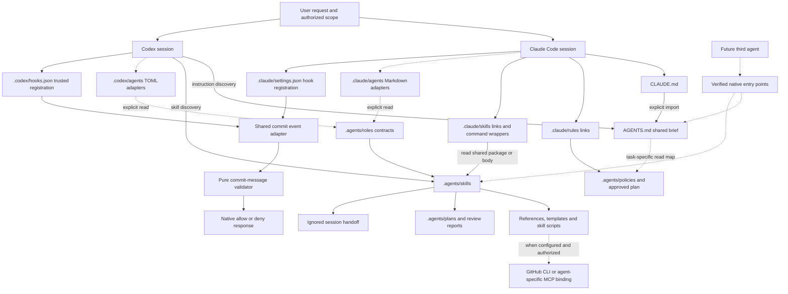

# SlideRAG-mini agent toolkit audit and Codex support plan

**Recommendation: adopt option 2, a shared toolkit with agent-specific entry points, through a small, reversible Codex pilot.** Keep portable skills, policy, role instructions, and workflow artifacts in shared locations; retain Claude Code and Codex discovery files, permissions, hooks, and orchestration adapters in their native layouts. Do not introduce a configuration generator yet.

The strongest evidence is already in this repository: Claude commands write plans and reports into `.agents/`; the memory skill explicitly proposes shared `AGENTS.md` content with a thin `CLAUDE.md`; most skill resources are ordinary Markdown, Python, or Bash. Conversely, the command graph contains broken references, some policy checks disagree, and local integration settings do not establish a reproducible installation. Generating configurations now would encode those inconsistencies. See `.claude/commands/core_piv_loop/plan-feature.md:377`, `.claude/commands/validation/execution-report.md:20`, and `.claude/skills/managing-agent-memory/SKILL.md:19`.

**First milestone:** add a concise root `AGENTS.md` and a `CLAUDE.md` that imports it, then share only `writing-session-handoffs` through `.agents/skills/`, preserving its Claude entry point. Rename its currently ignored template so a fresh checkout receives it. Test discovery and a synthetic handoff in both clients before moving another workflow. This report proposes those changes; it does not perform them.

**Verdict: recommended for staged implementation; runtime compatibility remains untested.** Option 2 scores **4.05/5**, versus **3.50** for targeted support and **3.05** for generated configurations. An urgency-heavy weighting makes targeted support win, so the first milestone deliberately resembles option 1 while establishing option 2's ownership model.

## 1. Scope, evidence, and limits

- **Checked:** 2026-11-04, Europe/Budapest. Repository snapshot: branch `chore/repo-github-scaffold`, HEAD `f2ddbf9`; local `main` is the preceding bootstrap commit `aea4579`. Initial working tree was clean. These are local observations, not a fresh remote audit.
- **Method:** static filesystem enumeration, including ignored/hidden files and symlinks; Git metadata reads; inspection of definitions, references, templates, and script source; research in official documentation. No repository hook, helper script, agent workflow, application test, install, integration, or remote mutation was run. Only this report was written.
- **Instructions:** no applicable root/ancestor `AGENTS.md` or root `CLAUDE.md` was found. The `AGENTS.md` under the memory skill is a template, not project policy. Existing rules and the governing preparation documents were read as repository guidance. The user's detailed report request takes precedence over the output rule's suggestion to summarize reports longer than 40 lines.
- **Boundaries:** credential stores, `.aws/` contents, ignored archives, and external plugin installations were not audited. Local settings are described by function and plugin identifiers; no secret values are reproduced. Historical mission instructions were inspected as evidence, not executed as current authorization.
- **Labels:** **[R]** repository observation; **[D]** documented platform behavior; **[P]** recommendation. Dependency edges use **V** = verified in static source, **I** = inferred intended connection, **U** = unresolved/missing dependency. V does not mean runtime-tested.
- **Application status:** `app/`, `tests/`, `demo/`, `pyproject.toml`, `uv.lock`, `Dockerfile`, and `.github/workflows/` are absent. Planned application paths are not automatically broken toolkit references. `docs/.prepare/execution-plan.md:13` establishes authority; its workflow at line 133 favors outcome-sized work and a small active document set.

The official Codex URLs used below now redirect to OpenAI's ChatGPT Learn documentation. The compatibility assessment targets local Codex clients and Claude Code in a repository checkout. It does not assert identical discovery in hosted/cloud sessions or managed installations. Client versions and effective local settings were not executed or probed.

## 2. Current toolkit inventory

### 2.1 Directory roles and counts

| Surface | Observed contents | What it does |
|---|---|---|
| `.claude/` | 15 skill packages, 27 command files, 4 agent definitions, 7 rules, 1 hook, shared and local settings; 17 scripts inside skills | Main reusable toolkit and Claude-native integration layer. 175 file/link entries exist locally; 173 are tracked. |
| `.agents/` | One file: `plans/github-bootstrap-mission.md`; empty `execution-reports/` and `system-reviews/` directories | Workflow artifacts and mission packets. **No `.agents/skills/` exists.** Empty directories do not survive Git checkout. `code-reviews/` is a configured future output, currently absent. |
| `.codex/` | Empty local directory; no tracked files | No repository Codex configuration, hooks, agents, or other integration can be inferred from its presence. |
| Root memory files | No root `AGENTS.md`, `AGENTS.override.md`, or `CLAUDE.md`; local ignored `HANDOFF.md` exists | No committed cross-agent instruction entry point. Handoff is derived state, not authority (`HANDOFF.md:4`). |
| `.github/` | `CODEOWNERS`, `dependabot.yml`, PR template, and five issue-template/config files | GitHub delivery scaffold, usable by either agent through Git/GitHub; no CI workflow yet. |
| `docs/.prepare/` | Governing execution plan, decision log, index, readiness/context/questions, source register, historical reviews and prompts | Durable planning evidence and authority. The index distinguishes current direction from historical proposals (`README.md:41`). |
| `.handoffs/`, `.legacy-assets/` | Local execution captures/handoffs; two source ZIP archives | Local provenance, not a portable dependency bundle. Ignored by `.gitignore:2` and `:40`. Archives were inventoried, not unpacked. |

The two local-only `.claude/` files are `.claude/settings.local.json` and **`.claude/skills/writing-session-handoffs/assets/templates/HANDOFF.md`**. The latter is caught by the unanchored `HANDOFF.md` ignore pattern at `.gitignore:41`; the skill refers to it at `SKILL.md:130` and `:187`. A fresh clone therefore lacks a required handoff template. This is a portability problem even before adding Codex.

### 2.2 Skills and supporting assets

Paths in this table are relative to `.claude/skills/`. Each row includes its `SKILL.md`; resources remain part of the package, not independent automatically discovered skills.

| Package | Purpose and invocation intent | Supporting assets and dependencies | Evidence |
|---|---|---|---|
| `analyzing-ai-repos` | Map AI repositories, trace logic, emit `.kb/designs/<repo>/` context and diagrams | Four scripts: `classify_repo.py`, `build_tree.py`, `diff_analysis.py`, `validate_mermaid.py`; four references; seven templates; workflow diagram. Python standard library, documented `uv` commands; optional Git clone/web research and Claude Explore delegation | `SKILL.md:64`, `:85`, `:147`, `:178` |
| `audit-rules-drift` | Read-only comparison of policy/hook/code or approved planned paths | No bundled scripts; reads rules, hook, root anchors if present, and execution plan; expects matching scope lists | `SKILL.md:10`, `:30` |
| `commit-format-check` | Check commit grammar and attribution | No executable implementation in package; prose regex and optional `gh` issue check; claims hook reuse | `SKILL.md:3`, `:15`, `:70`, `:95` |
| `excalidraw-diagram` | Produce `.excalidraw` JSON with visual reasoning | Two references: `color-palette.md`, `json-schema.md`; extensive inline JSON examples. No MCP server definition or rendering script | `SKILL.md:3`, `:371`, `:570` |
| `git-history-manager` | Advertises `/history` analyze/rebase/search/snapshot | Declared name is `history`; three links to absent `.claude/references/` helpers; example JSON settings have no identified consumer | `SKILL.md:2`, `:20`, `:36`, `:50` |
| `issue-to-subtasks` | Resolve a GitHub issue, research/score directions, critic pass, propose five subtasks | `resolve_issue.sh`, `list_repos.sh`, `fetch_issue_graph.sh`, `score_directions.py`; three references, three templates, one worked example. Bash, `gh`, `jq`, Python, authenticated GitHub/network | `SKILL.md:35`, `:96`, `:245`, `:290`, `:314` |
| `library-claim-verify` | Execute small third-party API claims before relying on them in a plan | Inline Python snippets, `uv`, project-pinned libraries/`uv.lock`; no bundled executor script. Has side effects in temporary data roots and executes supplied verification code | `SKILL.md:24`, `:82`; prerequisites currently absent |
| `managing-agent-memory` | Generate/update shared instructions and a documentation suite | One index generator, two references, eight regular templates plus `CLAUDE.md` and `GEMINI.md` symlinks to `AGENTS.md`; optional `docs/_kB/repo-map/` input | `SKILL.md:19`, `:33`, `:62`, `:85`; `templates/skeleton.md:11` |
| `managing-llms-txt` | Build `llms.txt` and concatenated `llms-full.txt` | `scripts/gen_llms_full.sh`; Bash/sed/wc; fixed core-document list, writes output from repository root | `SKILL.md:49`; script `:4`, `:13`, `:34` |
| `preparing-skill-briefs` | Interview, validate, assemble a tiered skill brief | `validate_brief.py`, `assemble_brief.py`; four references, two templates, workflow diagram. Python ≥3.10/`uv`; optional PyYAML with limited fallback parsing; web fetch for URL input | `SKILL.md:53`, `:237`, `:284`; validator `:86` |
| `processing-coderabbit-reviews` | Fetch review comments, fix sequentially, validate, commit, reply | One parsing/reference guide; `gh`, Git, project's checks. Names external `coderabbit:code-review`/`coderabbit:autofix`, neither bundled here | `SKILL.md:18`, `:97`, `:128`, `:138`, `:179` |
| `prompt-architect` | Select prompting frameworks and improve prompts | 27 framework reference files, 29 templates, two Python helper modules (`framework_analyzer.py`, `prompt_evaluator.py`); metadata version 3.2.2 and MIT declaration | `SKILL.md:1`, `:194`, `:227`. Helpers are present, but the main skill does not explicitly invoke them |
| `repo-visibility-audit` | Read-only public documentation audit, skip not-yet-created files | No bundled scripts; Git/filesystem, HTTP probes; cross-checks versions/config/tests and output rule | `SKILL.md:10`, `:20`, `:22`, `:52` |
| `skill-creator` | Initialize, author, validate, package a skill | `init_skill.py`, `quick_validate.py`, `package_skill.py`; two references; Apache-2.0 `LICENSE.txt`. Validator requires PyYAML; packager imports it | `SKILL.md:256`, `:320`; validator `:9`, `:42` |
| `writing-session-handoffs` | Capture Git state, decisions, dead ends, actionable next steps | One template, one workflow diagram; Git and shell. Template exists locally but is not tracked | `SKILL.md:45`, `:128`, `:172`, `:180` |

**[R] Platform assumptions:** several skills name Claude tools (`Read`, `Write`, `Bash`, `WebFetch`, Explore) or use Claude `allowed-tools` metadata. `preparing-skill-briefs` uses a YAML list for that field; handoffs and issue decomposition use comma-separated tool names. Most scripts assume Bash/Unix utilities or a particular current directory. Commands such as `uv run scripts/validate_brief.py` are skill-directory relative, whereas the llms script explicitly expects repository-root execution. Moving directories without defining both the package path and output root can break these calls.

### 2.3 All 27 command files, grouped

Paths below are relative to `.claude/commands/`. These are prompt templates, not shell executables. Current Claude documentation maps a nested command to a colon-separated name, e.g. `core_piv_loop/plan-feature.md` to `/core_piv_loop:plan-feature`; actual availability in the installed client is untested. [Claude skills](https://code.claude.com/docs/en/skills#how-a-skill-gets-its-command-name)

| Group and files | Workflow and important coupling |
|---|---|
| `core_piv_loop/prime.md`, `plan-feature.md`, `execute.md` | Context → researched plan → implementation/validation. `$ARGUMENTS` supplies feature or plan. Planner emits `.agents/plans/`; execution reads the supplied path (`plan-feature.md:377`, `execute.md:10`). |
| `validation/code-review.md`, `code-review-fix.md`, `execution-report.md`, `system-review.md` | Review → corrections; implementation report → process review. Outputs `.agents/code-reviews/`, `.agents/execution-reports/`, `.agents/system-reviews/`. Fix command refers to missing `commands/validate.md`; system review names misplaced command paths (`:32`, `:40`). |
| `base_prp/generate-prp.md`, `prp-create.md`, `execute-prp.md`, `prp-execute.md` | Two overlapping create/execute pairs. Both creators depend on absent `PRPs/templates/prp_base.md`; PRP guide references include `/PRPs/prp-readme.md` and typo `PRPs/prp-readme.md.md`. More elaborate executor includes repository-specific persistence guidance (`prp-execute.md:39`). |
| `do/prd.md`, `breakdown.md`, `preparation.md`, `implementation.md`, `review.md` | PRD/issue-driven delivery variants. Depend on absent root `AGENTS.md`; three name absent `github-pm`. Implementation directly closes an issue after checks (`:38`), conflicting with steward merge-based closure. |
| `base_cm/prime_nogit.md`, `repo-docs.md`, `plan-validate.md`, `perplexity-deep-research-skeleton.md` | Filesystem priming, six-artifact documentation generation, plan review, external research prompt. Generic GitLab/Helm/service assumptions in `prime_nogit.md:20`; doc suite overlaps memory skill. |
| `prompts/ai-engineer-doc-architect-prompt.md`, `plan-validate.md`, `perplexity-deep-research-skeleton.md` | Another broad doc generator plus two **byte-identical duplicates** of `base_cm/` files, verified by hashes. Architect prompt includes Claude CLI/action examples (`:611`), a distinct output contract, and calls `AGENTS.md` Claude's primary context file (`:180`). |
| `git-operations/conflict-resolver-general.md`, `conflict-resolver-specific.md`, `smart-resolver.md` | Conflict analysis, editing/staging, optional `gh` and validation. Generic npm/Poetry lockfile guidance requires adaptation to the planned uv stack; these are mutating workflows. |
| `end-to-end-feature.md` | Intended prime → plan → execute → commit chain. All four `core_commands/*` references are absent; output uses `plans/` rather than `.agents/plans/` (`:18`, `:28`, `:40`, `:44`, `:54`). No bundled commit command completes this chain. |

### 2.4 Agents, policy, hooks, integrations, and templates

| Files | Role, dependencies, and limits |
|---|---|
| `.claude/agents/github-steward.md` | GitHub taxonomy, milestones, native sub-issues, Projects v2, scaffolding, audits, release guidance. Reads all seven rules and approved plan/decisions (`:28`). Bash/Read/Grep/Glob/Edit/Write/WebFetch; model inheritance. Requires `gh`, credentials, GitHub APIs and two external reference repositories. Rules distinguish approved direction from tested readiness. |
| `.claude/agents/prp-quality-agent.md` | Assess completed PRPs; Read/Grep/WebFetch/Bash. Explicitly requires executed library-claim evidence (`:98`). No YAML `skills:` preload: this is a prose workflow dependency. |
| `.claude/agents/prp-validation-gate-agent.md` | Run PRP final gates and produce report; Bash/Read/Grep/Glob. Needs a real PRP and executable validation environment (`:20`). |
| `.claude/agents/repo-visibility-manager.md` | Read-only public docs review; largely overlaps `repo-visibility-audit` but adds quick-start/demo/pitch checks (`:26`). No explicit call to the skill. Both include Bash, so a read-only description alone is not OS-level write isolation. |
| `.claude/rules/product-vision.md`, `security-patterns.md`, `test-requirements.md` | Product scope/approved plan; defensive input/storage/secret handling; offline lint/tests and QG-01…09. No path-scoped frontmatter. |
| `.claude/rules/commit-format.md`, `branch-naming.md`, `versioning.md`, `output-formatting.md` | Commit/issue/attribution rules; one issue/branch/PR; manual SemVer releases; structured status reports. No path-scoped frontmatter. |
| `.claude/settings.json:2` → `.claude/hooks/check-commit-format.sh` | One `PreToolUse` command hook, matcher `Bash`, timeout 5 seconds; reads JSON stdin, extracts `tool_input.command`, examines commit message, emits deny JSON. Bash, grep/sed/head/tr; optional jq. Hook path and `.git/COMMIT_EDITMSG` assume current-directory layout. |
| `.claude/settings.local.json:2` | Ignored local configuration: 11 Bash allow entries, `enableAllProjectMcpServers: true`, enabled `skill-codex@skill-codex` and `understand-anything@understand-anything`. These names prove configuration intent only; no installation, version, implementation, or interoperability was verified. |
| MCP/plugin definitions | No root `.mcp.json`, repository plugin manifest/marketplace, or MCP server launch definition was found. References to MCP in prompts describe capabilities or proposed integrations, not configured servers. The Excalidraw skill writes JSON without requiring an Excalidraw MCP definition. |
| `.github/ISSUE_TEMPLATE/{umbrella,epic,sub-issue,bug_report}.md`, `config.yml`; `.github/PULL_REQUEST_TEMPLATE.md` | Shared delivery templates already exist. PR template explicitly allows checks to be marked not applicable for documentation/scaffolding without a Python project (`:9`). |
| `.github/CODEOWNERS`, `.github/dependabot.yml` | Ownership and future dependency upkeep. Dependabot explicitly depends on future manifests (`dependabot.yml:1`), so its presence is not evidence of working automation. |

## 3. Dependency map and current workflow behavior

### 3.1 Entry-to-output traces

| Entry | Loads/calls → output | Edge status and unresolved dependencies |
|---|---|---|
| Claude session | Native rules/settings/skills/agents → task-specific command or skill | **V** files/configuration exist; **D** discovery described in §5. **U** actual client loading, local plugin installation, effective managed settings. |
| Feature planning | `core_piv_loop/prime.md` → `plan-feature.md` → `.agents/plans/<feature>.md` → `execute.md <path>` | **I** sequence between separate commands; **V** planner output and executor input. No dispatcher establishes automatic chaining. Application/manifests still absent. |
| Review loop | `validation/code-review.md` → `.agents/code-reviews/`; `code-review-fix.md` consumes findings; `execution-report.md` → `.agents/execution-reports/`; `system-review.md` consumes plan/report → `.agents/system-reviews/` | **V** declared input/output paths; **I** orchestration between prompts; **U** missing validate command and stale planner/executor paths. |
| End-to-end shortcut | `end-to-end-feature.md` → four `core_commands/*` files → `plans/` → commit | **V** textual references; **U** all referenced command files and output-path reconciliation. Cannot be claimed operational. |
| PRP workflow | Creator → PRP template/guide → `PRPs/<feature>.md`; library claim verification → quality agent → executor → validation agent | **V** template/guide requirements and quality-agent claim check; **I** complete lifecycle ordering; **U** absent `PRPs/`, runtime libraries, lockfile, explicit orchestration. |
| GitHub bootstrap | `.agents/plans/github-bootstrap-mission.md:3` → `github-steward.md` → rules + execution plan + decisions → `gh`/Git → repo/board/issues/scaffold PR | **V** explicit links and instructions. **V** local `.github/` files and two commits corroborate part of completion. Local handoff/captures report remote completion; no current GitHub verification. Mission is historical, not safe to replay. |
| Issue decomposition | `issue-to-subtasks` → resolve/list repositories → fetch graph → score candidates → critic/reference/templates → review package | **V** direct helper references. **U** authenticated API/CLI compatibility and native hierarchy completeness. Creating sub-issues is a separate requested step (`SKILL.md:330`). |
| Commit attempt | Claude Bash tool → settings hook → shell parsing/regex → allow or deny | **V** actual configured executable edge. **Not** hook → skill: shell never loads `commit-format-check/SKILL.md`, despite the skill's wording. No Git `commit-msg` installation or CI enforcement is defined here. |
| Documentation upkeep | `managing-agent-memory` → KB or heuristic discovery → templates/index generator → root instructions + `docs/_base/`; `managing-llms-txt` → fixed source list → llms files | **V** source/templates/scripts. **U** missing optional KB/mapping skill and competing doc-generator contracts. llms script tolerates missing sources with warnings, so output alone would not prove completeness. |
| Repository analysis/skill authoring | `analyzing-ai-repos` → four helpers/references/templates → `.kb/designs/`; `preparing-skill-briefs` → interview/validator/assembler → brief; `skill-creator` → initializer/validator/packager → package | **V** internal resources. **I** brief-to-creator handoff: a separate “skill-generator pipeline” is mentioned but not implemented as a repository dispatcher. |
| Handoff | `writing-session-handoffs` → Git/conversation evidence → template → `HANDOFF.md` | **V** requested procedure; **U** clean-clone template availability, currently broken by ignore rule. Existing handoff says its last refresh used `$co-handoff` (`HANDOFF.md:45`), so it does not prove execution of this repo skill. |
| CodeRabbit feedback | Skill → `gh` comments → extracted suggestion → edit/check → commit → GitHub reply | **V** instructions; **U** external CodeRabbit availability and usable validation environment. Current commit example conflicts with repo policy; see §4. |
| Historical multi-session preparation | Starter prompt → Herdr session packets → raw delegated output → reconciled preparation docs | **V** recorded packet/report relationship (`docs/.prepare/delegation-manifest.md:117`); runtime not repeated. Current index says this history does not mandate another delegation cycle (`README.md:35`). Herdr is an external runtime, not a directory standard. |

### 3.2 What `.claude/` and `.agents/` actually share

**[R] They are complementary today, not mirrored agent configurations.** `.claude/` defines behavior; `.agents/` stores plans and intended execution/review artifacts. The bootstrap mission points back into a Claude agent definition. The more portable directory name did not itself make the mission Codex-discoverable.

There is no shared `.agents/skills/` tree, generator, or central configuration schema. There are two memory-template symlinks, but neither installs root instructions. No `.codex/` files connect these assets to Codex. The local `skill-codex` plugin flag is not evidence that this repository has already solved Codex support.

**[R] Maintainer workflow priorities supported by the files:**

- Evidence-backed planning and explicit authority: the preparation index and execution plan preserve approved direction while distinguishing historical proposals and untested prerequisites (`docs/.prepare/README.md:14`, execution plan `:15`, `:137`).
- Small, outcome-based delivery despite a broad reusable prompt library: one milestone-sized issue/PR where practical; minor steps as checkboxes; minimal offline CI (`execution-plan.md:135`).
- GitHub traceability: open issue references, milestone/umbrella/epic/sub-issue hierarchy, proof before parent closure (`commit-format.md:69`, `github-steward.md:122`).
- Correctness and safe recovery: synthetic-only data, citation provenance, refusal behavior, preserved durable state, focused tests (`security-patterns.md:45`, `:64`; `test-requirements.md:58`).
- Reusable context across sessions and tools: handoff assets, a shared-memory design, framework/reference libraries, and documented delegated-session packets. These show workflow investment, not evidence of universal runtime support.

## 4. Findings that matter before migration

| Priority | Finding and evidence | Consequence / recommended disposition |
|---|---|---|
| High | **Handoff resource missing from Git.** Local template is ignored by `.gitignore:41`; required at handoff `SKILL.md:130`. | Fix in the first pilot: rename to `handoff-template.md` and update its references, preserving ignored operational `HANDOFF.md` files. Verify in a fresh checkout. |
| High | **Broken workflow references.** End-to-end command names nonexistent `core_commands/*`; system review uses nonexistent flat command paths; fix command names absent `commands/validate.md`; PRP templates/guides absent, one guide name doubled. | Do not expose these as supported Codex workflows until repaired or explicitly retired. Missing app files are planned; these missing toolkit dependencies are distinct. |
| High | **Commit policy has three divergent implementations.** Rule permits scope omission only for project-wide docs/release (`commit-format.md:65`); both regexes make it optional for every type. Skill regex bans internal periods (`SKILL.md:15`), while hook explicitly permits SemVer periods (`hook:78`). Rule bans all AI attribution, hook catches only three patterns (`hook:89`). Open-issue check is mandatory in rule, optional in skill, absent from hook. | Agree one message contract; separate offline grammar validation from online issue-state verification. Prose skill is not deterministic enforcement. Do not copy divergence to Codex. |
| High | **Hook is a partial guardrail.** Detects literal `git commit` (`:35`), parses shell text naively (`:48`), falls back to possibly stale `.git/COMMIT_EDITMSG` (`:62`), allows when no message is extracted (`:67`). | Static gaps include `git -C … commit`, aliases/wrappers, complex quoting/multiple `-m`/quoted `-F`, editor flow, subdirectories and `.git` files in worktrees. These are source-based failure hypotheses, not executed reproductions. Extract a message validator; add explicit fixtures and native adapters later. |
| High | **CodeRabbit procedure conflicts with policy and over-trusts review text.** Uses reviewer-provided agent prompt as primary instruction (`SKILL.md:101`); immediate `fix: …` commit lacks scope/issue (`:133`); auto-posts replies (`:142`). | Treat review content as evidence to assess, preserve authorization boundaries, use project commit grammar and correct issue, and separate drafting from authorized external posting. No comments were posted in this audit. |
| Medium | **Issue workflows disagree.** `do/implementation.md:42` closes after local validation; steward closes on PR merge (`:125`). `github-pm` is absent. | Route future issue work through the steward contract; retain old command names as adapted entry points. Do not substitute a similarly named external skill without inspection. |
| Medium | **“Graph” helper is partial.** `fetch_issue_graph.sh:42` searches PR bodies; `:66` parses `#N`; `:75` extracts parent/blocker hints. No native parent/sub-issue traversal is present. No-match grep pipelines under `set -euo pipefail` may terminate early (`:13`, `:69`, `:76`). | Do not claim complete native GitHub hierarchy discovery. Pin/check CLI fields, handle empty results, and add real hierarchy queries only in a later authorized implementation. |
| Medium | **Competing documentation contracts.** Memory skill emits uppercase `docs/_base/` suite; `base_cm/repo-docs.md:46` emits numbered suite; architect prompt has another schema. Memory skeleton calls `@` imports on-demand (`templates/skeleton.md:16`). | Select one small document contract. Imports load with the parent; use ordinary links for optional references. [Claude memory](https://code.claude.com/docs/en/memory#import-additional-files) |
| Medium | **Skill standard and validator mismatch.** `git-history-manager` declares `name: history`; helpers are missing. Local validator's allow-list omits `compatibility` (`quick_validate.py:42`), present in `prompt-architect/SKILL.md:5`. | Rename the portable history package to match its name if retained; preserve the old entry alias. Update validation against the chosen standard before using it as a migration gate. Do not run or install it during this audit. |
| Medium | **Hidden external dependencies and collisions.** `mapping-repo-context`, `github-pm`, `coderabbit:*`, Explore/batch tools, and local plugins are not bundled. A repo `skill-creator` can collide with Codex's system skill; personal `prompt-architect` variants may differ. | Record capability requirements and use namespaced project workflow names where needed. Verify selected source paths, not just matching display names. |
| Medium | **Historical state can be mistaken for current instructions.** Mission says zero commits/no remote (`:11`) and mixes `M0 - Preparation` with `M0 - Readiness` (`:29–30`); local Git and handoff contradict the old state. | Keep provenance; mark mission as completed/historical with a public summary before future reuse. Do not replay create-everything instructions. |
| Low | **Exact duplicates and conceptual overlap.** Two command duplicate pairs; dual PRP pairs; visibility skill/agent; three documentation writers; generic priming/conflict variants. | Consolidate bodies and preserve useful aliases. Similarity alone is insufficient to retire a distinct output contract. |

The current toolkit is therefore neither wholly Claude-only nor safely portable as-is. The content layer is the strongest reuse candidate; discovery, executable checks, tool permissions, and orchestration require explicit treatment.

## 5. Documented compatibility and what transfers

All documentation in this section was checked **2026-11-04**. Every row is **runtime untested in this repository**. “Direct” means reusable content/format after placing it in a documented discovery path; it does not mean installed, invoked, or policy-equivalent.

| Component found or proposed | Claude Code discovery / invocation [D] | Codex discovery / invocation [D] | Reuse, adaptation, and possible loss [P] |
|---|---|---|---|
| **Root `AGENTS.md`** — absent | Current Claude supports it conditionally from v2.1.277: default fallback when no relevant `CLAUDE.md`/`CLAUDE.local.md` exists. `CLAUDE.md` can explicitly import it. [Memory](https://code.claude.com/docs/en/memory#use-an-existing-agents-md) | Reads root-to-CWD instruction chain; per directory, `AGENTS.override.md`, then `AGENTS.md`, then configured fallbacks; default combined cap 32 KiB. [Instructions](https://learn.chatgpt.com/docs/agent-configuration/agents-md) | Share concise plain Markdown. Use explicit Claude import for predictable compatibility. Do not put necessary shared policy only in `AGENTS.override.md`, which Claude does not read. |
| **`.agents/` directory** — mission/artifacts only | No generic instruction discovery for contents of `.agents/`. [Memory](https://code.claude.com/docs/en/memory#when-claude-code-reads-agents-md) | Specifically discovers `.agents/skills` from CWD up to repo root; arbitrary plans/reports are not skills. [Skills](https://learn.chatgpt.com/docs/build-skills#where-codex-loads-local-skills) | Keep plans/reports as explicitly opened artifacts. `.agents/policies`, `roles`, and `workflows` below are repository conventions, not new platform discovery claims. |
| **`.codex/` directory** — empty | No Claude discovery contract for Codex project configuration in the reviewed docs | Trusted-project `.codex/config.toml` participates in configuration precedence; hooks and custom agents have separate documented paths. [Config](https://learn.chatgpt.com/docs/config-file/config-basic), [hooks](https://learn.chatgpt.com/docs/hooks), [subagents](https://learn.chatgpt.com/docs/agent-configuration/subagents) | Add only settings actually needed. Empty directory does nothing; do not copy Claude JSON to TOML or use it as a generic skills directory. |
| `CLAUDE.md` / seven `.claude/rules/*.md` | `@` imports load with parent; rules without `paths` load at launch. [Memory](https://code.claude.com/docs/en/memory) | Root `CLAUDE.md` is not in the default instruction filename chain; arbitrary Markdown rules are not Codex command-permission rules. [Instructions](https://learn.chatgpt.com/docs/agent-configuration/agents-md) | Share rule content; Codex needs explicit read instructions in `AGENTS.md`. Claude can retain native rule links. Loss to avoid: silent omission or changed conditional loading. |
| 15 `SKILL.md` packages | `.claude/skills/<name>/SKILL.md`; `/name` or relevant task; directory symlinks supported. [Skills](https://code.claude.com/docs/en/skills#choose-where-skills-load) | `.agents/skills/<name>/SKILL.md`; explicit `$name` or implicit selection; symlinked skill folders supported. [Skills](https://learn.chatgpt.com/docs/build-skills) | Portable core: name/description, procedure, references, templates, scripts. Move one complete package at a time. Keep model/tool-specific clauses in wrappers. |
| Skill metadata and runtime names | Supports Claude extensions, tool names and argument expansion. [Skills](https://code.claude.com/docs/en/skills#using-skill-frontmatter-outside-claude-code) | Optional `agents/openai.yaml` supplies invocation policy/UI/dependencies; `allow_implicit_invocation: false` retains explicit invocation. [Skills](https://learn.chatgpt.com/docs/build-skills#optional-metadata) | Do not equate `allowed-tools` with cross-client restriction. Standard field is experimental; list/comma forms need normalization or removal. `history` name differs from its directory. [Agent Skills specification](https://agentskills.io/specification) |
| 27 `.claude/commands/*.md` | Legacy commands remain supported; `$ARGUMENTS`/indexed placeholders expand. [Skills](https://code.claude.com/docs/en/skills#pass-arguments-to-skills) | No reviewed Codex contract auto-loads `.claude/commands/` | Convert selected procedures to skills with explicit input contracts; keep Claude aliases. Do not rely on Codex interpolating Claude placeholders. Loss: old slash names, implicit argument handling, tool pre-approval. |
| Four `.claude/agents/*.md` | Native Markdown/frontmatter agents, description-based delegation or explicit selection, tool/model settings. [Subagents](https://code.claude.com/docs/en/sub-agents) | Project custom agents are `.codex/agents/*.toml`, requiring `name`, `description`, `developer_instructions`. They inherit parent permissions/provider/MCP; role prose cannot create a read-only sandbox. [Subagents](https://learn.chatgpt.com/docs/agent-configuration/subagents#custom-agents) | Share role instructions, adapt registration and capabilities. Preserve inherited model intent without translating `model: inherit` literally. Different tools/context/delegation timing require acceptance checks. Sequential fallback must be labeled, not claimed as independent review. |
| Commit `PreToolUse` hook | Configured in `.claude/settings.json`; `Bash` JSON input/deny output; project path variable available. [Hooks](https://code.claude.com/docs/en/hooks) | `.codex/hooks.json` or inline hooks in config; non-managed hooks need trust, project layer must be trusted. `Bash` includes shell/unified exec; `tool_input.command` and deny shape match this hook. [Hooks](https://learn.chatgpt.com/docs/hooks#pretooluse) | **Potential protocol reuse is documented**, not merely guessed from names. Register separately and fix parsing/CWD assumptions. Hooks merge; tool coverage has exceptions, including no fresh pre-hook on `write_stdin`. Do not claim complete commit enforcement. |
| Shared/local settings and permissions | Project shared JSON and ignored local JSON are separate scopes. Shared settings depend on session directory. [Settings](https://code.claude.com/docs/en/settings) | TOML uses Codex configuration/approval/sandbox semantics. [Config](https://learn.chatgpt.com/docs/config-file/config-basic) | Keep agent-owned. Never bulk-translate 11 local Bash allowances or blanket MCP enablement. Effective restrictions can differ by client and managed environment. |
| Scripts, templates, diagrams | Loaded/called by skill or command, not automatic from file extension | Same principle | Reuse runtime-independent resources directly after checking interpreter/dependency/CWD contracts. Replace Claude tool labels with capabilities. No promise that `uv`, Bash, jq, gh, PyYAML, network or authentication exists. |
| MCP and plugin references | Project MCP definitions use `.mcp.json`; plugins may bundle their own. [MCP](https://code.claude.com/docs/en/mcp#project-scope) | Native MCP configuration uses `[mcp_servers.*]`; plugin-managed connections have their own lifecycle. [MCP](https://learn.chatgpt.com/docs/extend/mcp?surface=cli) | MCP standardizes protocol interaction, not all client installation/configuration/authorization. [MCP specification](https://modelcontextprotocol.io/specification/2025-11-25). Reuse a compatible server if later needed; translate bindings and revalidate tool names/auth. No server is added by this plan's first milestone. |
| `.github/` templates, plans, review reports, handoffs | Files read/written when the task requests them | Files read/written when the task requests them | Direct artifact reuse. Preserve current versus historical status and ignore rules; do not turn a saved authorization record into permission for a new unrelated action. |

**Standard boundary [D]:** Agent Skills specifies a directory containing `SKILL.md`, required `name`/`description`, optional resources, and a name matching the directory. It does not make every agent's discovery paths, tools, permissions, or orchestration interchangeable. The repository's same-format files are candidates for reuse, not proof of behavioral equivalence. [Agent Skills specification](https://agentskills.io/specification)

**Third-agent assessment [P]:** the shared packages and explicit inputs/outputs would support another agent through its own discovery and runtime adapter. The existing `GEMINI.md` template symlink demonstrates a sharing idea, not verified Gemini support. Select a third client later, verify its official instruction/skill/configuration contracts, run the same fixtures, and register only supported capabilities. A third client without native skills can still explicitly read a workflow, but that is reduced integration rather than equivalent discovery.

## 6. Three migration options and scoring

### 6.1 Definitions and hard requirements

1. **Targeted Codex support:** leave `.claude/` authoritative; add root instructions and a small `.agents/skills/` selection using adapters/links into vetted existing packages. Port handoff, planning and drift checks first. Larger workflow families remain Claude-only.
2. **Shared toolkit with agent-specific entry points:** promote vetted content into `.agents/skills/`, policies, and role/workflow documents. Preserve Claude paths with links or thin wrappers; use native Codex registration only where needed. One source per procedure, manually maintained small adapters; no generator.
3. **Shared source with generated configurations:** introduce a canonical manifest/content schema plus a deterministic generator producing Claude and Codex entry points, metadata and configuration. Commit generated outputs, mark them generated, and verify reproducibility/drift. Permissions and credentials still cannot be inferred or generated from local grants.

**Disqualifiers, independent of score:**

- This audit authorizes only the report. Implementing any option now would fail scope.
- An implementation must preserve supported Claude entry points, current policy and evidence boundaries, ignored provenance, and explicit external-action authorization. Silent guardrail removal or automatic credential/permission propagation disqualifies that implementation.
- Missing dependencies must be repaired or declared unsupported. Claiming full parity by copying the current broken workflows disqualifies all three approaches.
- If exact independent tool restrictions in every delegated role are mandatory, neither a common Markdown body nor current Codex custom-agent files establishes them. Reassess parent-session isolation before accepting any option.
- If zero new generation tooling is required, option 3 is disqualified. If a strict deadline permits only additive changes, option 2's consolidation phase is deferred and option 1 becomes the delivery choice.

No candidate is otherwise disqualified under the stated task. Existing Claude workflows include broken references; “preserve compatibility” means preserve working behavior and disclose repairs, not reproduce every defect.

### 6.2 Scale and weights, defined before scoring

Scores are ordinal engineering judgments about the **completed migration**, not measured performance: **1** poor/substantial burden, **2** limited, **3** adequate with tradeoffs, **4** strong, **5** excellent. For effort and risk, higher means **less effort/lower risk**. Common defect repairs apply to every option; estimates below are relative, not project-hour forecasts.

| Criterion | Weight | What is evaluated |
|---|---:|---|
| Useful workflow coverage | 25% | Planning, implementation/review, handoff, policy checks, GitHub and authoring workflows, with honest fallbacks |
| Existing Claude compatibility | 20% | Entry-point continuity and preservation of native behavior |
| Maintainability | 20% | Single ownership, understandable changes, drift and schema upkeep |
| Implementation effort | 15% | Migration/adapters/verification burden |
| Operational risk | 10% | Accidental invocation, permissions, silent omissions, rollback difficulty |
| Adding a third agent | 10% | Reuse without proliferating full duplicate workflows |
| **Total** | **100%** | |

Formula: `weighted total = Σ(score × percentage / 100)`, on a 1–5 scale; `total × 20` expresses it out of 100.

| Option | Coverage 25% | Claude 20% | Maintenance 20% | Effort 15% | Risk 10% | Third agent 10% | Weighted total | /100 | Rank |
|---|---:|---:|---:|---:|---:|---:|---:|---:|---:|
| 1. Targeted support | 3 | 5 | 2 | 5 | 4 | 2 | **3.50** | **70** | 2 |
| 2. Shared toolkit + entry points | 4 | 4 | 5 | 3 | 4 | 4 | **4.05** | **81** | 1 |
| 3. Shared source + generation | 4 | 3 | 3 | 1 | 2 | 5 | **3.05** | **61** | 3 |

Arithmetic checked independently:

- Option 1: `0.75 + 1.00 + 0.40 + 0.75 + 0.40 + 0.20 = 3.50`.
- Option 2: `1.00 + 0.80 + 1.00 + 0.45 + 0.40 + 0.40 = 4.05`.
- Option 3: `1.00 + 0.60 + 0.60 + 0.15 + 0.20 + 0.50 = 3.05`.

### 6.3 Evidence behind the ranking

- **Option 1 wins effort/Claude continuity:** the current layout and most commands need not move. But 27 commands, four role definitions and several policy readers remain coupled to `.claude/`, and a second or third client accumulates adapters or duplicated procedures. This explains coverage 3, maintenance 2 and extension 2. It is appropriate if only a few Codex workflows will actually be used.
- **Option 2 wins maintenance:** `.agents/` already has an artifact role, memory authoring already proposes shared instructions, and 15 packages mostly consist of portable resources. Shared bodies plus small native registrations remove known duplication without a schema/compiler layer. Maintenance 5 assumes the acceptance checks below are maintained; it is not a claim that links cannot drift. Coverage is 4, not 5, because tool permissions and delegation behavior still differ. Claude compatibility is 4 because moves and links require verification.
- **Option 3 adds the largest initial burden:** there is no generator or canonical schema, and existing frontmatter/validators already disagree. It would need schema/version management, path/quoting/metadata translation, generated-output checks and fixtures before it could preserve behavior. That yields effort 1 and risk 2. Its extension score of 5 reflects reusable generation once those costs are paid, not automatic support for arbitrary third agents. With only two clients and unresolved contracts, its maintenance score is 3.
- **Risk is not identical to edit count:** option 1 keeps latent workflow drift, while option 2 touches more paths but centralizes the repaired contracts. Both score 4 with a staged rollout. Option 3 adds a new common failure point that can affect every generated configuration at once.

### 6.4 Sensitivity check

| Weight scenario (coverage / Claude / maintenance / effort / risk / third) | Option 1 | Option 2 | Option 3 | Winner |
|---|---:|---:|---:|---|
| Baseline: 25 / 20 / 20 / 15 / 10 / 10 | 3.50 | 4.05 | 3.05 | 2 |
| Shift 10 points from maintenance to effort: 25 / 20 / 10 / 25 / 10 / 10 | 3.80 | 3.85 | 2.85 | 2, narrowly |
| Urgent pilot: 15 / 25 / 10 / 30 / 15 / 5 | 4.10 | 3.80 | 2.50 | 1 |

Each row sums to 100%. Moving **11 percentage points** from maintenance to effort creates an option-1/option-2 tie: baseline gap `0.55`, reduced by `0.05` per point moved. Thus the recommendation is sensitive to a plausible urgency preference. If Claude continuity and minimal effort dominate, stop after targeted support. If ongoing shared maintenance and a future third client matter, continue to option 2. Generation should be reconsidered only after real adapter repetition or drift justifies it.

## 7. Recommended design

### 7.1 Pros, cons, and ownership

**Pros:** one reviewed procedure per workflow; existing Claude interfaces can remain; native Codex skill discovery; shared output formats; easy incremental rollback; a clear adapter boundary for a third agent. **Cons:** links and working-directory handling require care; some metadata must remain agent-specific; native permissions and delegation do not become identical; migrations still need acceptance checks and an explicit supported-workflow list.

**[P] Ownership rule:** shared content describes inputs, steps, outputs, evidence and side effects. Agent-owned files describe discovery, argument binding, native tool access, model inheritance and lifecycle registration. Plans/reports are artifacts, not configuration. A script that serves one skill stays with it; only cross-workflow validators belong in `.agents/scripts/`.

### 7.2 Proposed tree

This is a target layout, not a claim that these paths exist. Add directories only when their first migrated component needs them.

```text
SlideRAG-mini/
├── AGENTS.md                         # shared concise instructions + explicit read map
├── CLAUDE.md                         # Claude-owned: @AGENTS.md + Claude-only guidance
├── .agents/
│   ├── skills/                       # portable packages; native Codex discovery
│   │   ├── writing-session-handoffs/
│   │   │   ├── SKILL.md
│   │   │   └── assets/templates/handoff-template.md
│   │   ├── audit-rules-drift/
│   │   ├── plan-feature/             # selected command converted to shared skill
│   │   ├── execute-plan/
│   │   └── <other vetted skills>/    # references/scripts/assets travel with package
│   ├── policies/                     # explicit-read convention, not native discovery
│   │   ├── product-vision.md
│   │   ├── security-patterns.md
│   │   ├── test-requirements.md
│   │   ├── commit-format.md
│   │   ├── branch-naming.md
│   │   ├── versioning.md
│   │   └── output-formatting.md
│   ├── roles/                        # shared task/side-effect/evidence contracts
│   │   ├── github-steward.md
│   │   ├── prp-quality.md
│   │   ├── prp-validation.md
│   │   └── repo-visibility.md
│   ├── workflows/                    # common bodies/templates where skills do not fit
│   ├── scripts/
│   │   ├── check_commit_message.py   # proposed pure message validator
│   │   └── commit_pretool.py         # proposed JSON event adapter; no shell eval
│   ├── plans/                        # existing artifact location; mission marked historical
│   ├── code-reviews/                 # created only when producing a review
│   ├── execution-reports/
│   └── system-reviews/
├── .claude/
│   ├── skills/writing-session-handoffs/SKILL.md # thin wrapper retaining Claude metadata
│   ├── skills/<portable-name>        # link -> ../../.agents/skills/<name> when metadata fits
│   ├── commands/<existing-path>.md   # thin legacy alias: bind inputs, read common body
│   ├── agents/*.md                  # Claude frontmatter + read shared role instructions
│   ├── rules/*.md                   # links -> ../../.agents/policies/<file>
│   ├── hooks/check-commit-format.sh  # compatibility shim to shared adapter
│   ├── settings.json                # Claude event/path/timeout registration
│   └── settings.local.json          # ignored personal grants/plugins; never copied
├── .codex/
│   ├── config.toml                  # only necessary, non-secret native settings
│   ├── hooks.json                   # later: native registration, trusted/tested separately
│   └── agents/*.toml                # later: supported roles, read shared role instructions
├── .github/                         # existing shared delivery templates; future minimal CI
├── docs/
│   ├── .prepare/                    # preserve existing authority/provenance structure
│   └── agent-toolkit-audit.md        # this report
├── HANDOFF.md                       # ignored operational state
└── .handoffs/                       # ignored local evidence; preserve on rollback
```

**[P] Discovery details:** use per-skill links where metadata is compatible, not a second copied skills tree. The handoff pilot needs a thin Claude `SKILL.md` wrapper retaining its existing `allowed-tools`; its shared package uses portable metadata and owns the procedure/resources. The wrapper explicitly reads the shared file. When a legacy command is converted to a shared skill, retain its existing command path as the Claude wrapper and avoid adding a competing Claude skill alias with the same invocation name. Do not assume `@` expansion inside Codex TOML or arbitrary Markdown; role adapters must instruct the agent to read the named file before acting.

`AGENTS.md` should state the approved execution-plan authority, current pre-implementation status, critical safety/commit constraints, and which policy files to read for each task. Initially point it to the existing `.claude/rules/` files; update paths only when policies move. Keep optional deep dives as normal links. Preserve essential constraints in the brief; a link alone is not guaranteed instruction loading. Claude rule links retain its current native loading behavior, while Codex explicitly reads applicable shared policies.

For Unix checkouts, relative links are a reasonable starting point given the existing template links and Bash dependencies. Verify clean-clone and worktree behavior. If supported developer platforms cannot reliably preserve links, keep the old paths as small text wrappers or choose option 1 until another distribution mechanism is justified. Do not silently check in full duplicate bodies.

### 7.3 File-by-file migration map

**All actions below are future proposals.** Prefix `C/` means `.claude/commands/`; `S/` means `.claude/skills/`. A package move includes every script, reference, template, diagram and license in that package unless the row says otherwise.

| Current file/package | Action | Destination / behavior |
|---|---|---|
| Root `AGENTS.md` (absent) | **Add shared** | Concise project brief, source authority and mandatory read map; no unverified setup claims |
| Root `CLAUDE.md` (absent) | **Add adapter** | Explicit `@AGENTS.md`; only Claude-specific information |
| `.agents/plans/github-bootstrap-mission.md` | **Keep, annotate** | Historical/completed mission; remove replay ambiguity using a public completion summary, preserve original evidence |
| `S/writing-session-handoffs/SKILL.md`, diagrams, template | **Share + adapt first** | `.agents/skills/writing-session-handoffs/`; rename `assets/templates/HANDOFF.md` to `handoff-template.md`, update links; thin Claude wrapper retains entry point and tool metadata, shared package owns the body |
| `S/audit-rules-drift/` | **Share + adapt** | Scan shared policies and both native adapters; stop treating missing root references as proof Claude rules were never loaded |
| `S/commit-format-check/` | **Share + adapt** | Call shared message validator; separate online issue check; remove false claim that shell executes this skill |
| `S/repo-visibility-audit/` | **Share + reconcile** | One check inventory with visibility role; preserve missing-file skips |
| `S/library-claim-verify/` | **Share + adapt** | Explicit reviewed-snippet execution contract, pinned dependency prerequisites, temporary-root controls; no implied execution in read-only audits |
| `S/issue-to-subtasks/` and its four scripts | **Share + repair** | Retain scoring/templates; correct empty-result handling and hierarchy claims; prefer explicit repo input before broad repository scans |
| `S/analyzing-ai-repos/` and four scripts | **Share + adapt** | Preserve templates; capability-based web/delegation instructions; define package/output roots and optional sequential mode |
| `S/preparing-skill-briefs/` and two scripts | **Share + adapt** | Normalize metadata; document YAML parser limits/dependency choice; define package-relative script calls |
| `S/prompt-architect/` and all resources | **Share** | Preserve provenance and framework resources; choose a project-specific name if user/system skill collision occurs; do not pretend helpers are already wired |
| `S/excalidraw-diagram/` | **Share** | Preserve JSON resources; rendering/MCP remains optional capability, not invented prerequisite |
| `S/managing-agent-memory/` | **Share + simplify** | Keep shared-brief/thin-adapter design; update skeleton eager-import wording and references; avoid automatic full `docs/_base/` suite; preserve or retire template symlinks with explicit rationale |
| `S/managing-llms-txt/` | **Share + adapt** | Update source list only when docs exist; package path portable, output root explicit; missing required sources should prevent a completeness claim |
| `S/skill-creator/` | **Adapt + rename** | `.agents/skills/project-skill-author/`; retain license; update name, schema validator and dependency documentation. Claude alias can preserve old interface; avoid Codex system-skill collision |
| `S/git-history-manager/` | **Quarantine, then adapt or retire** | Missing helper contract must be restored or removed before support. If retained, canonical `.agents/skills/history/` with matched name; history-rewriting actions explicitly requested |
| `S/processing-coderabbit-reviews/` | **Adapt before sharing** | Correct untrusted-comment handling, commit scope/issue and side-effect authorization; no automatic posting merely because a skill is discoverable |
| `C/core_piv_loop/prime.md` | **Share + keep alias** | Shared priming procedure; tolerate absent app and root docs, use approved plan |
| `C/core_piv_loop/plan-feature.md` | **Share + adapt** | `.agents/skills/plan-feature/`; explicit feature input; preserve `.agents/plans/` output; no mandatory extra milestone plan for existing EXEC-01 scope |
| `C/core_piv_loop/execute.md` | **Share + adapt** | `.agents/skills/execute-plan/`; explicit path input and current project checks |
| `C/validation/code-review.md` | **Share + keep alias** | Shared review procedure; `.agents/code-reviews/` output |
| `C/validation/code-review-fix.md` | **Adapt** | Explicit findings/scope inputs; replace missing validate command with repository verification contract |
| `C/validation/execution-report.md` | **Share + keep alias** | Same artifact path and evidence distinctions |
| `C/validation/system-review.md` | **Adapt** | Correct planner/executor references; compare artifacts; proposals do not automatically rewrite toolkit |
| `C/base_prp/generate-prp.md`, `prp-create.md` | **Reconcile or retire one body** | Keep aliases only if PRP workflow is needed; supply approved template/guide and fix doubled filename first |
| `C/base_prp/execute-prp.md`, `prp-execute.md` | **Reconcile or retire one body** | Preserve repository-specific persistence checks; share with execute-plan where contracts match |
| `C/do/prd.md` | **Share optionally** | PRD workflow for substantial new scope; not mandatory for approved MVP work |
| `C/do/breakdown.md` | **Adapt** | Replace missing `github-pm` with inspected steward capability; outcome-sized tasks |
| `C/do/preparation.md` | **Adapt** | Explicit issue/repo input and current context; remove unresolved task-runner assumptions |
| `C/do/implementation.md` | **Adapt** | Use shared execution contract and merge-based issue closure |
| `C/do/review.md` | **Reconcile** | Reuse shared review checklist while preserving distinct input/output expectations |
| `C/base_cm/prime_nogit.md` | **Adapt + keep variant** | Filesystem-only fallback to shared prime; remove compulsory Helm/GitLab assumptions |
| `C/base_cm/repo-docs.md` | **Reconcile** | One explicitly selected doc-generation contract with memory skill; retain alias if used |
| `C/prompts/ai-engineer-doc-architect-prompt.md` | **Adapt or retire alias** | Extract useful doc content; keep Claude CLI/action examples in Claude adapter docs, not universal workflow |
| Both `C/{base_cm,prompts}/plan-validate.md` files | **Share one body** | `.agents/workflows/plan-validate.md`; two thin aliases until usage confirms one can retire |
| Both `C/{base_cm,prompts}/perplexity-deep-research-skeleton.md` files | **Share one template** | `.agents/workflows/perplexity-deep-research.md`; external research-provider selection remains explicit, no integration enabled |
| `C/git-operations/conflict-resolver-general.md` | **Share + adapt** | Common conflict procedure with explicit staging behavior |
| `C/git-operations/conflict-resolver-specific.md` | **Adapt + keep alias** | Bind strategy/files to common procedure; retain ambiguity handling |
| `C/git-operations/smart-resolver.md` | **Reconcile** | Retain semantic checks; replace generic lockfile deletion advice with package-aware regeneration plan |
| `C/end-to-end-feature.md` | **Repair last or retire** | Reference real shared prime/plan/execute/commit-check procedures and `.agents/plans/`; no unconditional commit when issue/authorization is missing |
| `.claude/agents/github-steward.md` | **Keep native wrapper + share role** | `.agents/roles/github-steward.md`; later `.codex/agents/github-steward.toml` |
| `.claude/agents/prp-quality-agent.md` | **Keep native wrapper + share role** | `.agents/roles/prp-quality.md`; optional Codex role only after PRP prerequisites are restored |
| `.claude/agents/prp-validation-gate-agent.md` | **Keep native wrapper + share role** | `.agents/roles/prp-validation.md`; distinguish inspection from execution |
| `.claude/agents/repo-visibility-manager.md` | **Keep native wrapper + share role** | `.agents/roles/repo-visibility.md`; shared visibility checklist, verified capability limits |
| Seven `.claude/rules/` files named in §2.4 | **Share contents, keep native paths** | Each corresponding `.agents/policies/<same-name>.md`; per-file Claude links; update all readers together |
| `.claude/hooks/check-commit-format.sh` | **Adapt, keep path** | Thin shim to shared JSON adapter and pure message validator; reviewed behavior changes tested before activation |
| `.claude/settings.json` | **Keep agent-owned** | Update root-safe hook location only with tested adapter; retain event/matcher/timeout intent |
| `.claude/settings.local.json` | **Keep local** | No copying of grants/plugins; do not publish or generate it |
| `.codex/config.toml`, `hooks.json`, `agents/*.toml` (absent) | **Add native only as needed** | Handwritten minimal adapters; no config generator, no embedded credentials or blanket permission defaults |
| `.github/*`, `docs/.prepare/*`, root/local handoffs | **Keep** | Preserve authority and artifact semantics; update cross-links only when their targets actually migrate; never move ignored evidence into shared skills |

### 7.4 Proposed discovery and invocation flow

Solid arrows show intended loading/calling; dotted arrows show optional registration or explicit file reads. The diagram describes the proposed design, not an executed runtime trace.



## 8. Phased rollout, verification, and rollback

These are future implementation checks, **not checks executed by this audit**. Use isolated fixtures/checkouts and selected client versions; do not replay bootstrap or mutate a live GitHub project to test migration.

| Phase | Changes and acceptance | Rollback |
|---|---|---|
| **0. Baseline and contract selection** | Record client versions, relevant effective discovery settings and current invocation names without secrets. Mark working/unsupported workflows. Capture a clean-clone inventory, especially the missing handoff template. Select supported platforms and decide exact commit grammar using the existing rule. | No runtime migration; retain report/baseline only. |
| **1. Small first milestone** | Add root brief/import; share only handoff package in `.agents/skills/`; rename and track template; retain a thin Claude wrapper with its tool metadata. Both clients must identify the shared package's actual path and produce a synthetic handoff from the same fixture, with decisions distinguished from facts and an actionable next step. Run from repository root and a subdirectory. Confirm existing Claude commands/agents remain discoverable and unchanged. | Revert the isolated migration commit; restore original package path and remove added entry points. Preserve any real ignored handoffs. Keep the template fix separately if useful. |
| **2. Policy and planning consolidation** | Move seven policies with Claude links; update explicit read map and drift skill. Port prime/plan/execute/review/report procedures, repair broken references, preserve aliases. Verify output paths and current EXEC-01 precedence. Do not require new PRPs/plans for already approved work. | Revert one workflow group at a time; retain completed artifacts and restore old references together. |
| **3. Deterministic commit checks** | Implement one pure validator and adapters. Test synthetic messages and payloads, then test hook registration in both clients in a disposable repository. Record actual blocks. Optional Git/CI validation can enforce checks beyond agent hooks, but activation is a separate implementation step. | Restore old Claude hook/config together; remove new Codex registration and shared calls. Report any remaining enforcement gap; do not silently downgrade required checks to advice. |
| **4. Roles and external workflows** | Share role contracts; add native Codex agents only for needed workflows. Exercise read-only visibility first, then issue planning with recorded fixtures. Fix CodeRabbit/issue-graph semantics before live use. Verify auth/tool names separately for any later authorized external operation. | Remove individual native registrations, retain shared role text, or return to explicit sequential execution with its limitations stated. Do not delete real GitHub objects as rollback for a toolkit change. |
| **5. Consolidate and consider a third client** | Retire duplicate bodies only after alias usage is understood. Revisit generator option when repeated adapter changes create measured drift. For a third agent, verify docs and rerun the same contracts rather than cloning configuration blindly. | Preserve supported two-agent design; third adapter is independently removable. |

**Verification matrix:**

| Contract | Claude Code check | Codex check | Pass evidence |
|---|---|---|---|
| Instructions | Inspect loaded memory/context; confirm shared brief imported once and native rules still present | Ask for active instruction sources; inspect startup evidence and task-specific policy reads | Correct source paths/precedence, approved plan recognized; no template mistaken for root policy |
| Skill discovery | Invoke existing `/writing-session-handoffs`; inspect resolved package; try one trigger and one non-trigger prompt | Invoke `$writing-session-handoffs`; inspect selected source; repeat trigger/non-trigger checks | Shared body/template used, no collision with unrelated personal/system skill; no unintended writes |
| Command adaptation | Invoke preserved nested slash aliases with feature/plan/findings arguments | Invoke corresponding shared skill with explicit named inputs | Same input/output contract; no literal unresolved `$ARGUMENTS`, `$1` or stale paths |
| Resource portability | Fresh checkout and nested-CWD invocation; verify links/resources | Same, including a Git worktree | No missing ignored template; package paths and output roots correct; no reading stale main-checkout state |
| Policies | Compare legacy behavior against expected allowed/denied cases | Compare mandatory policy reads and native permission behavior | No policy lost merely because its filename moved; limitations explicitly recorded |
| Commit validation | Synthetic stdin payloads plus real tool interception in disposable repo | Equivalent payloads and trusted registration; check supported shell tool path | Valid SemVer description accepted; invalid scope/type/issue/trailer denied; scope exception consistent; messages/files/quotes/editor/worktree cases covered |
| Roles | Confirm native tool list, inherited model and role-body read | Confirm TOML registration, inherited permissions and role-body read | Appropriate role selected; no assertion of write isolation from prose alone; sequential fallback labeled |
| External workflows | Recorded GitHub/comment fixtures before live reads | Same fixture outputs | No automatic posts, issue closure, repo creation or integration enablement outside requested scope |

Commit fixtures should include missing/closed/zero issue numbers, allowed and disallowed scope omission, internal periods, generic AI-attribution lines, multiple message arguments, quoted message files, no parsed message, `git -C`, nested CWD and worktree `.git` files. Separate offline syntax expectations from an optional online open-issue check. A hook test must prove the action was blocked, not merely that JSON printed. Failure/timeout/untrusted-hook behavior also needs an explicit acceptance result.

**Rollback mechanics:** keep migration commits small and independent; record original path and alias mappings; restore config and code atomically for each hook change. Do not rely on Git to restore ignored `HANDOFF.md`, `.handoffs/`, raw delegation, local settings, or archives. Preserve those separately and leave credentials outside migration commits. If a hard guardrail cannot be preserved, suspend that workflow until repaired rather than presenting a text-only reminder as equivalent enforcement.

## 9. Unresolved issues that could change the decision

1. **Client versions and execution surfaces.** Current docs establish capabilities, not what the installed clients/managed settings expose. Older Claude instruction handling, different Codex hooks support, cloud execution, or disabled local customization could favor a smaller targeted rollout.
2. **Actual workflow usage.** The repository contains a large library, but no reliable usage telemetry. If only handoff and planning matter, option 1 may remain sufficient. Do not spend effort porting every historical PRP/doc generator by default.
3. **Platform/link support.** A mandatory native-Windows or packaging environment that cannot preserve links would increase option 2's adapter cost and could justify generation sooner.
4. **Required enforcement strength.** Exact independent subagent restrictions, commit enforcement across non-agent Git clients, or mandatory online issue checks need more than portable prompts. These requirements could change architecture and scores.
5. **External plugin behavior.** Local `skill-codex`/`understand-anything` flags and unbundled helper names leave unresolved functionality/provenance. Inspect them only if a selected workflow actually needs them; their existence does not justify installation or integration activation.
6. **PRP and GitHub helper contracts.** Missing PRP scaffolding and incomplete issue-graph extraction must be resolved before those families count as supported. Restoring them versus retiring them is a usage decision, not a filename conversion.

## 10. Sources and audit verification

### Repository evidence

Line references throughout are repository-relative and refer to the inspected snapshot. Key anchors:

- `.claude/settings.json:2`; `.claude/settings.local.json:17` (local-only); `.claude/hooks/check-commit-format.sh:19`.
- `.claude/rules/commit-format.md:65`; `.claude/skills/commit-format-check/SKILL.md:15`; `.claude/skills/processing-coderabbit-reviews/SKILL.md:97`.
- `.claude/commands/core_piv_loop/plan-feature.md:377`; `.claude/commands/validation/system-review.md:26`; `.claude/commands/end-to-end-feature.md:14`.
- `.claude/skills/managing-agent-memory/SKILL.md:19`; `templates/skeleton.md:15` within that package; `.claude/skills/writing-session-handoffs/SKILL.md:130`.
- `.agents/plans/github-bootstrap-mission.md:3`; `docs/.prepare/README.md:12`; `docs/.prepare/execution-plan.md:133`; local-only `HANDOFF.md:15` and `:33`.
- `.gitignore:30` and `:40`; `.github/PULL_REQUEST_TEMPLATE.md:9`; `.github/dependabot.yml:1`.

Local handoffs/captures were treated as dated secondary evidence and were not copied into the report. This document is self-contained without requiring their publication.

### Official external sources

All checked **2026-11-04**. These are platform/format authorities, separate from repository observations and recommendations.

| Source | Specific relevance |
|---|---|
| [OpenAI: Custom instructions with AGENTS.md](https://learn.chatgpt.com/docs/agent-configuration/agents-md) | Instruction discovery, overrides, fallback filenames, size limit |
| [OpenAI: Build skills](https://learn.chatgpt.com/docs/build-skills) | Local skill discovery, symlinks, optional OpenAI metadata |
| [OpenAI: Config basics](https://learn.chatgpt.com/docs/config-file/config-basic) | Trusted project configuration and precedence |
| [OpenAI: Hooks](https://learn.chatgpt.com/docs/hooks) | Registration, trust, event payloads, tool coverage, denial behavior |
| [OpenAI: Subagents](https://learn.chatgpt.com/docs/agent-configuration/subagents) | Native TOML definitions and inherited permissions |
| [OpenAI: Model Context Protocol](https://learn.chatgpt.com/docs/extend/mcp?surface=cli) | Native server configuration and plugin-managed connections |
| [Claude Code: Skills](https://code.claude.com/docs/en/skills) | Legacy commands, native paths, links, invocation and metadata |
| [Claude Code: Memory](https://code.claude.com/docs/en/memory) | Conditional AGENTS support, imports and rules |
| [Claude Code: Hooks reference](https://code.claude.com/docs/en/hooks) | Event contract and project/worktree path handling |
| [Claude Code: Custom subagents](https://code.claude.com/docs/en/sub-agents) | Markdown definitions and native tool configuration |
| [Claude Code: Settings files and precedence](https://code.claude.com/docs/en/settings) | Shared versus local settings and session-directory behavior |
| [Claude Code: MCP](https://code.claude.com/docs/en/mcp) | Project `.mcp.json`, local/user scopes and plugin servers |
| [Agent Skills specification](https://agentskills.io/specification) | Portable package structure and metadata constraints |
| [MCP specification, revision 2025-11-25](https://modelcontextprotocol.io/specification/2025-11-25) | Protocol-level sharing boundary; does not establish client config parity |

**Static verification completed:** meaningful component counts and duplicate pairs checked; tracked versus local-only resources distinguished; cited paths/line ranges reviewed; weighted totals and sensitivity arithmetic independently recalculated; proposed Mermaid structure checked as text. No renderer, agent invocation, hook execution, application test, GitHub live probe, or integration validation was performed. Runtime rollout checks remain pending as listed in §8.
